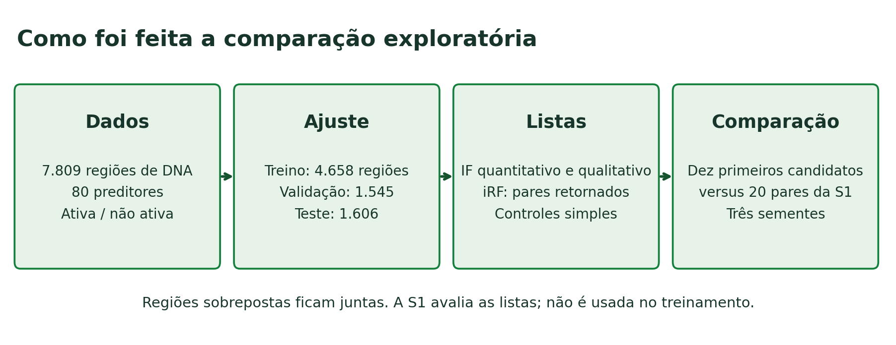
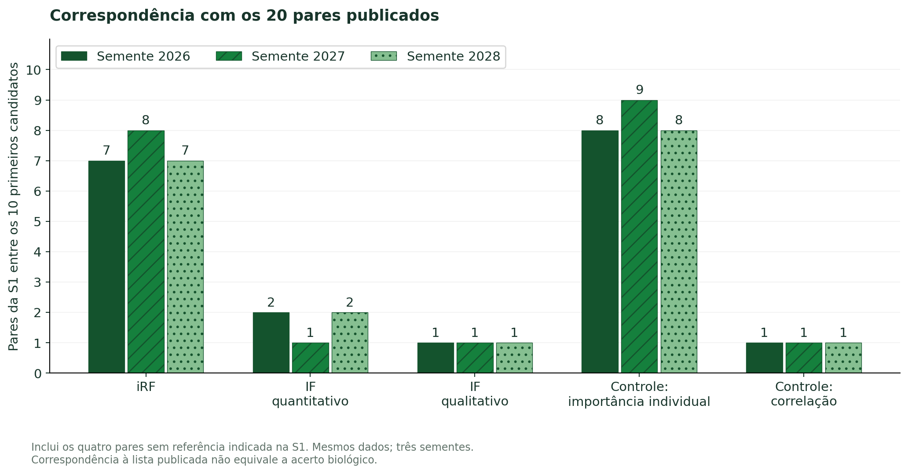
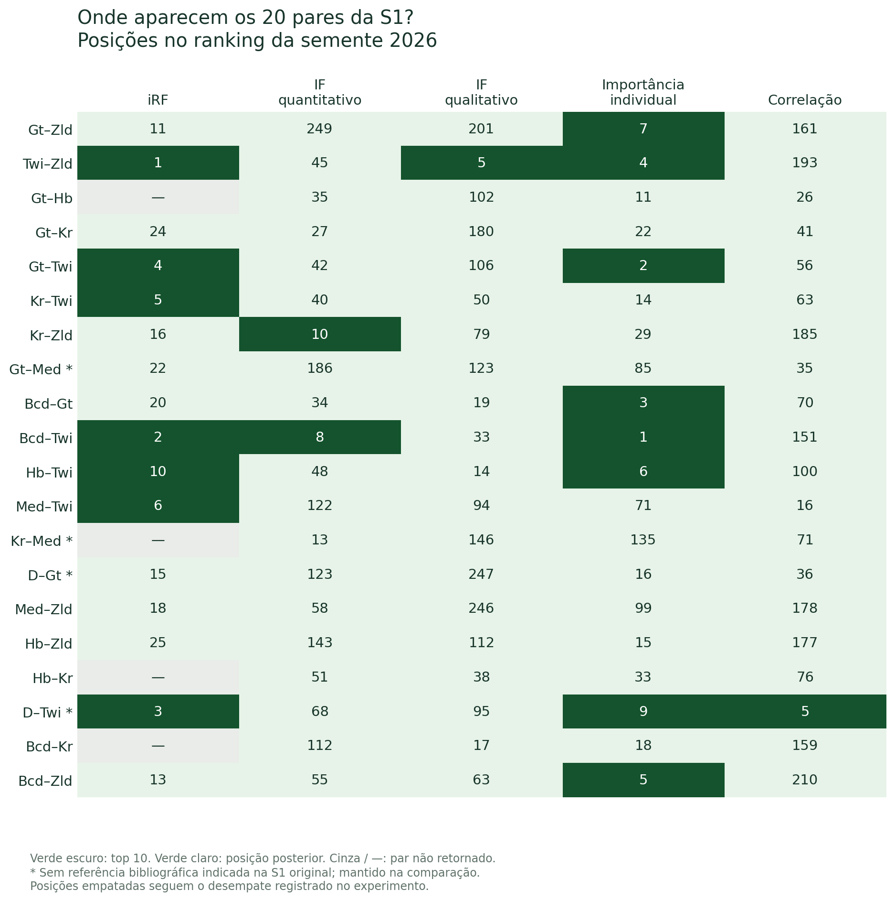
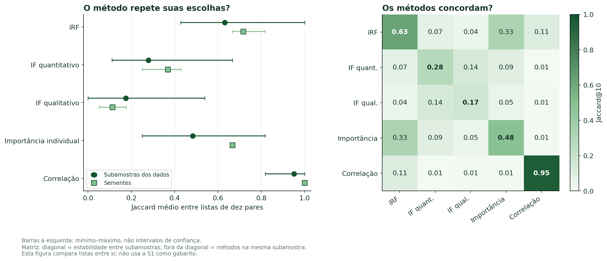
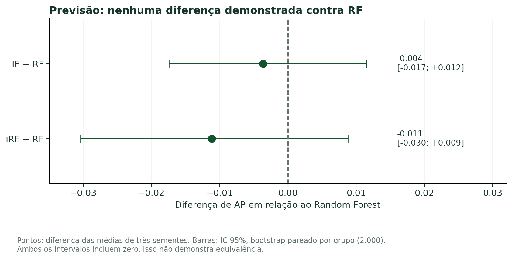

# Drosophila — comparação exploratória de IF e iRF com a Tabela S1

**Execução dos modelos: 17/11/2026. Documentação e revisão gráfica: 17/11/2026 (America/Sao_Paulo).**

**Resultado principal:** entre os dez primeiros candidatos, o iRF recupera 7–8 dos 20 pares publicados na Tabela S1, o IF quantitativo 1–2 e o IF qualitativo 1. O controle baseado em importância individual recupera 8–9. Esses números medem correspondência à lista publicada, não acerto biológico.

Esta página registra uma análise exploratória posterior do experimento `detectores_regulacao_drosophila_v1`. Por decisão explícita do pesquisador, os **20 pares da Tabela S1** são usados como referência, incluindo quatro sem referência bibliográfica indicada pelos autores. Não se exige nova auditoria bibliográfica para contar correspondências. A revisão bibliográfica anterior é uma atividade distinta e não define os resultados aqui.

[Dados, figuras e reprodução desta página](https://github.com/danifilho/Mestrado_ICMC/blob/59b867836b856e5dbb1bb64f873e2d66b8ef3616/wiki/assets/drosophila-s1/README.md) · [Protocolo original](https://github.com/danifilho/Mestrado_ICMC/blob/59b867836b856e5dbb1bb64f873e2d66b8ef3616/wiki/assets/drosophila-s1/PROTOCOLO.md) · [Decisões originais](https://github.com/danifilho/Mestrado_ICMC/blob/59b867836b856e5dbb1bb64f873e2d66b8ef3616/wiki/assets/drosophila-s1/DECISOES.md)

## 1. Pergunta e referência

**Quanto IF, iRF e controles simples recuperam dos pares de fatores de transcrição destacados no estudo original do iRF, quando aplicados aos mesmos dados de treino?** Também examinamos se cada lista se repete quando os dados ou a semente mudam, e se métodos distintos concordam entre si.

Basu et al. (2018) apresentaram 20 pares com estabilidade > 0,5 e relataram referências para 16. O suplemento S4 descreve suporte de duas formas: um fator regula a expressão do outro; ou a ligação conjunta dos fatores se associa a maior expressão de outros alvos. Essas informações são atribuídas aos autores; esta página não revalida experimentalmente cada relação. [Artigo](https://doi.org/10.1073/pnas.1711236115), [suplemento S4 e Tabela S1 na versão arXiv](https://arxiv.org/pdf/1706.08457v4).

Os 20 pares são: Gt–Zld, Twi–Zld, Gt–Hb, Gt–Kr, Gt–Twi, Kr–Twi, Kr–Zld, Gt–Med, Bcd–Gt, Bcd–Twi, Hb–Twi, Med–Twi, Kr–Med, D–Gt, Med–Zld, Hb–Zld, Hb–Kr, D–Twi, Bcd–Kr e Bcd–Zld. **Gt–Med, Kr–Med, D–Gt e D–Twi** não têm referência bibliográfica indicada na S1 e continuam incluídos nesta comparação. [Transcrição da referência](https://github.com/danifilho/Mestrado_ICMC/blob/59b867836b856e5dbb1bb64f873e2d66b8ef3616/wiki/assets/drosophila-s1/dados/tabela_S1.csv).

**Limite da referência:** ela foi selecionada originalmente pelo iRF. Estar fora da S1 não é ser um falso positivo. Portanto, maior recuperação não demonstra superioridade biológica geral de um detector.

## 2. Dados e desenho executado

**Leitura da figura:** os modelos recebem medidas das regiões genômicas, produzem listas de candidatos e depois essas listas são comparadas à S1. A S1 não foi usada como alvo de treinamento ou para selecionar parâmetros. A validação tem um papel específico no controle de importância, descrito abaixo.

- **Fonte:** arquivos `enhancer.Rdata` e `irfSuppData1.csv` dos autores, [Zenodo 10.5281/zenodo.1401347](https://doi.org/10.5281/zenodo.1401347). A auditoria original registrou identidade com os dados já usados na comparação preditiva do projeto.
- **Unidade:** uma região genômica de D. melanogaster. São 7.809 regiões; 694 ativas.
- **Resposta:** se a região dirige expressão com padrão no blastoderma, estágio 5, em ensaio de reporter transgênico. Não foram feitos novos experimentos de laboratório.
- **Entradas:** 80 medidas de enriquecimento de ChIP: 35 colunas de 23 fatores de transcrição, 41 de marcas de histonas e 4 de input. Cada valor corresponde ao máximo de enriquecimento normalizado na região. Todos os 80 preditores foram usados; a comparação de candidatos considera apenas pares dos 23 fatores (253 possibilidades).
- **Grupos:** 4.086 componentes de regiões sobrepostas, de mesmo identificador ou atributos idênticos. Grupos foram mantidos inteiros nas partições. Na divisão original, 1.165 grupos (4.216 linhas) estavam presentes dos dois lados.

| Partição principal | Regiões | Ativas | Uso |
|---|---:|---:|---|
| Treino | 4.658 | 416 | Ajustar modelos e extrair candidatos |
| Validação | 1.545 | 127 | Importância por permutação no controle RF |
| Teste | 1.606 | 151 | Previsão fora do treino |

A divisão foi feita com `StratifiedGroupKFold`, cinco folds, semente 2026: folds 0–2 treino, 3 validação e 4 teste. Não houve busca de hiperparâmetros nem seleção por associação ao desfecho. Não se aprendeu nova transformação dos dados. Este conjunto já era conhecido no projeto; não é uma confirmação em dados inteiramente inéditos. [Detalhes no protocolo](https://github.com/danifilho/Mestrado_ICMC/blob/59b867836b856e5dbb1bb64f873e2d66b8ef3616/wiki/assets/drosophila-s1/PROTOCOLO.md).

### Métodos e regras de extração

| Lista | Implementação e configuração | Como se forma o ranking |
|---|---|---|
| IF quantitativo / qualitativo | diversityForest 0.6.0; importance=both; 20.000 árvores de profundidade restrita para EIM; floresta separada de 2.000 árvores para previsão | Duas listas distintas de EIM. Máximo entre combinações de colunas dos dois fatores; exclui pares de réplicas do mesmo fator |
| iRF | iRF 2.0.0; cinco iterações × 500 árvores; 30 bootstraps internos; RIT com profundidade 5, 500 árvores e dois filhos | Somente conjuntos de exatamente dois fatores retornados nativamente; estabilidade da última iteração; réplicas agrupadas |
| Importância individual | RF de probabilidade, ranger 0.18.0, 500 árvores | Queda de AP na validação ao permutar cada coluna, média de dez repetições; máximo por fator; soma dos postos individuais para ordenar pares |
| Correlação | Spearman absoluto entre entradas do treino | Máximo entre combinações de colunas dos dois fatores |

IF avalia todos os pares de colunas neste p=80. Não retornar um par no iRF difere de lhe atribuir posição baixa no IF. O controle de importância não calcula um escore específico de interação para formar pares, mas seu RF de origem pode usar interações; ele **não é um modelo puramente aditivo**. Os esforços computacionais dos modelos não foram igualados. RPF e RSRF não foram incluídos neste experimento.

Rankings ordenados por escore decrescente; empates resolvidos por sorteio com semente fixa, não alfabeticamente. Listas do iRF não são completadas artificialmente. As figuras preservam os desempates existentes; variações perto do corte podem decorrer de empate. O estudo original também registrou sensibilidade ao desempate, mas esta publicação não recalculou essa análise.

### Repetições e custo

Foram usados três ajustes com treino completo (sementes 2026, 2027, 2028); 20 subamostras de 80% dos grupos do treino sem reposição, iguais para todos os métodos; dez permutações de resposta por grupos; e uma reprodução na divisão original. São 102 tarefas mais três do piloto técnico, com 20,65 CPU-h alocadas relatadas. As permutações e a antiga avaliação bibliográfica não são desfechos da comparação S1 desta página. Não houve novo treinamento para esta publicação.

## 3. Resultado principal: recuperação da lista publicada

**Como ler:** cada barra conta os pares da S1 entre dez candidatos. As três cores e padrões distinguem sementes, não níveis de evidência biológica. Uma barra em 7 significa 7/10 candidatos correspondentes e 7/20 pares da referência recuperados: 70% e 35%, respectivamente.

| Lista | Semente 2026 | 2027 | 2028 |
|---|---:|---:|---:|
| iRF | 7/10 | 8/10 | 7/10 |
| IF quantitativo | 2/10 | 1/10 | 2/10 |
| IF qualitativo | 1/10 | 1/10 | 1/10 |
| Importância individual | 8/10 | 9/10 | 8/10 |
| Correlação | 1/10 | 1/10 | 1/10 |

**Interpretação:** o iRF prioriza mais pares dessa referência que o IF. Porém, uma regra simples baseada na importância individual recupera ainda mais. Assim, recuperar a S1 não demonstra por si só contribuição específica de um detector de interação. A comparação é descritiva; três sementes não são três experimentos biológicos independentes. Não há teste de significância ou contagem de falsos positivos baseada em ausência na S1.

[Dados recalculados diretamente dos rankings — k=5, 10 e 20](https://github.com/danifilho/Mestrado_ICMC/blob/59b867836b856e5dbb1bb64f873e2d66b8ef3616/wiki/assets/drosophila-s1/dados/recuperacao_S1.csv). Os cortes 5 e 20 são sensibilidades disponíveis no arquivo, não validação bibliográfica ampliada. Todas as 15 contagens de top 10 coincidem com as previamente registradas na revisão.

## 4. Quais relações e em quais posições?

**Como ler:** cada linha é um par da S1, cada coluna uma lista na semente 2026. Números indicam posição, não força biológica. Verde escuro marca top 10; verde claro indica posição posterior. Traço cinza significa não retornado como par na lista iRF. Asteriscos marcam os quatro pares sem referência indicada na S1.

- **Twi–Zld:** primeiro no iRF, quinto no IF qualitativo e 45º no quantitativo; os critérios de priorização diferem.
- **Bcd–Twi:** segundo no iRF, oitavo no IF quantitativo e primeiro no controle de importância; é compartilhado, mas não distingue o detector do controle simples.
- **Med–Twi:** sexto no iRF e 71º no controle de importância; o iRF também tem prioridades próprias.
- **Gt–Zld:** 11º no iRF. Ficar fora do top 10 não significa não ter sido encontrado.

[Posições da figura](https://github.com/danifilho/Mestrado_ICMC/blob/59b867836b856e5dbb1bb64f873e2d66b8ef3616/wiki/assets/drosophila-s1/dados/posicoes_S1_semente2026.csv) · [Rankings completos publicados](https://github.com/danifilho/Mestrado_ICMC/tree/59b867836b856e5dbb1bb64f873e2d66b8ef3616/wiki/assets/drosophila-s1/dados/rankings).

## 5. Estabilidade e concordância: outra pergunta

**Esta figura não usa a S1 como referência.** Ela compara listas de dez pares entre si. Jaccard é o tamanho da interseção dividido pelo da união: para duas listas de dez, compartilhar um par dá 1/19≈0,053; cinco dá 5/15≈0,333; oito dá 8/12≈0,667; listas iguais dão 1.

À esquerda, círculos comparam diferentes subamostras dos dados; quadrados comparam sementes nos mesmos dados. Barras são mínimo–máximo observado, **não IC 95%**. À direita, a diagonal mede estabilidade entre diferentes execuções do mesmo método — por isso não é automaticamente 1. Fora da diagonal, comparam-se métodos na mesma subamostra.

O iRF tem estabilidade média 0,63 entre subamostras; IF quantitativo 0,28; IF qualitativo 0,17. Já iRF×IF quantitativo fica em 0,07 e iRF×IF qualitativo em 0,04. O iRF concorda mais consigo mesmo que com o IF, sugerindo prioridades recorrentes distintas. A instabilidade do IF impede atribuir toda discordância exclusivamente à definição matemática de interação. A correlação tem estabilidade 0,95, mas recupera pouco da S1: repetibilidade e correspondência à referência não são a mesma coisa.

[Estabilidade](https://github.com/danifilho/Mestrado_ICMC/blob/59b867836b856e5dbb1bb64f873e2d66b8ef3616/wiki/assets/drosophila-s1/dados/estabilidade.csv) · [Concordância](https://github.com/danifilho/Mestrado_ICMC/blob/59b867836b856e5dbb1bb64f873e2d66b8ef3616/wiki/assets/drosophila-s1/dados/concordancia.csv). As subamostras compartilham observações; não são experimentos biológicos independentes.

## 6. Previsão: resultado complementar

**Como ler:** zero significa mesma AP que RF. Pontos são diferenças entre médias de três sementes. Aqui, ao contrário da figura de estabilidade, as barras são **intervalos de 95%**, calculados no estudo original por 2.000 reamostragens pareadas de grupos do teste. Os dois intervalos incluem zero: não houve diferença preditiva demonstrada, sem prova de equivalência.

| Método | AP média | ROC-AUC média | Brier médio (menor é melhor) |
|---|---:|---:|---:|
| RF | 0,566 | 0,822 | 0,059 |
| IF | 0,562 | 0,824 | 0,059 |
| iRF | 0,555 | 0,817 | 0,060 |
| Constante, segundo relatório original | 0,094 | 0,500 | 0,085 |

AP é uma medida de priorização de positivos, não porcentagem de acertos. Diferença IF−RF: −0,004 [−0,017; 0,012]; iRF−RF: −0,011 [−0,030; 0,009]. [Previsões: métricas por semente](https://github.com/danifilho/Mestrado_ICMC/blob/59b867836b856e5dbb1bb64f873e2d66b8ef3616/wiki/assets/drosophila-s1/dados/predicao.csv), [diferenças e intervalos](https://github.com/danifilho/Mestrado_ICMC/blob/59b867836b856e5dbb1bb64f873e2d66b8ef3616/wiki/assets/drosophila-s1/dados/predicao_diferencas.csv).

## 7. Por que a comparação não repete exatamente o artigo?

A análise principal usa uma partição agrupada diferente, enquanto a reprodução secundária usa a divisão oficial. O treino muda, os métodos são aleatórios e há empates. Além disso, **selecionar os dez primeiros não é aplicar o limiar de estabilidade >0,5 da S1**.

Na execução de reprodução, os 20 pares apareceram na saída, mas isso não significa reprodução exata do resultado: Hb–Zld e Med–Zld ficaram em aproximadamente 0,47 e não passariam pelo limiar original >0,5. Foram recuperados como candidatos, sem reproduzir todas as estabilidades ou a seleção pelo limiar. Não isolamos a contribuição causal da partição, da semente e da implementação para cada discrepância. [Resultados da reprodução](https://github.com/danifilho/Mestrado_ICMC/blob/59b867836b856e5dbb1bb64f873e2d66b8ef3616/wiki/assets/drosophila-s1/dados/irf_reproducao_tabela_S1.csv).

## 8. Conclusão, limitações e decisões

Modelos com desempenho preditivo semelhante produziram listas diferentes. O iRF foi mais estável e mais próximo da S1 que o IF; o controle de importância individual recuperou ainda mais pares dessa referência. Isso justifica investigar o que cada critério de interação prioriza, mas não classificar as listas como biologicamente certas ou erradas.

Limites principais: referência selecionada pelo próprio iRF; apenas um sistema biológico; top 10 sensível a corte e desempate; agregação pelo máximo entre réplicas; esforço de ajuste diferente entre métodos; estabilidade não é verdade biológica; ausência na S1 não é negativo; comparação exploratória posterior e não confirmatória. Não se demonstrou que todos os pares do iRF sejam apenas efeitos individuais.

A análise bibliográfica anterior e sua revisão tiveram acesso incompleto às fontes e critérios diferentes; suas categorias não foram usadas para decidir correspondência à S1. A antiga taxa-base 45/253 não pertence a esta análise. O pesquisador autorizou explicitamente o uso dos 20 pares, inclusive os quatro sem referência, e a publicação desta página.

## 9. Identidade visual e rastreabilidade

Cinco figuras foram reorganizadas em uma sequência: desenho → recuperação → pares individuais → estabilidade → previsão. Paleta: verde escuro `#14532D`, médio `#15803D`, claro `#86BF91`, fundo suave `#E7F3E8`, texto `#18352B`, ausência neutra `#E9ECE9`. Números, padrões e símbolos evitam depender exclusivamente da cor. Verde escuro indica destaque definido pela legenda, nunca comprovação biológica.

- [Figuras PNG e SVG](https://github.com/danifilho/Mestrado_ICMC/tree/59b867836b856e5dbb1bb64f873e2d66b8ef3616/wiki/assets/drosophila-s1/figuras): PNG para leitura na Wiki; SVG para exportação.
- [Script de geração](https://github.com/danifilho/Mestrado_ICMC/blob/59b867836b856e5dbb1bb64f873e2d66b8ef3616/wiki/assets/drosophila-s1/gerar_figuras.py), [paleta](https://github.com/danifilho/Mestrado_ICMC/blob/59b867836b856e5dbb1bb64f873e2d66b8ef3616/wiki/assets/drosophila-s1/paleta.json), [manifesto SHA-256](https://github.com/danifilho/Mestrado_ICMC/blob/59b867836b856e5dbb1bb64f873e2d66b8ef3616/wiki/assets/drosophila-s1/manifesto_sha256.json).
- Fontes locais consultadas: protocolo, decisões, rankings, tabelas de estabilidade, concordância, previsão e reprodução; relatório e tabela de contagens da revisão bibliográfica. Não houve reexecução dos modelos nem validação independente dos experimentos biológicos.
- Os links de evidência e imagem estão fixados no commit `59b867836b856e5dbb1bb64f873e2d66b8ef3616` do repositório principal. O pacote reproduz figuras e contagens desta página; não contém o pipeline completo de treinamento no HPCC.

### Referências metodológicas

1. Basu et al. (2018). *Iterative random forests to discover predictive and stable high-order interactions*. [DOI](https://doi.org/10.1073/pnas.1711236115). Fonte da aplicação, extração e Tabela S1; seção S4 consultada.
2. Hornung & Boulesteix (2022). *Interaction forests: Identifying and exploiting interpretable quantitative and qualitative interaction effects*. [DOI](https://doi.org/10.1016/j.csda.2022.107460). Fonte do IF e das duas EIM; configurações preservadas no protocolo.
3. [Dados e análises dos autores no Zenodo](https://doi.org/10.5281/zenodo.1401347). Proveniência conforme auditoria registrada no experimento.

### Histórico

- 17/11/2026: execução original dos modelos, conforme registros locais.
- 17/11/2026: documentação da decisão exploratória de usar todos os 20 pares; revisão de paleta, legendas e distinção entre recuperação, estabilidade e previsão. Publicação autorizada pelo pesquisador. Imagens anteriores e arquivos locais de pesquisa preservados.
