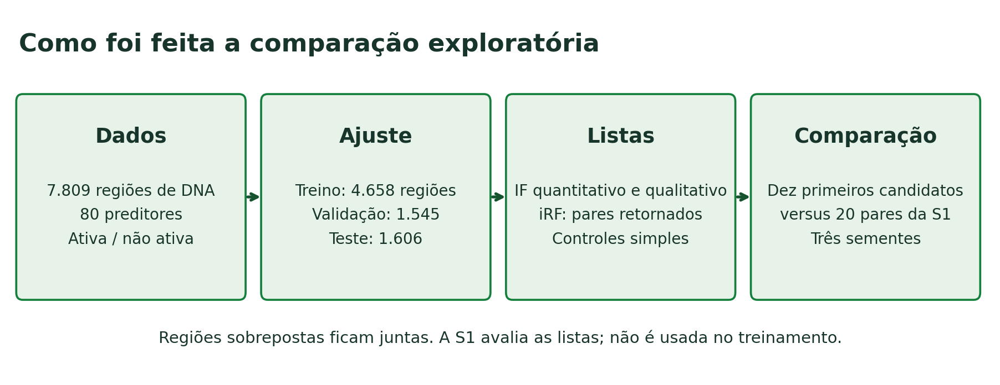
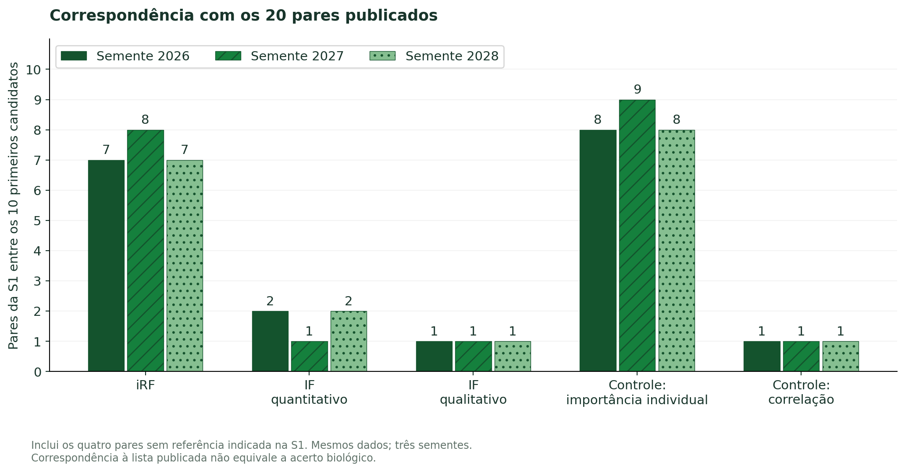
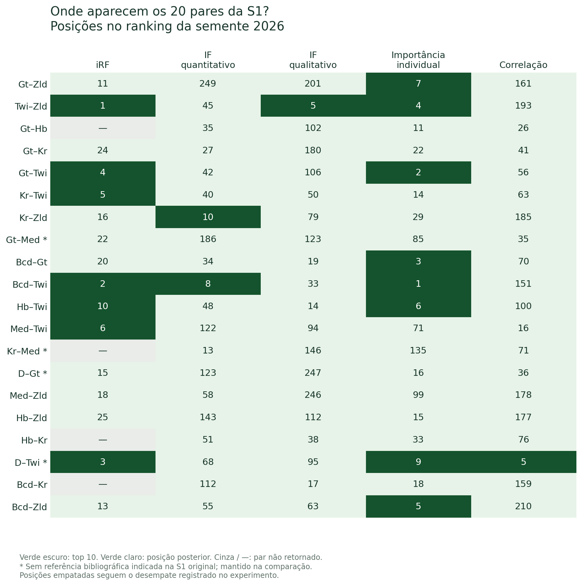
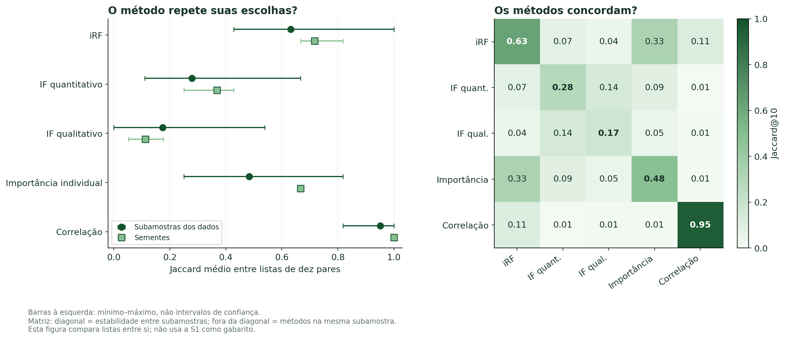
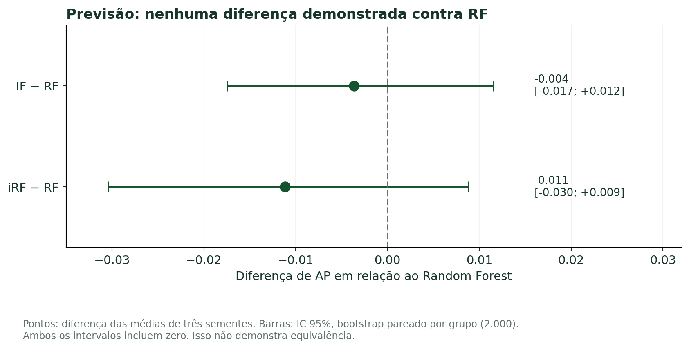

# Drosophila — como ler as cinco figuras da comparação S1

**Documentação ampliada em 18/11/2026. Ajustes executados em 17/11/2026.** Esta página trata somente da última comparação exploratória com os **20 pares da Tabela S1** do artigo de iRF. São cinco figuras próprias, em verde; não são figuras extraídas do artigo. [Página do estudo](Drosophila-IF-iRF-Tabela-S1) · [Código e roteiro de reprodução](https://github.com/danifilho/Mestrado_ICMC/blob/07766ce1973e5988f2036c3a9d11206bd1d80bd2/experimentos/detectores_regulacao_drosophila_v1/README.md).

## Antes dos gráficos: três perguntas diferentes

| Pergunta | O que se compara | Figura |
|---|---|---|
| Recuperamos candidatos já publicados? | Top 10 de cada lista versus os 20 pares da S1 | 2 e 3 |
| As escolhas são repetíveis e os métodos concordam? | Listas de pares entre execuções e entre métodos | 4 |
| Os métodos preveem a atividade das regiões igualmente bem? | Previsões no teste, comparadas a RF | 5 |

Recuperação, estabilidade e previsão não são sinônimos. Um método pode acertar previsões e priorizar pares diferentes; pode repetir sempre a mesma lista e recuperar poucos pares da S1. Nenhuma dessas medidas isolada demonstra um mecanismo biológico.

## Figura 1 — de onde saem as listas

**Pergunta:** qual é o caminho dos dados até a comparação? Este é um diagrama de procedimento: não tem eixo numérico nem barra de desempenho.

Leia as caixas da esquerda para a direita:

1. **Dados:** 7.809 regiões de DNA da mosca. Uma linha é uma região, não um gene nem um paciente. As 80 colunas são medidas experimentais de enriquecimento; a resposta indica região ativa ou não. As medidas não são anotações de Gene Ontology.
2. **Ajuste:** 4.658 regiões no treino, 1.545 na validação e 1.606 no teste. Regiões relacionadas pelo agrupamento ficam juntas. Treino ajusta as florestas e extrai pares; validação serve ao controle de importância individual; teste avalia previsões. A S1 não entra como resposta de treinamento.
3. **Listas:** IF produz duas ordenações, quantitativa e qualitativa. iRF retorna conjuntos de fatores: nesta comparação usamos apenas os pares nativos. Há ainda controles por importância individual e correlação. As réplicas de ensaio são reunidas por fator: 23 fatores permitem 253 pares distintos.
4. **Comparação:** tomamos os dez primeiros pares de cada lista e contamos quais pertencem à S1. Repetimos com três sementes nos mesmos dados de treino. São três execuções computacionais, não três conjuntos biológicos independentes.

As setas representam etapas de processamento, não causalidade biológica. A divisão agrupada é nossa adaptação; não é a mesma divisão do artigo. Veja os números e parâmetros na [página principal](Drosophila-IF-iRF-Tabela-S1).

**Código e dados:** [auditoria e partições](https://github.com/danifilho/Mestrado_ICMC/blob/07766ce1973e5988f2036c3a9d11206bd1d80bd2/experimentos/detectores_regulacao_drosophila_v1/scripts/01_auditar_preparar.py), [matrizes e partições](https://github.com/danifilho/Mestrado_ICMC/tree/07766ce1973e5988f2036c3a9d11206bd1d80bd2/experimentos/detectores_regulacao_drosophila_v1/data/processed), [adaptadores dos modelos](https://github.com/danifilho/Mestrado_ICMC/blob/07766ce1973e5988f2036c3a9d11206bd1d80bd2/experimentos/detectores_regulacao_drosophila_v1/src/metodos.R); desenho no [gerador, bloco 1](https://github.com/danifilho/Mestrado_ICMC/blob/59b867836b856e5dbb1bb64f873e2d66b8ef3616/wiki/assets/drosophila-s1/gerar_figuras.py#L38).

## Figura 2 — quantos pares da S1 estão entre os dez primeiros?

**Eixo horizontal:** cinco listas; IF quantitativo e qualitativo são duas saídas de um método, não duas espécies de dado. **Eixo vertical:** número de pares da S1 encontrados entre os dez primeiros candidatos, de zero a dez.

Cada grupo tem três barras. Verde escuro, verde médio hachurado e verde claro pontilhado identificam as sementes 2026, 2027 e 2028. Cor não indica significância ou confirmação biológica. O número sobre a barra é a contagem exata. Não há intervalo de confiança nesta figura.

| Lista | Contagens nas três sementes | Leitura |
|---|---|---|
| iRF | 7, 8, 7 | A maioria dos dez primeiros pertence à S1 |
| IF quantitativo | 2, 1, 2 | Poucos dos dez primeiros pertencem à S1 |
| IF qualitativo | 1, 1, 1 | Um candidato da S1 por execução |
| Importância individual | 8, 9, 8 | Recupera ainda mais dessa lista que iRF |
| Correlação | 1, 1, 1 | Forte correlação entre entradas não reproduz a lista S1 |

**Exemplo de denominadores:** barra 7 = sete correspondências em dez candidatos (**70% da lista priorizada**), mas sete dos vinte pares da referência (**35% da S1**). Não é “70% de acerto biológico”. A tabela de dados registra as duas frações para evitar a ambiguidade.

O controle de importância forma pares combinando a posição individual dos fatores, sem um escore específico de interação do par. Seu bom resultado mostra que recuperar a S1 não basta para demonstrar vantagem do detector de interações. Isso não prova que todos os pares do iRF sejam efeitos individuais. Tampouco transforma pares ausentes da S1 em falsos positivos: a S1 é incompleta e foi selecionada pelo próprio iRF no artigo.

**Código e dados:** [rankings de entrada](https://github.com/danifilho/Mestrado_ICMC/tree/59b867836b856e5dbb1bb64f873e2d66b8ef3616/wiki/assets/drosophila-s1/dados/rankings), [20 pares de referência](https://github.com/danifilho/Mestrado_ICMC/blob/59b867836b856e5dbb1bb64f873e2d66b8ef3616/wiki/assets/drosophila-s1/dados/tabela_S1.csv), [contagens em k=5, 10 e 20](https://github.com/danifilho/Mestrado_ICMC/blob/59b867836b856e5dbb1bb64f873e2d66b8ef3616/wiki/assets/drosophila-s1/dados/recuperacao_S1.csv). No [gerador](https://github.com/danifilho/Mestrado_ICMC/blob/59b867836b856e5dbb1bb64f873e2d66b8ef3616/wiki/assets/drosophila-s1/gerar_figuras.py), linhas 21–32 calculam as interseções; o bloco 2 desenha as barras. As figuras usam k=10; 5 e 20 são sensibilidades, não novos experimentos.

## Figura 3 — em que posição aparece cada par?

**Linhas:** os vinte pares da S1. **Colunas:** as cinco listas. Aqui usamos somente a semente 2026, explicitada no título. Cada célula contém a posição do par naquela ordenação, começando em 1.

- Verde escuro: posição entre 1 e 10.
- Verde claro: par encontrado depois da décima posição. A intensidade é categórica: posições 11 e 100 têm a mesma cor clara.
- Cinza com travessão: par não retornado como par nativo. Não é escore zero nem interação biologicamente inexistente.
- Asterisco junto ao nome: um dos quatro pares sem referência bibliográfica indicada na S1 original, incluído por decisão exploratória.

Leia **Twi–Zld** da esquerda para a direita: aparece em 1º no iRF, 45º no IF quantitativo e 5º no IF qualitativo. O mesmo par pode ser prioritário sob um critério e secundário sob outro. Em **Bcd–Twi**, os lugares 2º no iRF, 8º no IF quantitativo e 1º no controle de importância mostram uma preferência compartilhada. **Med–Twi** é 6º no iRF e 71º no controle de importância: as listas também têm prioridades próprias. **Gt–Zld**, 11º no iRF, ilustra o efeito do corte: encontrado, mas fora dos dez primeiros.

Os números não são grandezas comparáveis de “força biológica”. EIM e estabilidade iRF são escores distintos, convertidos em ordenações para esta comparação. Empates seguem o desempate registrado; trocar a semente de desempate pode afetar a fronteira do top 10. A matriz mostra apenas os pares da S1, não todos os candidatos que cada método descobriu.

**Código e dados:** [construção dos rankings](https://github.com/danifilho/Mestrado_ICMC/blob/07766ce1973e5988f2036c3a9d11206bd1d80bd2/experimentos/detectores_regulacao_drosophila_v1/src/rankings.py), [matriz numérica da figura](https://github.com/danifilho/Mestrado_ICMC/blob/59b867836b856e5dbb1bb64f873e2d66b8ef3616/wiki/assets/drosophila-s1/dados/posicoes_S1_semente2026.csv), [gerador, bloco 3](https://github.com/danifilho/Mestrado_ICMC/blob/59b867836b856e5dbb1bb64f873e2d66b8ef3616/wiki/assets/drosophila-s1/gerar_figuras.py#L58). O código usa três estados de cor: ausente, depois do top 10, dentro do top 10.

## Figura 4 — repetir escolhas é diferente de concordar com outro método

Esta figura **não conta correspondências à S1**. Compara listas de dez pares entre si. A medida é **Jaccard = número de pares compartilhados / número de pares distintos na união das duas listas**.

| Pares compartilhados em duas listas de 10 | União | Jaccard |
|---:|---:|---:|
| 0 | 20 | 0 |
| 1 | 19 | 0,053 |
| 5 | 15 | 0,333 |
| 8 | 12 | 0,667 |
| 10 | 10 | 1 |

Logo, Jaccard 0,63 não significa diretamente “63% dos dez pares”. Além disso, o valor mostrado é uma média de comparações, não um número inteiro fixo de pares compartilhados.

### Painel esquerdo: o método concorda consigo mesmo?

O eixo horizontal vai de listas totalmente distintas, perto de 0, até idênticas, em 1. Cada linha é uma lista/método. **Círculos** comparam 20 subamostras de 80% dos grupos do treino; há 190 comparações duas a duas. **Quadrados** comparam as três sementes sobre o treino completo; há três comparações duas a duas. O centro marca a média. As barras mostram os extremos observados, **mínimo–máximo, não IC95%**.

iRF tem média 0,63 entre subamostras, contra 0,28 do IF quantitativo e 0,17 do qualitativo. Isso indica maior repetibilidade da lista iRF neste teste. A correlação chega a 0,95, embora recupere só um par da S1 no top 10. Repetibilidade não implica correspondência à referência nem validade biológica.

### Painel direito: métodos diferentes concordam?

Escolha uma linha e uma coluna. **Fora da diagonal**, a célula resume o Jaccard dos dois métodos na mesma subamostra, em média nas 20 subamostras. Verde mais escuro significa maior sobreposição de listas, na escala 0–1 da barra lateral. Não é correlação entre previsões.

**A diagonal tem uma definição especial:** traz a estabilidade do método entre subamostras diferentes. Por isso não é automaticamente 1, como seria comparar uma lista consigo mesma. Essa diagonal repete a informação dos círculos do painel esquerdo.

iRF × IF quantitativo = 0,07; iRF × IF qualitativo = 0,04; iRF × importância = 0,33. Há pouca sobreposição iRF–IF, mesmo com desempenho preditivo próximo. Mas o IF também varia quando os dados mudam; portanto, a discordância não pode ser atribuída integralmente a uma diferença conceitual entre detectores. As subamostras se sobrepõem e as 190 comparações não são 190 experimentos independentes.

**Código e dados:** [estabilidade](https://github.com/danifilho/Mestrado_ICMC/blob/59b867836b856e5dbb1bb64f873e2d66b8ef3616/wiki/assets/drosophila-s1/dados/estabilidade.csv), [concordância](https://github.com/danifilho/Mestrado_ICMC/blob/59b867836b856e5dbb1bb64f873e2d66b8ef3616/wiki/assets/drosophila-s1/dados/concordancia.csv), [recálculo e conferência do Jaccard](https://github.com/danifilho/Mestrado_ICMC/blob/07766ce1973e5988f2036c3a9d11206bd1d80bd2/experimentos/detectores_regulacao_drosophila_v1/scripts/verificar_analise_s1.py), [gerador, bloco 4](https://github.com/danifilho/Mestrado_ICMC/blob/59b867836b856e5dbb1bb64f873e2d66b8ef3616/wiki/assets/drosophila-s1/gerar_figuras.py#L69). O escore de estabilidade interno do iRF, usado para ordenar seus pares, é outra quantidade: não confundir com o Jaccard desta figura.

## Figura 5 — a previsão melhora em relação a RF?

**Linhas:** IF−RF e iRF−RF. **Eixo horizontal:** diferença de Average Precision (AP), calculada no teste. AP avalia a priorização de regiões ativas ao percorrer limiares de decisão; não é a porcentagem de classificações corretas. O valor depende da composição do teste.

A linha vertical tracejada em zero representa empate com RF. Ponto à esquerda = AP menor; à direita = maior. Cada ponto é a média das diferenças nas três sementes. As barras, nesta figura, **são IC95%**, obtidos por 2.000 reamostragens de grupos do teste. Os mesmos grupos sorteados são usados para os dois métodos comparados: esse é o sentido de “pareado”. Não houve 2.000 treinamentos novos.

| Comparação | Diferença média de AP | IC95% |
|---|---:|---|
| IF−RF | −0,0036 | [−0,0174; 0,0115] |
| iRF−RF | −0,0112 | [−0,0304; 0,0088] |

A diferença IF−RF é pequena e negativa, mas o intervalo admite desde perda até ganho. O mesmo ocorre com iRF−RF. Como ambos cruzam zero, o teste não demonstra superioridade ou inferioridade preditiva. **Não demonstrar diferença não prova equivalência**: seria preciso estabelecer uma margem de equivalência e um desenho apropriado.

Os intervalos descrevem a incerteza por reamostragem dos grupos do teste para esses ajustes preservados. Não cobrem toda a incerteza de trocar o conjunto biológico, o protocolo ou as condições experimentais. Esse gráfico responde sobre previsão de atividade, não sobre precisão biológica dos pares.

**Código e dados:** [previsões de cada ajuste](https://github.com/danifilho/Mestrado_ICMC/tree/07766ce1973e5988f2036c3a9d11206bd1d80bd2/experimentos/detectores_regulacao_drosophila_v1/resultados/brutos/principal), [métricas por semente](https://github.com/danifilho/Mestrado_ICMC/blob/59b867836b856e5dbb1bb64f873e2d66b8ef3616/wiki/assets/drosophila-s1/dados/predicao.csv), [diferenças e IC](https://github.com/danifilho/Mestrado_ICMC/blob/59b867836b856e5dbb1bb64f873e2d66b8ef3616/wiki/assets/drosophila-s1/dados/predicao_diferencas.csv), [recálculo do bootstrap pareado](https://github.com/danifilho/Mestrado_ICMC/blob/07766ce1973e5988f2036c3a9d11206bd1d80bd2/experimentos/detectores_regulacao_drosophila_v1/scripts/verificar_analise_s1.py), [gerador, bloco 5](https://github.com/danifilho/Mestrado_ICMC/blob/59b867836b856e5dbb1bb64f873e2d66b8ef3616/wiki/assets/drosophila-s1/gerar_figuras.py#L87).

## Como reproduzir e o que foi conferido

O [roteiro de código](https://github.com/danifilho/Mestrado_ICMC/blob/07766ce1973e5988f2036c3a9d11206bd1d80bd2/experimentos/detectores_regulacao_drosophila_v1/README.md) separa gerar gráficos, recalcular análises e treinar novamente. As cinco figuras mantêm a paleta verde escolhida; não foram acrescentadas figuras de outros testes. PNG e SVG estão na [pasta de figuras](https://github.com/danifilho/Mestrado_ICMC/tree/59b867836b856e5dbb1bb64f873e2d66b8ef3616/wiki/assets/drosophila-s1/figuras).

Em 18/11, foram regeneradas as cinco figuras em cópia separada e recalculados os 115 rankings, os Jaccards e os dois IC de AP a partir das saídas dos ajustes, com concordância com as tabelas publicadas. [Registro da verificação](https://github.com/danifilho/Mestrado_ICMC/blob/07766ce1973e5988f2036c3a9d11206bd1d80bd2/experimentos/detectores_regulacao_drosophila_v1/VALIDACAO.md). Não houve novo treinamento ou nova revisão biológica dos artigos citados pela S1.

As figuras e tabelas desta apresentação permanecem fixadas no commit `59b8678`; o código de origem e a rotina de conferência estão no commit `07766ce`. A [página principal](Drosophila-IF-iRF-Tabela-S1) explica a origem no artigo, os critérios da S1 e os limites da comparação.
