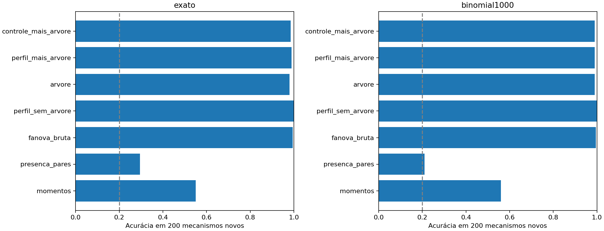
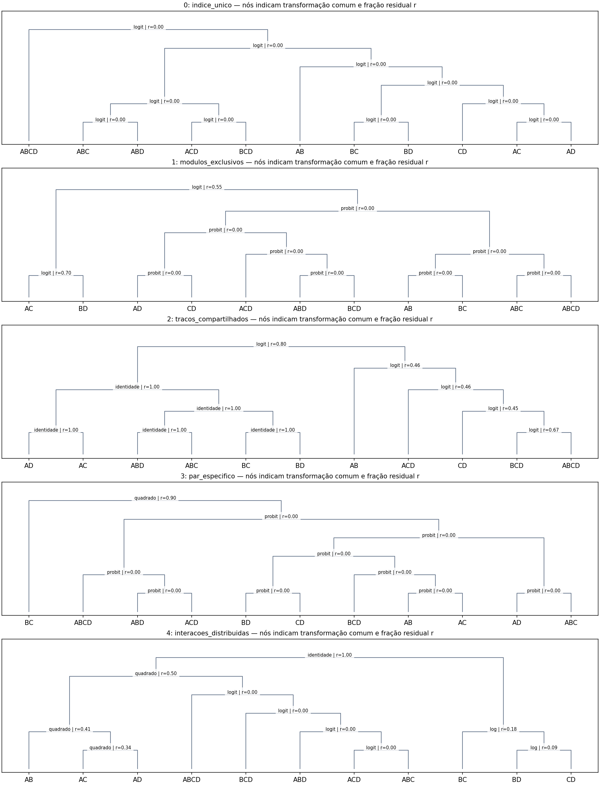
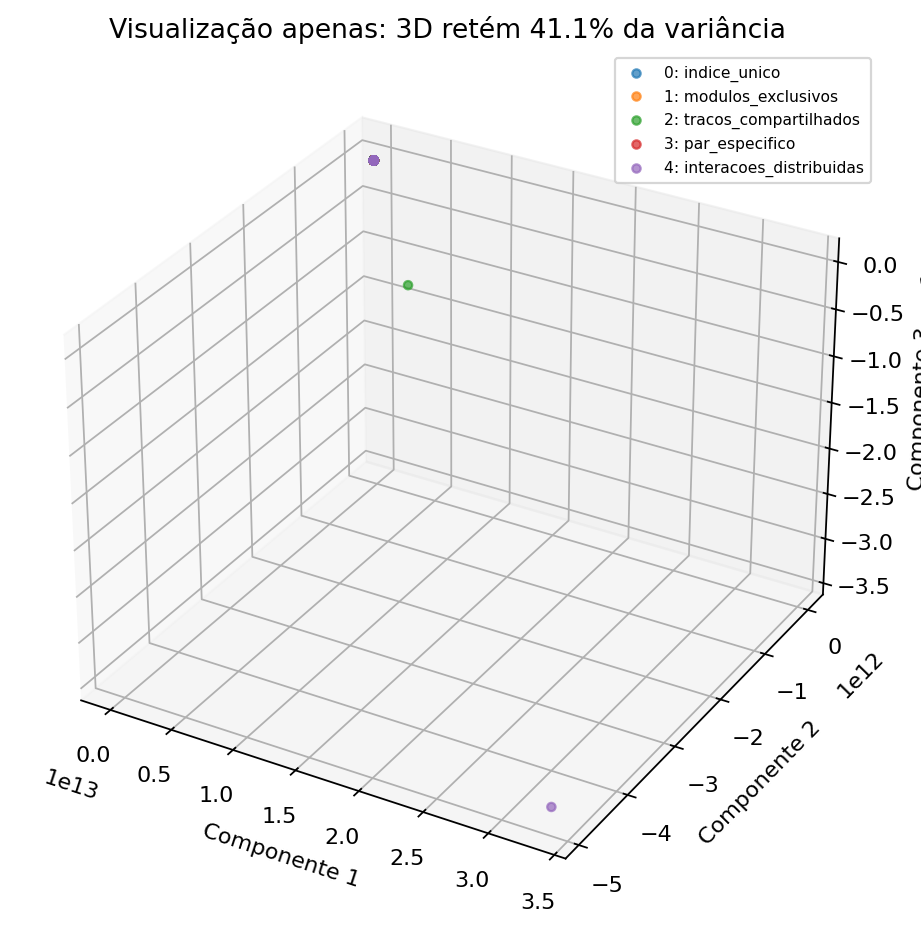
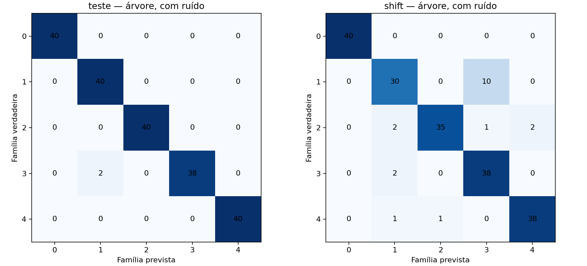

# Piloto 3 — Uma árvore de explicações compartilhadas das interações

12 de novembro de 2026. Experimento exploratório executado; não é uma validação biológica nem uma prova de identificabilidade.

## Pergunta e conclusão

**Interações que diminuem sob as mesmas transformações podem formar uma assinatura que ajuda a reconhecer a organização que gerou os dados? E agrupar essas interações numa árvore melhora essa assinatura?**

Neste conjunto de simulações, o perfil de resposta às transformações contém informação útil sobre a família matemática geradora. A árvore derivada desse perfil também permite classificá-la, mas **não supera o perfil sem árvore**. Portanto, este piloto apoia investigar a assinatura, mas não demonstra vantagem preditiva da hierarquia. Tampouco demonstra uma assinatura única de cada mecanismo.

## O que entra e o que sai

Entrada: uma tabela com quatro variáveis A–D e uma resposta entre zero e um, nas 625 combinações de cinco níveis por variável. Cada tabela é um sistema simulado diferente. Saída: onze componentes de interação, seus perfis sob sete transformações e uma árvore que agrupa componentes compatíveis com uma transformação comum. Um segundo modelo recebe um resumo dessa árvore e tenta reconhecer qual das cinco famílias gerou uma tabela nova.

As folhas são AB, AC, AD, BC, BD, CD, ABC, ABD, ACD, BCD e ABCD. Não são observações, genes isolados ou rótulos GO. Um nó pode agrupar, por exemplo, AB e CD se uma mesma transformação reduz a contribuição normalizada de ambos. Isso é compatibilidade com uma explicação comum; não prova um intermediário biológico compartilhado.

## Sistemas simulados

| Família | Construção antes da curva final |
|---|---|
| Índice único | Soma ponderada das quatro variáveis |
| Módulos exclusivos | Curva de uma soma de A e B mais curva de uma soma de C e D, com nomes permutados |
| Traços compartilhados | Duas somas diferentes usando todas as variáveis, cada uma passando por uma curva |
| Par específico | Soma ponderada mais um produto entre duas variáveis |
| Interações distribuídas | Soma ponderada mais seis produtos de pares |

As fórmulas exatas estão em `generate()` no código. Pesos, sinais, intensidade das curvas e nomes das variáveis mudam entre realizações. O sinal latente é padronizado e passa por uma curva logística ou probit. As duas curvas aparecem em todas as famílias. A família de interações distribuídas não é, por si só, um modelo de epistasia microscópica emergente: contém apenas seis termos explícitos.

Foram geradas 700 funções independentes: 300 para treino, 200 para teste em condições semelhantes e 200 para teste com saturação mais forte, fora da faixa de treino. Cada função foi observada sem ruído e com ruído binomial de 1.000 ensaios por célula, totalizando 1.400 tabelas. As versões com e sem ruído são pareadas; não são 1.400 mecanismos independentes.

## Como construímos a árvore

1. Decompomos a resposta por fANOVA no fatorial completo, com pesos uniformes. Isso separa efeitos individuais e componentes de ordem dois, três e quatro.
2. Repetimos a decomposição após identidade, log, raiz, quadrado, inverso negativo, logit e probit. Cada contribuição é dividida pela variância total daquela escala, evitando um ganho trivial por encolher numericamente toda a resposta.
3. Para cada conjunto de componentes S, calculamos `C(S) = menor soma das energias de S entre as sete transformações`.
4. Unimos os dois grupos cujo uso de uma transformação comum custa menos em comparação com permitir uma transformação diferente para cada grupo. O custo adicional é normalizado pela energia bruta do conjunto. Empates têm desempates determinísticos documentados no código.
5. Registramos nos nós a transformação escolhida, energia antes e depois, tamanho e custo de compartilhar a transformação. Esses números formam a assinatura usada na classificação.

**A transformação é aplicada à resposta inteira**, não separadamente a módulos locais. A árvore é uma descrição dos perfis; ainda não é uma fórmula hierárquica reconstruível da resposta. Transformações podem redistribuir energia entre ordens: reduzir um componente não significa removê-lo biologicamente. A árvore também agrega componentes quase nulos; isso merece um controle posterior.

O procedimento sempre produz uma árvore binária completa. Não existe neste piloto um teste calibrado para parar as fusões ou rejeitar uma hierarquia. Quando uma transformação global explica tudo, várias árvores empatam. Suas ramificações não devem ser interpretadas como módulos únicos recuperados.

## Comparações justas

O mesmo classificador fixo (ExtraTrees, 250 árvores, profundidade máxima 8, mínimo de três observações por folha) foi treinado em diferentes representações. Não houve ajuste de hiperparâmetros pelos resultados de teste.

- Momentos da resposta: nove resumos, como média, dispersão e quantis.
- Presença de pares: seis indicadores ordenados de energia acima de 0,0001; um controle fraco, não uma implementação do iRF.
- fANOVA bruta: energias de efeitos individuais e interações, ordenadas dentro de cada ordem.
- Perfil sem árvore: as 77 energias dos onze componentes sob sete transformações, em log e em ordem canônica independente dos nomes das variáveis.
- Árvore: 130 características dos dez nós internos; não é uma codificação completa de toda a topologia.
- Perfil + árvore; e momentos + fANOVA bruta + árvore.

A árvore é calculada a partir do perfil: não cria informação que ele não continha. Pode oferecer uma representação mais conveniente, uma hipótese a testar. Todas as transformações e regras foram fixadas antes da execução; o experimento não teve registro externo prévio.

## Resultados

Percentual de famílias corretamente reconhecidas em 200 tabelas novas por condição. Acaso balanceado: 20%.

| Representação | Sem ruído, semelhante | Sem ruído, maior saturação | Com ruído, semelhante | Com ruído, maior saturação |
|---|---:|---:|---:|---:|
| Momentos da resposta | 55,0 | 17,0 | 56,0 | 17,0 |
| Presença dos pares | 29,5 | 23,0 | 21,0 | 22,5 |
| fANOVA bruta | 99,5 | 72,5 | 99,5 | 74,0 |
| Perfil sem árvore | 100,0 | 97,5 | 100,0 | 97,5 |
| Árvore | 98,0 | 93,5 | 99,0 | 90,5 |
| Perfil + árvore | 99,0 | 97,5 | 99,0 | 93,0 |
| Momentos + fANOVA bruta + árvore | 98,5 | 95,5 | 99,0 | 93,0 |

Com ruído e maior saturação, a árvore supera a fANOVA bruta em 16,5 pontos percentuais (intervalo bootstrap pareado de 95%: 8,5 a 24,5), mas perde para o perfil sem árvore em 7 pontos (intervalo: −11,5 a −2,5). Acrescentar a árvore ao perfil também não trouxe vantagem nesta execução.

O controle com rótulos de treino permutados, repetido 20 vezes, obteve média de 20,35%: próximo ao acaso. Os intervalos principais reamostram tabelas de teste, mantendo o treino fixo; não incluem a variabilidade de refazer todo o treinamento. Intervalos bootstrap degenerados em resultados de 100% não significam certeza de desempenho perfeito na população.

## O que aprendemos

**Compatível com os resultados:** observar como componentes mudam com transformações ajudou a generalizar para uma saturação mais forte. A árvore também preservou informação suficiente para uma boa classificação neste cenário.

**Não demonstrado:** que a topologia revele os módulos verdadeiros; que a árvore seja melhor que o perfil; que duas organizações biologicamente diferentes sejam distinguíveis; que haja superioridade ao iRF; ou que se prevejam melhor respostas de combinações de variáveis ainda não medidas. A tarefa avaliada foi reconhecer famílias de tabelas novas, cada uma observada no grid completo.

A fANOVA bruta já quase resolve o teste em condições semelhantes. Portanto, classificar essas cinco famílias é relativamente fácil nesse regime. O resultado mais informativo é a comparação sob mudança de saturação, especialmente a vantagem do perfil sem árvore.

## A assinatura tridimensional

`assinatura_3d.png` projeta a assinatura da árvore por PCA, ajustada apenas no treino e sem usar os nomes das famílias. As três coordenadas retêm aproximadamente **41,1%** da variância padronizada: 21,7%, 10,6% e 8,7%. A classificação usa todos os atributos, não essas três coordenadas. Proximidade visual em 3D não prova proximidade mecanística; a projeção descarta grande parte da variação.

## Limitações e próximo teste decisivo

- Cinco famílias conhecidas e um único sorteio principal; não há mecanismo desconhecido nem rejeição fora do catálogo.
- Desenho completo e 1.000 ensaios por célula são condições favoráveis. Não estudamos poucas observações, células faltantes ou altas dimensões.
- O banco contém as inversas das curvas globais geradoras. Isso favorece encontrar a explicação e deve ser testado com curvas não incluídas no banco.
- Energias descartam sinais e a forma completa dos componentes. Mecanismos distintos podem produzir assinaturas iguais ou semelhantes.
- A representação ordenada perde parte de quais componentes compartilham variáveis. Isto limita a interpretação dos módulos.
- A árvore força fusões e usa apenas transformações globais. Não testamos nós com transformações locais sucessivas nem uma equação composta ao longo da árvore.
- Não há dados biológicos ou gabarito mecanístico experimental. Classificar fórmulas simuladas não equivale a recuperar mecanismos celulares.

O próximo teste deve perguntar **se nós com transformações locais permitem reconstruir e prever a resposta**, com grupos conhecidos e dados retidos, além de compará-los com o perfil sem árvore. Antes disso, vale repetir este desenho em novas sementes, medir estabilidade dos nós e permitir parar fusões sem suporte. Essas mudanças seriam novos testes, não ajustes para fazer o piloto atual vencer.

## Arquivos e reprodução

Execute `python experimento.py`. O script verifica reconstrução da fANOVA, aditividade, par puro, inversão logística, custos das fusões e invariância a renomear variáveis. Depois produz tabelas, matrizes, árvores e figuras em `resultados/`. `protocolo.json` registra sementes e opções. O tempo nesta execução foi de aproximadamente 17 segundos; varia por máquina. Dependências: Python, numpy, scipy, pandas, scikit-learn e matplotlib.

## Arquivos e figuras no repositório

- [Código, resultados e instruções](../piloto3/README.md)
- [Relatório original](../piloto3/RELATORIO_PILOTO_3.md)

