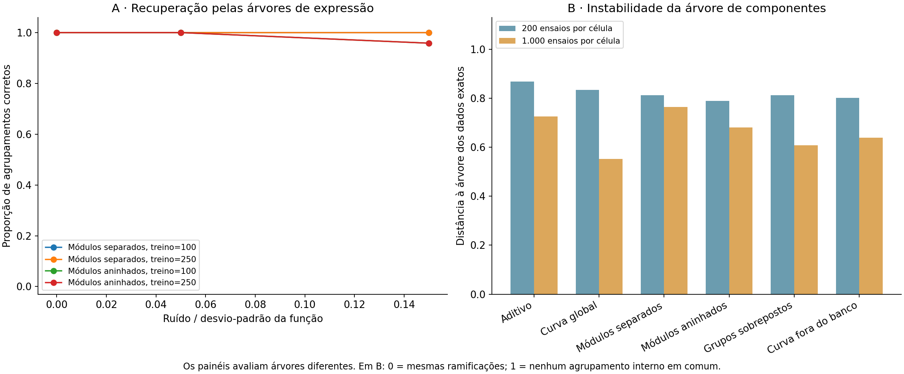
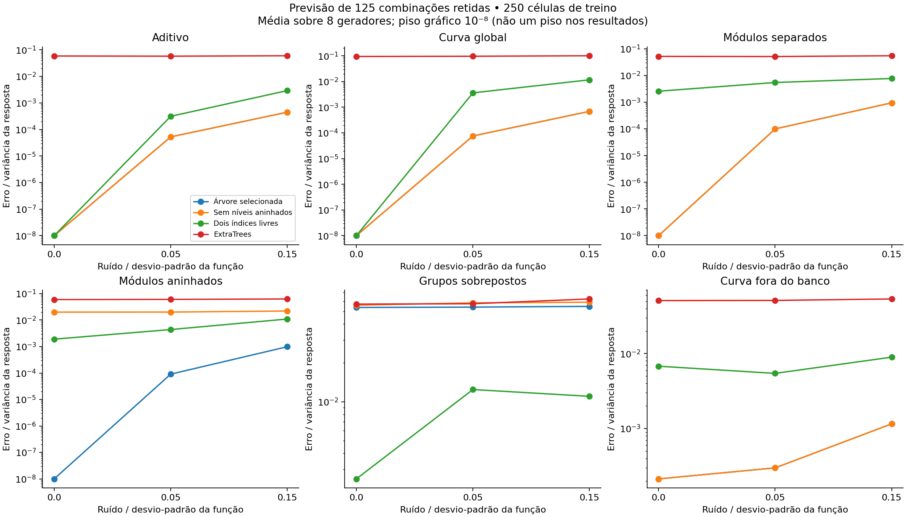

# Piloto 4 — A hierarquia recupera explicações e ajuda a prever?

12 de novembro de 2026. Experimento exploratório executado, com código, tabelas e figuras reproduzíveis.

## Conclusão principal

**Há suporte para recuperar e usar uma composição hierárquica quando ela é definida como um modelo explícito, dentro de um catálogo limitado. Não há, ainda, suporte para tratar a árvore de componentes do piloto 3 como uma assinatura topológica estável.**

Essas conclusões vêm de dois testes diferentes. Não devem ser fundidas em uma afirmação de que a árvore original aprendeu mecanismos. A árvore de expressão usa variáveis nas folhas e calcula uma resposta; a árvore original usa componentes de interação nas folhas e resume compatibilidades entre transformações. A primeira é uma verificação complementar de uma parte da hipótese, não a implementação final da proposta do usuário.

## 1. O que foi testado

### A. Recuperação e previsão por modelos de expressão

48 funções independentes: oito conjuntos de parâmetros para cada uma de seis famílias. Cada função é observada em um fatorial de quatro variáveis, cinco níveis por variável, totalizando 625 combinações.

| Família | Como a resposta foi gerada | O que uma árvore exclusiva pode representar |
|---|---|---|
| Aditivo | Soma ponderada | Representação plana; agrupamentos internos não identificáveis |
| Curva global | Uma tanh aplicada à soma | Um índice global, sem módulos internos identificados |
| Módulos separados | Soma de duas tanh, cada uma sobre um par diferente | Dois grupos não sobrepostos |
| Módulos aninhados | Curva sobre um par; esse resultado e uma terceira variável passam por outra curva; soma-se a quarta | Um grupo dentro de outro |
| Grupos sobrepostos | Duas tanh de índices com três variáveis cada; compartilham duas variáveis | Fora da gramática exclusiva oferecida, mas não provadamente fora de toda classe de árvores |
| Curva fora do banco | Dois módulos com arctan | Forma de agrupamento conhecida, curva não disponível aos candidatos |

Pesos, sinais, escalas, interceptos e agrupamentos variam com a semente. Todos os parâmetros geradores estão em `geradores.json`. A curva global é tanh neste teste; não é o mesmo desenho probabilístico do piloto 3.

O catálogo oferecido contém 17 modelos: soma aditiva, curva global, três partições em dois pares e 12 hierarquias aninhadas. Cada nó não linear calcula `a × tanh(soma dos filhos + b)`; folhas têm coeficientes livres e a resposta tem intercepto. As transformações locais são aprendidas via parâmetros dessa família, não por uma busca entre quaisquer curvas monótonas.

Comparações:

- **Árvore selecionada:** escolhe entre os 17 candidatos.
- **Sem níveis aninhados:** escolhe entre os primeiros cinco (aditivo, global e três partições). Este controle ainda permite módulos; somente não permite um módulo dentro de outro.
- **Dois índices livres:** dois índices de todas as variáveis passam por tanh e são somados, com uma contribuição linear adicional. São 17 parâmetros e nenhuma exigência de grupos exclusivos.
- **ExtraTrees:** 150 árvores, mínimo de duas observações por folha; controle preditivo genérico, sem otimização de hiperparâmetros. Não é iRF.
- **Estrutura verdadeira:** estrutura conhecida do gerador, com parâmetros ajustados somente no treino; controle com informação privilegiada sobre topologia.
- **Estrutura incorreta:** melhor candidato de topologia diferente, mas mesma classe e número de parâmetros, escolhido pela validação.

### Separação entre treino, validação e teste

Por gerador, 125 células inteiras ficam reservadas para teste e 125 para validação. Do restante, usam-se 100 ou 250 células no treino, com conjuntos aninhados. O teste mede erro nas combinações retidas, contra a função sem ruído conhecida. Não há observações da mesma célula no treino e no teste. É previsão dentro do domínio do grid, não extrapolação para níveis novos.

O ruído é gaussiano com desvio-padrão de 0%, 5% ou 15% do desvio-padrão da função. São três novas realizações do ruído por condição ruidosa e uma observação exata. Total: **672 condições e 12.768 ajustes de candidatos**. Há 48 funções independentes; réplicas e tamanhos de treino não aumentam esse número.

Os parâmetros são ajustados por mínimos quadrados, com gradientes analíticos verificados numericamente, dois inícios e até 100 avaliações. A seleção permite candidatos cuja MSE de validação esteja a até um erro padrão da melhor, preferindo o de menos parâmetros. **É uma heurística de seleção, não uma região de confiança sobre estruturas.** O teste final não participa da seleção.

### B. Estabilidade da árvore de componentes do piloto 3

Para cada uma das 48 funções, aplicou-se uma logística à função padronizada para produzir uma resposta entre zero e um. Comparamos a árvore em dados exatos com quatro realizações binomiais de 1.000 e de 200 ensaios por célula. Foram 432 tabelas, sempre no grid completo.

Usamos exatamente o agrupador de componentes anterior, preservado em `piloto3_legado.py`. Compararam-se os conjuntos de folhas sob os nós internos, mantendo a correspondência dos nomes das variáveis. A distância topológica normalizada é zero para árvores iguais e um quando nenhum agrupamento interno não trivial é compartilhado. Raiz e folhas isoladas são excluídas.

## 2. Recuperação de estruturas conhecidas

Com 250 células de treino:

| Família com grupos identificados no gerador | Sem ruído | Ruído de 5% | Ruído de 15% |
|---|---:|---:|---:|
| Dois módulos separados | 100% (8/8) | 100% (24/24) | 100% (24/24) |
| Módulos aninhados | 100% (8/8) | 100% (24/24) | 95,8% (23/24) |

Recuperação significa selecionar exatamente os subconjuntos de variáveis do gerador dentro do catálogo. Não significa recuperar todos os parâmetros de forma única ou um mecanismo biológico. Com 100 células, as taxas agregadas também foram 100% para os módulos separados e 95,8% para os aninhados no ruído de 15%.

Entre as três realizações de ruído de 15%, a estrutura selecionada se repetiu em 100% das comparações para módulos separados e em 91,7% para aninhados, usando 250 células. São somente oito geradores por família: evidência favorável neste domínio, não garantia geral.

## 3. A organização ajuda a prever combinações retidas?

Erro quadrático médio dividido pela variância da função verdadeira. Menor é melhor; 0,01 corresponde a MSE igual a 1% da variância, não a 99% de acerto de classificação.

Resultados médios com 250 células e ruído de 15%:

| Família | Árvore selecionada | Sem níveis aninhados | Dois índices livres, ajuste principal | ExtraTrees |
|---|---:|---:|---:|---:|
| Aditivo | 0,000446 | 0,000446 | 0,002899 | 0,059669 |
| Curva global | 0,000690 | 0,000690 | 0,011666 | 0,100981 |
| Módulos separados | 0,000943 | 0,000943 | 0,007691 | 0,054664 |
| Módulos aninhados | **0,000984** | **0,022059** | 0,010966 | 0,062934 |
| Grupos sobrepostos | **0,054664** | 0,058876 | **0,011014** | 0,062391 |
| Curva fora do banco | 0,001156 | 0,001156 | 0,008963 | 0,053508 |

No caso aninhado, permitir um grupo dentro de outro reduziu o erro aproximadamente 22 vezes em relação ao catálogo sem níveis aninhados. A diferença de erros foi 0,0211, com intervalo bootstrap de 95% de 0,0135 a 0,0323, reamostrando os oito geradores independentes. Esses intervalos não corrigem multiplicidade e são exploratórios.

Nos módulos separados, a hierarquia adicional não ajudou: o controle sem níveis aninhados já contém a explicação correta. Isso é um resultado esperado e importante.

### Controle com a mesma capacidade paramétrica

Nos geradores aninhados, a estrutura correta e as incorretas têm nove parâmetros. Com ruído de 15%, o erro da estrutura correta foi aproximadamente 0,000876, contra 0,010956 para a melhor estrutura incorreta escolhida por validação. A diferença foi 0,0101 (intervalo bootstrap: 0,0065 a 0,0141).

Nos módulos separados, o erro foi 0,000943 na estrutura correta e 0,055622 na melhor partição incorreta. Portanto, o agrupamento tem consequências preditivas que não se reduzem ao número de parâmetros, dentro desta gramática.

Isso demonstra utilidade relativa às alternativas testadas. Não demonstra que qualquer método sem árvore precise perder; uma rede mais ampla ou outra representação pode aproximar as mesmas funções.

## 4. Quando a árvore exclusiva é inadequada?

Nos sistemas sobrepostos, o modelo de índices livres foi selecionado em todas as condições sem ruído e com ruído de 5%, e em 91,7% das condições com ruído de 15% e 250 células. Seu erro foi menor que o das árvores exclusivas.

A saída é uma preferência entre os modelos oferecidos, não uma prova de que nenhuma árvore concebível represente a função. O modelo de índices livres tem mais parâmetros; a regra de um erro padrão tenta favorecer simplicidade, mas não elimina todas as diferenças de capacidade.

Quando trocamos tanh por arctan nos geradores de módulos, as árvores de tanh ainda aproximaram bem as respostas. Isso mostra tolerância a uma mudança específica de curva, não descoberta da curva real. O banco de transformações continua muito limitado.

## 5. Verificação adicional da otimização — registrada após a rodada principal

O modelo de índices livres teve erro mesmo sem ruído em famílias que ele pode representar exatamente. Isso exigiu uma análise de sensibilidade: dez inícios e até 500 avaliações, apenas para 250 células, réplica de ruído zero e níveis de ruído 0 e 15%. São **96 novos ajustes**, em arquivo separado; a análise principal não foi sobrescrita.

Sem ruído, o modelo livre passou a recuperar módulos separados e sistemas sobrepostos até precisão numérica. Logo, parte de sua desvantagem inicial era falha de otimização, não vantagem da representação hierárquica.

Comparação após essa verificação, na mesma réplica zero e com ruído de 15%:

| Família | Árvore, mesma réplica | Índices livres, otimização ampliada |
|---|---:|---:|
| Aditivo | 0,000497 | 0,003074 |
| Curva global | 0,000550 | 0,002360 |
| Módulos separados | 0,000940 | 0,001537 |
| Módulos aninhados | **0,001107** | **0,004052** |
| Grupos sobrepostos | **0,054053** | **0,001637** |
| Curva fora do banco | 0,000965 | 0,001801 |

A vantagem no caso aninhado permanece, mas é menor que a comparação inicial poderia sugerir. Nos casos sobrepostos, a vantagem do modelo livre aumenta. A análise adicional usa só uma réplica por gerador; seus números não devem ser misturados com a média das três réplicas da tabela principal.

Na rodada principal, 81,5% de todos os candidatos atingiram a condição de convergência do otimizador; **100% das árvores selecionadas** atingiram. Na análise ampliada, todos os 96 ajustes livres convergiram. Convergência numérica não certifica ótimo global.

## 6. A árvore original funciona como assinatura estável?

Não suficientemente neste teste. A distância média à árvore exata foi:

| Família | 1.000 ensaios por célula | 200 ensaios por célula |
|---|---:|---:|
| Aditivo | 0,726 | 0,868 |
| Curva global | 0,552 | 0,833 |
| Módulos separados | 0,764 | 0,813 |
| Módulos aninhados | 0,681 | 0,788 |
| Grupos sobrepostos | 0,608 | 0,813 |
| Curva fora do banco | 0,639 | 0,802 |

Mesmo com 1.000 ensaios por célula, muitas relações internas mudam. O agrupador força uma árvore binária completa e apresenta muitos custos de fusão próximos de zero. Os resultados são compatíveis com grande sensibilidade dos desempates e dos componentes pequenos; não isolamos experimentalmente a contribuição de cada causa.

Como diagnóstico adicional, procuramos, nos geradores aninhados, um nó que reunisse exatamente os quatro componentes internos ao grupo verdadeiro de três variáveis. Ele apareceu em 25% dos exemplos exatos e em 18,75% dos exemplos com 1.000 ensaios. Esse é um critério operacional complementar, não uma propriedade que o algoritmo original tenha garantia de recuperar.

Assim, **o desempenho de classificação do piloto 3 não pode ser usado como prova de recuperação de hierarquias explicativas**. Uma assinatura numérica pode classificar razoavelmente mesmo quando sua topologia varia.

## 7. Controle de ambiguidade

Construímos 15 árvores binárias diferentes de somas: três equilibradas e 12 aninhadas. Aplicando uma curva logística global à soma ponderada, todas produzem a mesma resposta, com diferença apenas de arredondamento numérico, inferior a 10⁻¹⁴.

Portanto, os valores da resposta não identificam um agrupamento interno único nessas descrições. Um procedimento que sempre escolhe uma árvore não resolveu essa ambiguidade; só adotou uma representação. Esse controle demonstra equivalência de descrições matemáticas, não equivalência de mecanismos celulares distintos.

## 8. O que estes testes sustentam para o projeto

- **Recuperação:** é possível recuperar módulos e níveis de composição dentro de uma gramática explícita e favorável. A recuperação não foi obtida pela árvore de componentes original.
- **Previsão:** uma topologia apropriada pode ajudar em combinações retidas, inclusive contra topologias incorretas de mesma capacidade. Isso é evidência da importância do agrupamento para aquelas funções.
- **Necessidade:** não há necessidade universal da hierarquia. Ela é dispensável nos controles planos e foi inadequada na forma exclusiva usada para grupos sobrepostos.
- **Assinatura:** a árvore de componentes ainda não tem a estabilidade necessária para ser chamada de impressão digital do sistema. Não demonstramos unicidade ou inferência biológica.

O elo ainda ausente é construir uma árvore **das interações**, com nós cuja explicação conjunta possa ser validada, que preserve essa informação e tenha utilidade demonstrável. O teste de expressões indica uma possibilidade matemática; não preenche automaticamente esse elo.

## 9. Limitações

Catálogo pequeno, quatro variáveis, oito geradores por família, mesmos níveis de entrada no treino e teste, maioria das funções dentro da gramática de tanh, ruído simples, busca paramétrica não convexa e ExtraTrees sem ajuste de hiperparâmetros. Os modelos de expressão foram fornecidos como candidatos completos: não há algoritmo que descobre livremente uma nova árvore a partir das interações. O uso de arctan é uma única verificação de mudança de curva. Não há dados biológicos, comparação com iRF, identificação causal ou validação de mecanismo real.

A execução curta foi usada para verificar funcionamento e tempo. O número de geradores passou de quatro para oito antes da execução principal. A otimização ampliada é a única análise adicional motivada pelos resultados e foi preservada separadamente. Nenhum limiar, gerador ou classificação principal foi ajustado para fazer resultados passarem.

## 10. Figuras e arquivos

- `resultados/previsao.png`: erros por família e ruído.
- `resultados/recuperacao_estabilidade.png`: recuperação das expressões e instabilidade da árvore de componentes.
- `resultados/previsao_resumo.csv`: todas as condições de previsão.
- `resultados/ajustes.csv`: candidatos, erros e convergência.
- `resultados/sensibilidade_otimizacao.csv`: verificação posterior de otimização.
- `resultados/controle_ambiguidade.json`: equivalência numérica das 15 árvores.
- `README.md`: reprodução completa.

## Arquivos e figuras no repositório

- [Código, resultados e instruções](../piloto4/README.md)
- [Relatório original](../piloto4/RELATORIO_PILOTO_4.md)

