# Piloto 7 — atlas integral do suplemento de Wright

[Principal](https://github.com/danifilho/Mestrado_ICMC/wiki/Piloto-7-Wright-Documentacao-integral) · [Figuras principais](https://github.com/danifilho/Mestrado_ICMC/wiki/Piloto-7-Figuras-comentadas)

**Fonte:** Wright, Ziegler e König (2016), suplemento 4, CC BY 4.0. [PDF vetorial original](https://github.com/danifilho/Mestrado_ICMC/blob/edcbf4cc450583364e69cbe89a738596c7c2762f/documentacao/piloto7-wright2016/fontes/MOESM4_ESM.pdf). Este atlas incorpora as 36 páginas físicas e comenta individualmente S1–S124. A numeração interna de páginas reinicia por seção; usamos a posição física no PDF. As imagens são rasterizações, não novas simulações.

**Distinção fundamental:** S1–S48 foram usados no nosso gabarito quantitativo. S49–S124 documentam análises dos autores não cobertas pelo nosso veredito. Não inventamos valores numéricos para essas curvas adicionais. As interpretações abaixo dizem o alvo e a leitura correta de cada imagem.

**Como ler:** nos painéis, x é o tamanho k da lista; y é uma proporção de repetições. Cinco painéis correspondem a Só interação, Modificador, Sem interação, Redundante e Sinérgico. Curvas individuais usam Gini/vermelho e permutação/azul; curvas de pares usam JVIMP, JMST e PPI conforme a legenda original. Aumento de k facilita inclusão; isso não é melhora de previsão do modelo.

## Página física 1: S1, S2, S3

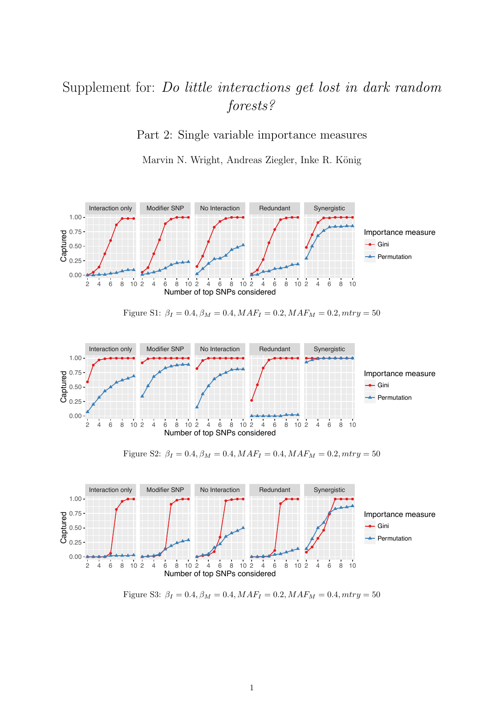

### S1

**Legenda original:** βI = 0.4,β M = 0.4,MAF I = 0.2,MAF M = 0.2,mtry = 50

**O que mede e por quê:** Captura dos dois SNPs designados por importância individual. x=k entre 2 e 10; y=fração de realizações com ambos no topo entre 100 SNPs. Não é identificação do par.

**Código dos painéis:** [01_main_simulation/02_plot_main.R](https://github.com/danifilho/Mestrado_ICMC/blob/edcbf4cc450583364e69cbe89a738596c7c2762f/documentacao/piloto7-wright2016/fontes/codigo_autores/replication/01_main_simulation/02_plot_main.R). Os scripts produzem os painéis; a paginação editorial do PDF não é atribuída a eles sem evidência.

**Resumo numérico publicado desta figura:** média sobre os cinco modelos e os cortes disponíveis — Gini: 0.701; Permutation: 0.255. Esse resumo é auxiliar de navegação; não mistura as medidas individuais com as de pares nem substitui a leitura por painel.

**Nossa reprodução desta figura:** 90 pontos comparados; 95.6% dentro de ±0,10; diferença absoluta média 0.0299. Configuração: quatro medidas originais preservadas e JVIMP 1.6.1. [Tabela ponto a ponto](https://github.com/danifilho/Mestrado_ICMC/blob/edcbf4cc450583364e69cbe89a738596c7c2762f/documentacao/piloto7-wright2016/resultados/tabelas/etapa0_completo_etapa0_comp_rfsrc341_jvimp_etapa0_comp_rfsrc161_pontos.csv).

### S2

**Legenda original:** βI = 0.4,β M = 0.4,MAF I = 0.4,MAF M = 0.2,mtry = 50

**O que mede e por quê:** Captura dos dois SNPs designados por importância individual. x=k entre 2 e 10; y=fração de realizações com ambos no topo entre 100 SNPs. Não é identificação do par.

**Código dos painéis:** [01_main_simulation/02_plot_main.R](https://github.com/danifilho/Mestrado_ICMC/blob/edcbf4cc450583364e69cbe89a738596c7c2762f/documentacao/piloto7-wright2016/fontes/codigo_autores/replication/01_main_simulation/02_plot_main.R). Os scripts produzem os painéis; a paginação editorial do PDF não é atribuída a eles sem evidência.

**Resumo numérico publicado desta figura:** média sobre os cinco modelos e os cortes disponíveis — Gini: 0.950; Permutation: 0.561. Esse resumo é auxiliar de navegação; não mistura as medidas individuais com as de pares nem substitui a leitura por painel.

**Nossa reprodução desta figura:** 90 pontos comparados; 100.0% dentro de ±0,10; diferença absoluta média 0.0213. Configuração: quatro medidas originais preservadas e JVIMP 1.6.1. [Tabela ponto a ponto](https://github.com/danifilho/Mestrado_ICMC/blob/edcbf4cc450583364e69cbe89a738596c7c2762f/documentacao/piloto7-wright2016/resultados/tabelas/etapa0_completo_etapa0_comp_rfsrc341_jvimp_etapa0_comp_rfsrc161_pontos.csv).

### S3

**Legenda original:** βI = 0.4,β M = 0.4,MAF I = 0.2,MAF M = 0.4,mtry = 50

**O que mede e por quê:** Captura dos dois SNPs designados por importância individual. x=k entre 2 e 10; y=fração de realizações com ambos no topo entre 100 SNPs. Não é identificação do par.

**Código dos painéis:** [01_main_simulation/02_plot_main.R](https://github.com/danifilho/Mestrado_ICMC/blob/edcbf4cc450583364e69cbe89a738596c7c2762f/documentacao/piloto7-wright2016/fontes/codigo_autores/replication/01_main_simulation/02_plot_main.R). Os scripts produzem os painéis; a paginação editorial do PDF não é atribuída a eles sem evidência.

**Resumo numérico publicado desta figura:** média sobre os cinco modelos e os cortes disponíveis — Gini: 0.493; Permutation: 0.214. Esse resumo é auxiliar de navegação; não mistura as medidas individuais com as de pares nem substitui a leitura por painel.

**Nossa reprodução desta figura:** 90 pontos comparados; 100.0% dentro de ±0,10; diferença absoluta média 0.0180. Configuração: quatro medidas originais preservadas e JVIMP 1.6.1. [Tabela ponto a ponto](https://github.com/danifilho/Mestrado_ICMC/blob/edcbf4cc450583364e69cbe89a738596c7c2762f/documentacao/piloto7-wright2016/resultados/tabelas/etapa0_completo_etapa0_comp_rfsrc341_jvimp_etapa0_comp_rfsrc161_pontos.csv).

## Página física 2: S4, S5, S6, S7

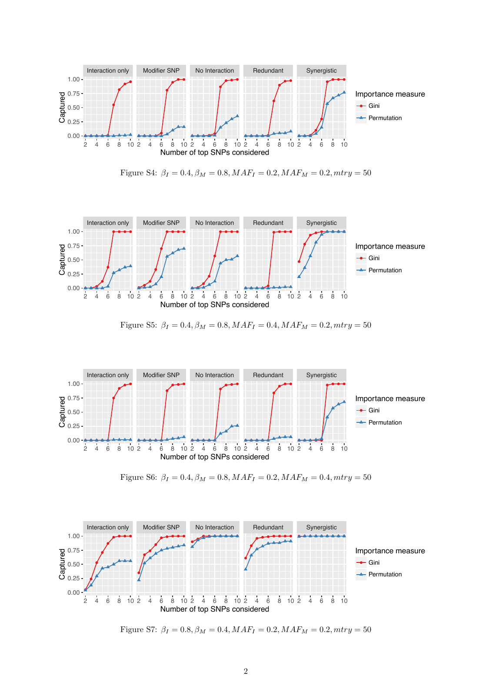

### S4

**Legenda original:** βI = 0.4,β M = 0.8,MAF I = 0.2,MAF M = 0.2,mtry = 50

**O que mede e por quê:** Captura dos dois SNPs designados por importância individual. x=k entre 2 e 10; y=fração de realizações com ambos no topo entre 100 SNPs. Não é identificação do par.

**Código dos painéis:** [01_main_simulation/02_plot_main.R](https://github.com/danifilho/Mestrado_ICMC/blob/edcbf4cc450583364e69cbe89a738596c7c2762f/documentacao/piloto7-wright2016/fontes/codigo_autores/replication/01_main_simulation/02_plot_main.R). Os scripts produzem os painéis; a paginação editorial do PDF não é atribuída a eles sem evidência.

**Resumo numérico publicado desta figura:** média sobre os cinco modelos e os cortes disponíveis — Gini: 0.418; Permutation: 0.104. Esse resumo é auxiliar de navegação; não mistura as medidas individuais com as de pares nem substitui a leitura por painel.

**Nossa reprodução desta figura:** 90 pontos comparados; 100.0% dentro de ±0,10; diferença absoluta média 0.0158. Configuração: quatro medidas originais preservadas e JVIMP 1.6.1. [Tabela ponto a ponto](https://github.com/danifilho/Mestrado_ICMC/blob/edcbf4cc450583364e69cbe89a738596c7c2762f/documentacao/piloto7-wright2016/resultados/tabelas/etapa0_completo_etapa0_comp_rfsrc341_jvimp_etapa0_comp_rfsrc161_pontos.csv).

### S5

**Legenda original:** βI = 0.4,β M = 0.8,MAF I = 0.4,MAF M = 0.2,mtry = 50

**O que mede e por quê:** Captura dos dois SNPs designados por importância individual. x=k entre 2 e 10; y=fração de realizações com ambos no topo entre 100 SNPs. Não é identificação do par.

**Código dos painéis:** [01_main_simulation/02_plot_main.R](https://github.com/danifilho/Mestrado_ICMC/blob/edcbf4cc450583364e69cbe89a738596c7c2762f/documentacao/piloto7-wright2016/fontes/codigo_autores/replication/01_main_simulation/02_plot_main.R). Os scripts produzem os painéis; a paginação editorial do PDF não é atribuída a eles sem evidência.

**Resumo numérico publicado desta figura:** média sobre os cinco modelos e os cortes disponíveis — Gini: 0.596; Permutation: 0.298. Esse resumo é auxiliar de navegação; não mistura as medidas individuais com as de pares nem substitui a leitura por painel.

**Nossa reprodução desta figura:** 90 pontos comparados; 88.9% dentro de ±0,10; diferença absoluta média 0.0286. Configuração: quatro medidas originais preservadas e JVIMP 1.6.1. [Tabela ponto a ponto](https://github.com/danifilho/Mestrado_ICMC/blob/edcbf4cc450583364e69cbe89a738596c7c2762f/documentacao/piloto7-wright2016/resultados/tabelas/etapa0_completo_etapa0_comp_rfsrc341_jvimp_etapa0_comp_rfsrc161_pontos.csv).

### S6

**Legenda original:** βI = 0.4,β M = 0.8,MAF I = 0.2,MAF M = 0.4,mtry = 50

**O que mede e por quê:** Captura dos dois SNPs designados por importância individual. x=k entre 2 e 10; y=fração de realizações com ambos no topo entre 100 SNPs. Não é identificação do par.

**Código dos painéis:** [01_main_simulation/02_plot_main.R](https://github.com/danifilho/Mestrado_ICMC/blob/edcbf4cc450583364e69cbe89a738596c7c2762f/documentacao/piloto7-wright2016/fontes/codigo_autores/replication/01_main_simulation/02_plot_main.R). Os scripts produzem os painéis; a paginação editorial do PDF não é atribuída a eles sem evidência.

**Resumo numérico publicado desta figura:** média sobre os cinco modelos e os cortes disponíveis — Gini: 0.426; Permutation: 0.078. Esse resumo é auxiliar de navegação; não mistura as medidas individuais com as de pares nem substitui a leitura por painel.

**Nossa reprodução desta figura:** 90 pontos comparados; 100.0% dentro de ±0,10; diferença absoluta média 0.0088. Configuração: quatro medidas originais preservadas e JVIMP 1.6.1. [Tabela ponto a ponto](https://github.com/danifilho/Mestrado_ICMC/blob/edcbf4cc450583364e69cbe89a738596c7c2762f/documentacao/piloto7-wright2016/resultados/tabelas/etapa0_completo_etapa0_comp_rfsrc341_jvimp_etapa0_comp_rfsrc161_pontos.csv).

### S7

**Legenda original:** βI = 0.8,β M = 0.4,MAF I = 0.2,MAF M = 0.2,mtry = 50

**O que mede e por quê:** Captura dos dois SNPs designados por importância individual. x=k entre 2 e 10; y=fração de realizações com ambos no topo entre 100 SNPs. Não é identificação do par.

**Código dos painéis:** [01_main_simulation/02_plot_main.R](https://github.com/danifilho/Mestrado_ICMC/blob/edcbf4cc450583364e69cbe89a738596c7c2762f/documentacao/piloto7-wright2016/fontes/codigo_autores/replication/01_main_simulation/02_plot_main.R). Os scripts produzem os painéis; a paginação editorial do PDF não é atribuída a eles sem evidência.

**Resumo numérico publicado desta figura:** média sobre os cinco modelos e os cortes disponíveis — Gini: 0.893; Permutation: 0.763. Esse resumo é auxiliar de navegação; não mistura as medidas individuais com as de pares nem substitui a leitura por painel.

**Nossa reprodução desta figura:** 90 pontos comparados; 98.9% dentro de ±0,10; diferença absoluta média 0.0282. Configuração: quatro medidas originais preservadas e JVIMP 1.6.1. [Tabela ponto a ponto](https://github.com/danifilho/Mestrado_ICMC/blob/edcbf4cc450583364e69cbe89a738596c7c2762f/documentacao/piloto7-wright2016/resultados/tabelas/etapa0_completo_etapa0_comp_rfsrc341_jvimp_etapa0_comp_rfsrc161_pontos.csv).

## Página física 3: S8, S9, S10, S11

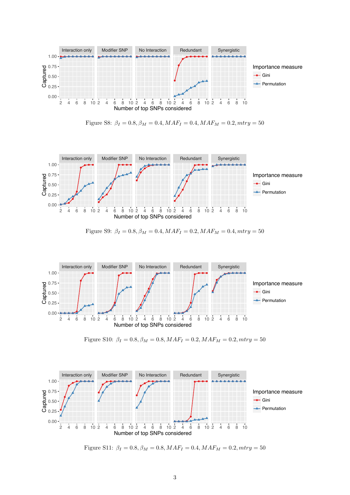

### S8

**Legenda original:** βI = 0.8,β M = 0.4,MAF I = 0.4,MAF M = 0.2,mtry = 50

**O que mede e por quê:** Captura dos dois SNPs designados por importância individual. x=k entre 2 e 10; y=fração de realizações com ambos no topo entre 100 SNPs. Não é identificação do par.

**Código dos painéis:** [01_main_simulation/02_plot_main.R](https://github.com/danifilho/Mestrado_ICMC/blob/edcbf4cc450583364e69cbe89a738596c7c2762f/documentacao/piloto7-wright2016/fontes/codigo_autores/replication/01_main_simulation/02_plot_main.R). Os scripts produzem os painéis; a paginação editorial do PDF não é atribuída a eles sem evidência.

**Resumo numérico publicado desta figura:** média sobre os cinco modelos e os cortes disponíveis — Gini: 0.980; Permutation: 0.840. Esse resumo é auxiliar de navegação; não mistura as medidas individuais com as de pares nem substitui a leitura por painel.

**Nossa reprodução desta figura:** 90 pontos comparados; 98.9% dentro de ±0,10; diferença absoluta média 0.0061. Configuração: quatro medidas originais preservadas e JVIMP 1.6.1. [Tabela ponto a ponto](https://github.com/danifilho/Mestrado_ICMC/blob/edcbf4cc450583364e69cbe89a738596c7c2762f/documentacao/piloto7-wright2016/resultados/tabelas/etapa0_completo_etapa0_comp_rfsrc341_jvimp_etapa0_comp_rfsrc161_pontos.csv).

### S9

**Legenda original:** βI = 0.8,β M = 0.4,MAF I = 0.2,MAF M = 0.4,mtry = 50

**O que mede e por quê:** Captura dos dois SNPs designados por importância individual. x=k entre 2 e 10; y=fração de realizações com ambos no topo entre 100 SNPs. Não é identificação do par.

**Código dos painéis:** [01_main_simulation/02_plot_main.R](https://github.com/danifilho/Mestrado_ICMC/blob/edcbf4cc450583364e69cbe89a738596c7c2762f/documentacao/piloto7-wright2016/fontes/codigo_autores/replication/01_main_simulation/02_plot_main.R). Os scripts produzem os painéis; a paginação editorial do PDF não é atribuída a eles sem evidência.

**Resumo numérico publicado desta figura:** média sobre os cinco modelos e os cortes disponíveis — Gini: 0.742; Permutation: 0.698. Esse resumo é auxiliar de navegação; não mistura as medidas individuais com as de pares nem substitui a leitura por painel.

**Nossa reprodução desta figura:** 90 pontos comparados; 95.6% dentro de ±0,10; diferença absoluta média 0.0247. Configuração: quatro medidas originais preservadas e JVIMP 1.6.1. [Tabela ponto a ponto](https://github.com/danifilho/Mestrado_ICMC/blob/edcbf4cc450583364e69cbe89a738596c7c2762f/documentacao/piloto7-wright2016/resultados/tabelas/etapa0_completo_etapa0_comp_rfsrc341_jvimp_etapa0_comp_rfsrc161_pontos.csv).

### S10

**Legenda original:** βI = 0.8,β M = 0.8,MAF I = 0.2,MAF M = 0.2,mtry = 50

**O que mede e por quê:** Captura dos dois SNPs designados por importância individual. x=k entre 2 e 10; y=fração de realizações com ambos no topo entre 100 SNPs. Não é identificação do par.

**Código dos painéis:** [01_main_simulation/02_plot_main.R](https://github.com/danifilho/Mestrado_ICMC/blob/edcbf4cc450583364e69cbe89a738596c7c2762f/documentacao/piloto7-wright2016/fontes/codigo_autores/replication/01_main_simulation/02_plot_main.R). Os scripts produzem os painéis; a paginação editorial do PDF não é atribuída a eles sem evidência.

**Resumo numérico publicado desta figura:** média sobre os cinco modelos e os cortes disponíveis — Gini: 0.597; Permutation: 0.440. Esse resumo é auxiliar de navegação; não mistura as medidas individuais com as de pares nem substitui a leitura por painel.

**Nossa reprodução desta figura:** 90 pontos comparados; 97.8% dentro de ±0,10; diferença absoluta média 0.0214. Configuração: quatro medidas originais preservadas e JVIMP 1.6.1. [Tabela ponto a ponto](https://github.com/danifilho/Mestrado_ICMC/blob/edcbf4cc450583364e69cbe89a738596c7c2762f/documentacao/piloto7-wright2016/resultados/tabelas/etapa0_completo_etapa0_comp_rfsrc341_jvimp_etapa0_comp_rfsrc161_pontos.csv).

### S11

**Legenda original:** βI = 0.8,β M = 0.8,MAF I = 0.4,MAF M = 0.2,mtry = 50

**O que mede e por quê:** Captura dos dois SNPs designados por importância individual. x=k entre 2 e 10; y=fração de realizações com ambos no topo entre 100 SNPs. Não é identificação do par.

**Código dos painéis:** [01_main_simulation/02_plot_main.R](https://github.com/danifilho/Mestrado_ICMC/blob/edcbf4cc450583364e69cbe89a738596c7c2762f/documentacao/piloto7-wright2016/fontes/codigo_autores/replication/01_main_simulation/02_plot_main.R). Os scripts produzem os painéis; a paginação editorial do PDF não é atribuída a eles sem evidência.

**Resumo numérico publicado desta figura:** média sobre os cinco modelos e os cortes disponíveis — Gini: 0.844; Permutation: 0.696. Esse resumo é auxiliar de navegação; não mistura as medidas individuais com as de pares nem substitui a leitura por painel.

**Nossa reprodução desta figura:** 90 pontos comparados; 95.6% dentro de ±0,10; diferença absoluta média 0.0171. Configuração: quatro medidas originais preservadas e JVIMP 1.6.1. [Tabela ponto a ponto](https://github.com/danifilho/Mestrado_ICMC/blob/edcbf4cc450583364e69cbe89a738596c7c2762f/documentacao/piloto7-wright2016/resultados/tabelas/etapa0_completo_etapa0_comp_rfsrc341_jvimp_etapa0_comp_rfsrc161_pontos.csv).

## Página física 4: S12, S13, S14, S15

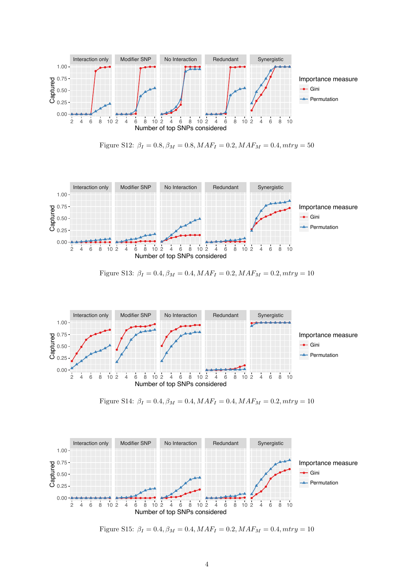

### S12

**Legenda original:** βI = 0.8,β M = 0.8,MAF I = 0.2,MAF M = 0.4,mtry = 50

**O que mede e por quê:** Captura dos dois SNPs designados por importância individual. x=k entre 2 e 10; y=fração de realizações com ambos no topo entre 100 SNPs. Não é identificação do par.

**Código dos painéis:** [01_main_simulation/02_plot_main.R](https://github.com/danifilho/Mestrado_ICMC/blob/edcbf4cc450583364e69cbe89a738596c7c2762f/documentacao/piloto7-wright2016/fontes/codigo_autores/replication/01_main_simulation/02_plot_main.R). Os scripts produzem os painéis; a paginação editorial do PDF não é atribuída a eles sem evidência.

**Resumo numérico publicado desta figura:** média sobre os cinco modelos e os cortes disponíveis — Gini: 0.496; Permutation: 0.353. Esse resumo é auxiliar de navegação; não mistura as medidas individuais com as de pares nem substitui a leitura por painel.

**Nossa reprodução desta figura:** 90 pontos comparados; 97.8% dentro de ±0,10; diferença absoluta média 0.0190. Configuração: quatro medidas originais preservadas e JVIMP 1.6.1. [Tabela ponto a ponto](https://github.com/danifilho/Mestrado_ICMC/blob/edcbf4cc450583364e69cbe89a738596c7c2762f/documentacao/piloto7-wright2016/resultados/tabelas/etapa0_completo_etapa0_comp_rfsrc341_jvimp_etapa0_comp_rfsrc161_pontos.csv).

### S13

**Legenda original:** βI = 0.4,β M = 0.4,MAF I = 0.2,MAF M = 0.2,mtry = 10

**O que mede e por quê:** Captura dos dois SNPs designados por importância individual. x=k entre 2 e 10; y=fração de realizações com ambos no topo entre 100 SNPs. Não é identificação do par.

**Código dos painéis:** [01_main_simulation/02_plot_main.R](https://github.com/danifilho/Mestrado_ICMC/blob/edcbf4cc450583364e69cbe89a738596c7c2762f/documentacao/piloto7-wright2016/fontes/codigo_autores/replication/01_main_simulation/02_plot_main.R). Os scripts produzem os painéis; a paginação editorial do PDF não é atribuída a eles sem evidência.

**Resumo numérico publicado desta figura:** média sobre os cinco modelos e os cortes disponíveis — Gini: 0.136; Permutation: 0.225. Esse resumo é auxiliar de navegação; não mistura as medidas individuais com as de pares nem substitui a leitura por painel.

**Nossa reprodução desta figura:** 90 pontos comparados; 96.7% dentro de ±0,10; diferença absoluta média 0.0322. Configuração: quatro medidas originais preservadas e JVIMP 1.6.1. [Tabela ponto a ponto](https://github.com/danifilho/Mestrado_ICMC/blob/edcbf4cc450583364e69cbe89a738596c7c2762f/documentacao/piloto7-wright2016/resultados/tabelas/etapa0_completo_etapa0_comp_rfsrc341_jvimp_etapa0_comp_rfsrc161_pontos.csv).

### S14

**Legenda original:** βI = 0.4,β M = 0.4,MAF I = 0.4,MAF M = 0.2,mtry = 10

**O que mede e por quê:** Captura dos dois SNPs designados por importância individual. x=k entre 2 e 10; y=fração de realizações com ambos no topo entre 100 SNPs. Não é identificação do par.

**Código dos painéis:** [01_main_simulation/02_plot_main.R](https://github.com/danifilho/Mestrado_ICMC/blob/edcbf4cc450583364e69cbe89a738596c7c2762f/documentacao/piloto7-wright2016/fontes/codigo_autores/replication/01_main_simulation/02_plot_main.R). Os scripts produzem os painéis; a paginação editorial do PDF não é atribuída a eles sem evidência.

**Resumo numérico publicado desta figura:** média sobre os cinco modelos e os cortes disponíveis — Gini: 0.665; Permutation: 0.509. Esse resumo é auxiliar de navegação; não mistura as medidas individuais com as de pares nem substitui a leitura por painel.

**Nossa reprodução desta figura:** 90 pontos comparados; 85.6% dentro de ±0,10; diferença absoluta média 0.0462. Configuração: quatro medidas originais preservadas e JVIMP 1.6.1. [Tabela ponto a ponto](https://github.com/danifilho/Mestrado_ICMC/blob/edcbf4cc450583364e69cbe89a738596c7c2762f/documentacao/piloto7-wright2016/resultados/tabelas/etapa0_completo_etapa0_comp_rfsrc341_jvimp_etapa0_comp_rfsrc161_pontos.csv).

### S15

**Legenda original:** βI = 0.4,β M = 0.4,MAF I = 0.2,MAF M = 0.4,mtry = 10

**O que mede e por quê:** Captura dos dois SNPs designados por importância individual. x=k entre 2 e 10; y=fração de realizações com ambos no topo entre 100 SNPs. Não é identificação do par.

**Código dos painéis:** [01_main_simulation/02_plot_main.R](https://github.com/danifilho/Mestrado_ICMC/blob/edcbf4cc450583364e69cbe89a738596c7c2762f/documentacao/piloto7-wright2016/fontes/codigo_autores/replication/01_main_simulation/02_plot_main.R). Os scripts produzem os painéis; a paginação editorial do PDF não é atribuída a eles sem evidência.

**Resumo numérico publicado desta figura:** média sobre os cinco modelos e os cortes disponíveis — Gini: 0.083; Permutation: 0.177. Esse resumo é auxiliar de navegação; não mistura as medidas individuais com as de pares nem substitui a leitura por painel.

**Nossa reprodução desta figura:** 90 pontos comparados; 100.0% dentro de ±0,10; diferença absoluta média 0.0207. Configuração: quatro medidas originais preservadas e JVIMP 1.6.1. [Tabela ponto a ponto](https://github.com/danifilho/Mestrado_ICMC/blob/edcbf4cc450583364e69cbe89a738596c7c2762f/documentacao/piloto7-wright2016/resultados/tabelas/etapa0_completo_etapa0_comp_rfsrc341_jvimp_etapa0_comp_rfsrc161_pontos.csv).

## Página física 5: S16, S17, S18, S19

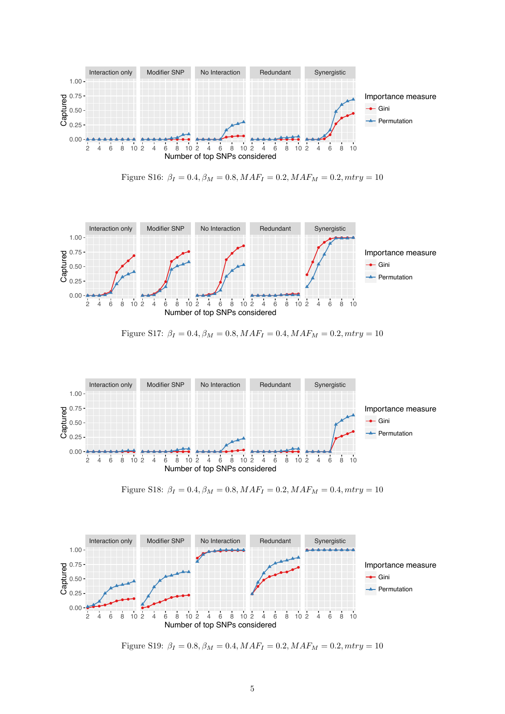

### S16

**Legenda original:** βI = 0.4,β M = 0.8,MAF I = 0.2,MAF M = 0.2,mtry = 10

**O que mede e por quê:** Captura dos dois SNPs designados por importância individual. x=k entre 2 e 10; y=fração de realizações com ambos no topo entre 100 SNPs. Não é identificação do par.

**Código dos painéis:** [01_main_simulation/02_plot_main.R](https://github.com/danifilho/Mestrado_ICMC/blob/edcbf4cc450583364e69cbe89a738596c7c2762f/documentacao/piloto7-wright2016/fontes/codigo_autores/replication/01_main_simulation/02_plot_main.R). Os scripts produzem os painéis; a paginação editorial do PDF não é atribuída a eles sem evidência.

**Resumo numérico publicado desta figura:** média sobre os cinco modelos e os cortes disponíveis — Gini: 0.040; Permutation: 0.089. Esse resumo é auxiliar de navegação; não mistura as medidas individuais com as de pares nem substitui a leitura por painel.

**Nossa reprodução desta figura:** 90 pontos comparados; 100.0% dentro de ±0,10; diferença absoluta média 0.0083. Configuração: quatro medidas originais preservadas e JVIMP 1.6.1. [Tabela ponto a ponto](https://github.com/danifilho/Mestrado_ICMC/blob/edcbf4cc450583364e69cbe89a738596c7c2762f/documentacao/piloto7-wright2016/resultados/tabelas/etapa0_completo_etapa0_comp_rfsrc341_jvimp_etapa0_comp_rfsrc161_pontos.csv).

### S17

**Legenda original:** βI = 0.4,β M = 0.8,MAF I = 0.4,MAF M = 0.2,mtry = 10

**O que mede e por quê:** Captura dos dois SNPs designados por importância individual. x=k entre 2 e 10; y=fração de realizações com ambos no topo entre 100 SNPs. Não é identificação do par.

**Código dos painéis:** [01_main_simulation/02_plot_main.R](https://github.com/danifilho/Mestrado_ICMC/blob/edcbf4cc450583364e69cbe89a738596c7c2762f/documentacao/piloto7-wright2016/fontes/codigo_autores/replication/01_main_simulation/02_plot_main.R). Os scripts produzem os painéis; a paginação editorial do PDF não é atribuída a eles sem evidência.

**Resumo numérico publicado desta figura:** média sobre os cinco modelos e os cortes disponíveis — Gini: 0.366; Permutation: 0.271. Esse resumo é auxiliar de navegação; não mistura as medidas individuais com as de pares nem substitui a leitura por painel.

**Nossa reprodução desta figura:** 90 pontos comparados; 86.7% dentro de ±0,10; diferença absoluta média 0.0429. Configuração: quatro medidas originais preservadas e JVIMP 1.6.1. [Tabela ponto a ponto](https://github.com/danifilho/Mestrado_ICMC/blob/edcbf4cc450583364e69cbe89a738596c7c2762f/documentacao/piloto7-wright2016/resultados/tabelas/etapa0_completo_etapa0_comp_rfsrc341_jvimp_etapa0_comp_rfsrc161_pontos.csv).

### S18

**Legenda original:** βI = 0.4,β M = 0.8,MAF I = 0.2,MAF M = 0.4,mtry = 10

**O que mede e por quê:** Captura dos dois SNPs designados por importância individual. x=k entre 2 e 10; y=fração de realizações com ambos no topo entre 100 SNPs. Não é identificação do par.

**Código dos painéis:** [01_main_simulation/02_plot_main.R](https://github.com/danifilho/Mestrado_ICMC/blob/edcbf4cc450583364e69cbe89a738596c7c2762f/documentacao/piloto7-wright2016/fontes/codigo_autores/replication/01_main_simulation/02_plot_main.R). Os scripts produzem os painéis; a paginação editorial do PDF não é atribuída a eles sem evidência.

**Resumo numérico publicado desta figura:** média sobre os cinco modelos e os cortes disponíveis — Gini: 0.027; Permutation: 0.073. Esse resumo é auxiliar de navegação; não mistura as medidas individuais com as de pares nem substitui a leitura por painel.

**Nossa reprodução desta figura:** 90 pontos comparados; 100.0% dentro de ±0,10; diferença absoluta média 0.0109. Configuração: quatro medidas originais preservadas e JVIMP 1.6.1. [Tabela ponto a ponto](https://github.com/danifilho/Mestrado_ICMC/blob/edcbf4cc450583364e69cbe89a738596c7c2762f/documentacao/piloto7-wright2016/resultados/tabelas/etapa0_completo_etapa0_comp_rfsrc341_jvimp_etapa0_comp_rfsrc161_pontos.csv).

### S19

**Legenda original:** βI = 0.8,β M = 0.4,MAF I = 0.2,MAF M = 0.2,mtry = 10

**O que mede e por quê:** Captura dos dois SNPs designados por importância individual. x=k entre 2 e 10; y=fração de realizações com ambos no topo entre 100 SNPs. Não é identificação do par.

**Código dos painéis:** [01_main_simulation/02_plot_main.R](https://github.com/danifilho/Mestrado_ICMC/blob/edcbf4cc450583364e69cbe89a738596c7c2762f/documentacao/piloto7-wright2016/fontes/codigo_autores/replication/01_main_simulation/02_plot_main.R). Os scripts produzem os painéis; a paginação editorial do PDF não é atribuída a eles sem evidência.

**Resumo numérico publicado desta figura:** média sobre os cinco modelos e os cortes disponíveis — Gini: 0.542; Permutation: 0.671. Esse resumo é auxiliar de navegação; não mistura as medidas individuais com as de pares nem substitui a leitura por painel.

**Nossa reprodução desta figura:** 90 pontos comparados; 98.9% dentro de ±0,10; diferença absoluta média 0.0268. Configuração: quatro medidas originais preservadas e JVIMP 1.6.1. [Tabela ponto a ponto](https://github.com/danifilho/Mestrado_ICMC/blob/edcbf4cc450583364e69cbe89a738596c7c2762f/documentacao/piloto7-wright2016/resultados/tabelas/etapa0_completo_etapa0_comp_rfsrc341_jvimp_etapa0_comp_rfsrc161_pontos.csv).

## Página física 6: S20, S21, S22, S23

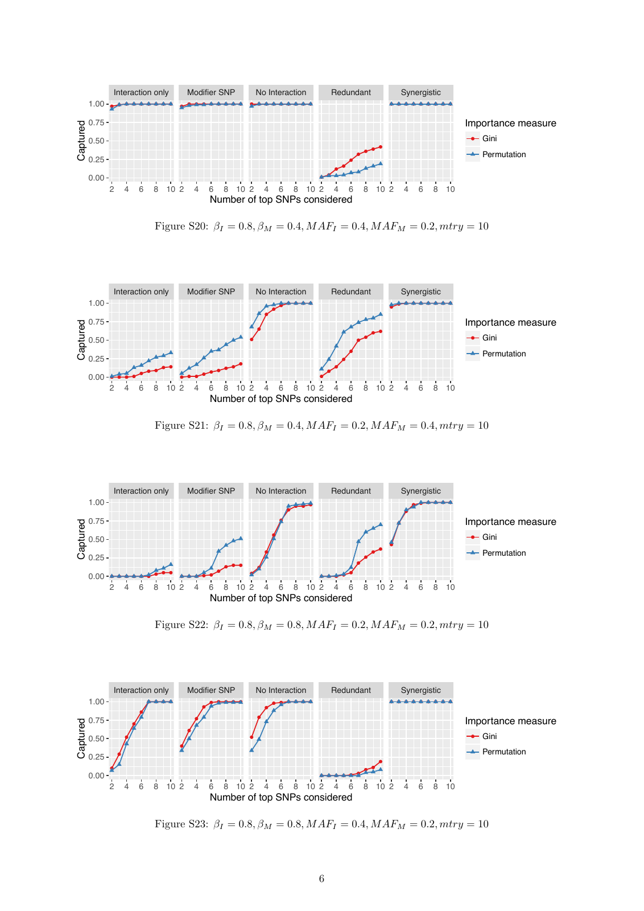

### S20

**Legenda original:** βI = 0.8,β M = 0.4,MAF I = 0.4,MAF M = 0.2,mtry = 10

**O que mede e por quê:** Captura dos dois SNPs designados por importância individual. x=k entre 2 e 10; y=fração de realizações com ambos no topo entre 100 SNPs. Não é identificação do par.

**Código dos painéis:** [01_main_simulation/02_plot_main.R](https://github.com/danifilho/Mestrado_ICMC/blob/edcbf4cc450583364e69cbe89a738596c7c2762f/documentacao/piloto7-wright2016/fontes/codigo_autores/replication/01_main_simulation/02_plot_main.R). Os scripts produzem os painéis; a paginação editorial do PDF não é atribuída a eles sem evidência.

**Resumo numérico publicado desta figura:** média sobre os cinco modelos e os cortes disponíveis — Gini: 0.844; Permutation: 0.812. Esse resumo é auxiliar de navegação; não mistura as medidas individuais com as de pares nem substitui a leitura por painel.

**Nossa reprodução desta figura:** 90 pontos comparados; 100.0% dentro de ±0,10; diferença absoluta média 0.0049. Configuração: quatro medidas originais preservadas e JVIMP 1.6.1. [Tabela ponto a ponto](https://github.com/danifilho/Mestrado_ICMC/blob/edcbf4cc450583364e69cbe89a738596c7c2762f/documentacao/piloto7-wright2016/resultados/tabelas/etapa0_completo_etapa0_comp_rfsrc341_jvimp_etapa0_comp_rfsrc161_pontos.csv).

### S21

**Legenda original:** βI = 0.8,β M = 0.4,MAF I = 0.2,MAF M = 0.4,mtry = 10

**O que mede e por quê:** Captura dos dois SNPs designados por importância individual. x=k entre 2 e 10; y=fração de realizações com ambos no topo entre 100 SNPs. Não é identificação do par.

**Código dos painéis:** [01_main_simulation/02_plot_main.R](https://github.com/danifilho/Mestrado_ICMC/blob/edcbf4cc450583364e69cbe89a738596c7c2762f/documentacao/piloto7-wright2016/fontes/codigo_autores/replication/01_main_simulation/02_plot_main.R). Os scripts produzem os painéis; a paginação editorial do PDF não é atribuída a eles sem evidência.

**Resumo numérico publicado desta figura:** média sobre os cinco modelos e os cortes disponíveis — Gini: 0.468; Permutation: 0.600. Esse resumo é auxiliar de navegação; não mistura as medidas individuais com as de pares nem substitui a leitura por painel.

**Nossa reprodução desta figura:** 90 pontos comparados; 92.2% dentro de ±0,10; diferença absoluta média 0.0319. Configuração: quatro medidas originais preservadas e JVIMP 1.6.1. [Tabela ponto a ponto](https://github.com/danifilho/Mestrado_ICMC/blob/edcbf4cc450583364e69cbe89a738596c7c2762f/documentacao/piloto7-wright2016/resultados/tabelas/etapa0_completo_etapa0_comp_rfsrc341_jvimp_etapa0_comp_rfsrc161_pontos.csv).

### S22

**Legenda original:** βI = 0.8,β M = 0.8,MAF I = 0.2,MAF M = 0.2,mtry = 10

**O que mede e por quê:** Captura dos dois SNPs designados por importância individual. x=k entre 2 e 10; y=fração de realizações com ambos no topo entre 100 SNPs. Não é identificação do par.

**Código dos painéis:** [01_main_simulation/02_plot_main.R](https://github.com/danifilho/Mestrado_ICMC/blob/edcbf4cc450583364e69cbe89a738596c7c2762f/documentacao/piloto7-wright2016/fontes/codigo_autores/replication/01_main_simulation/02_plot_main.R). Os scripts produzem os painéis; a paginação editorial do PDF não é atribuída a eles sem evidência.

**Resumo numérico publicado desta figura:** média sobre os cinco modelos e os cortes disponíveis — Gini: 0.343; Permutation: 0.409. Esse resumo é auxiliar de navegação; não mistura as medidas individuais com as de pares nem substitui a leitura por painel.

**Nossa reprodução desta figura:** 90 pontos comparados; 95.6% dentro de ±0,10; diferença absoluta média 0.0234. Configuração: quatro medidas originais preservadas e JVIMP 1.6.1. [Tabela ponto a ponto](https://github.com/danifilho/Mestrado_ICMC/blob/edcbf4cc450583364e69cbe89a738596c7c2762f/documentacao/piloto7-wright2016/resultados/tabelas/etapa0_completo_etapa0_comp_rfsrc341_jvimp_etapa0_comp_rfsrc161_pontos.csv).

### S23

**Legenda original:** βI = 0.8,β M = 0.8,MAF I = 0.4,MAF M = 0.2,mtry = 10

**O que mede e por quê:** Captura dos dois SNPs designados por importância individual. x=k entre 2 e 10; y=fração de realizações com ambos no topo entre 100 SNPs. Não é identificação do par.

**Código dos painéis:** [01_main_simulation/02_plot_main.R](https://github.com/danifilho/Mestrado_ICMC/blob/edcbf4cc450583364e69cbe89a738596c7c2762f/documentacao/piloto7-wright2016/fontes/codigo_autores/replication/01_main_simulation/02_plot_main.R). Os scripts produzem os painéis; a paginação editorial do PDF não é atribuída a eles sem evidência.

**Resumo numérico publicado desta figura:** média sobre os cinco modelos e os cortes disponíveis — Gini: 0.706; Permutation: 0.663. Esse resumo é auxiliar de navegação; não mistura as medidas individuais com as de pares nem substitui a leitura por painel.

**Nossa reprodução desta figura:** 90 pontos comparados; 96.7% dentro de ±0,10; diferença absoluta média 0.0226. Configuração: quatro medidas originais preservadas e JVIMP 1.6.1. [Tabela ponto a ponto](https://github.com/danifilho/Mestrado_ICMC/blob/edcbf4cc450583364e69cbe89a738596c7c2762f/documentacao/piloto7-wright2016/resultados/tabelas/etapa0_completo_etapa0_comp_rfsrc341_jvimp_etapa0_comp_rfsrc161_pontos.csv).

## Página física 7: S24

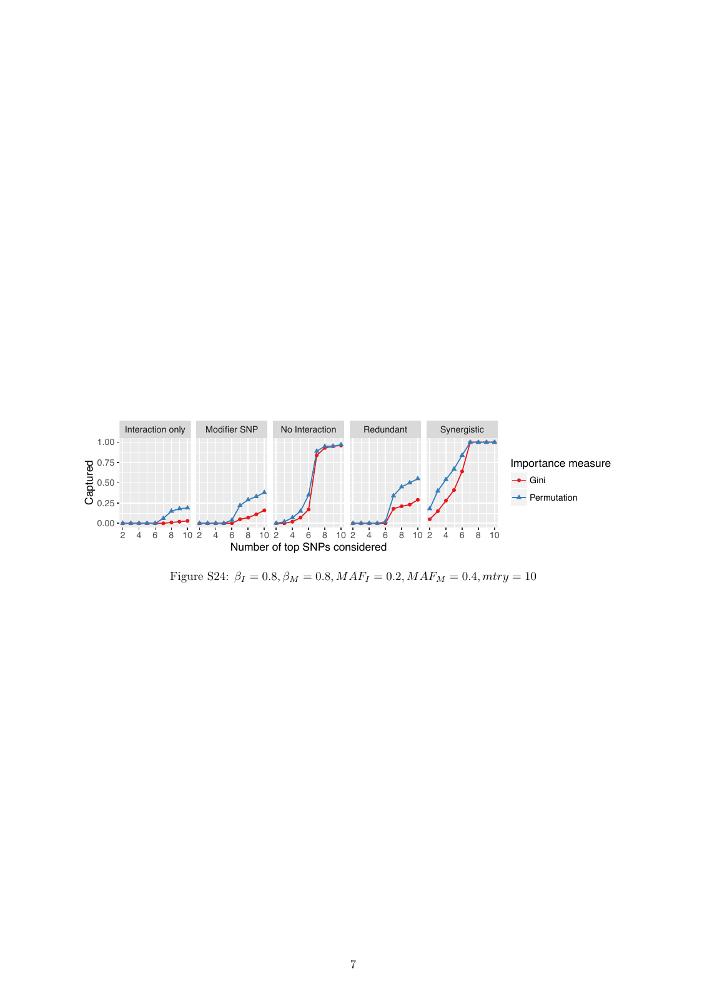

### S24

**Legenda original:** βI = 0.8,β M = 0.8,MAF I = 0.2,MAF M = 0.4,mtry = 10

**O que mede e por quê:** Captura dos dois SNPs designados por importância individual. x=k entre 2 e 10; y=fração de realizações com ambos no topo entre 100 SNPs. Não é identificação do par.

**Código dos painéis:** [01_main_simulation/02_plot_main.R](https://github.com/danifilho/Mestrado_ICMC/blob/edcbf4cc450583364e69cbe89a738596c7c2762f/documentacao/piloto7-wright2016/fontes/codigo_autores/replication/01_main_simulation/02_plot_main.R). Os scripts produzem os painéis; a paginação editorial do PDF não é atribuída a eles sem evidência.

**Resumo numérico publicado desta figura:** média sobre os cinco modelos e os cortes disponíveis — Gini: 0.241; Permutation: 0.326. Esse resumo é auxiliar de navegação; não mistura as medidas individuais com as de pares nem substitui a leitura por painel.

**Nossa reprodução desta figura:** 90 pontos comparados; 98.9% dentro de ±0,10; diferença absoluta média 0.0173. Configuração: quatro medidas originais preservadas e JVIMP 1.6.1. [Tabela ponto a ponto](https://github.com/danifilho/Mestrado_ICMC/blob/edcbf4cc450583364e69cbe89a738596c7c2762f/documentacao/piloto7-wright2016/resultados/tabelas/etapa0_completo_etapa0_comp_rfsrc341_jvimp_etapa0_comp_rfsrc161_pontos.csv).

## Página física 8: S25, S26, S27

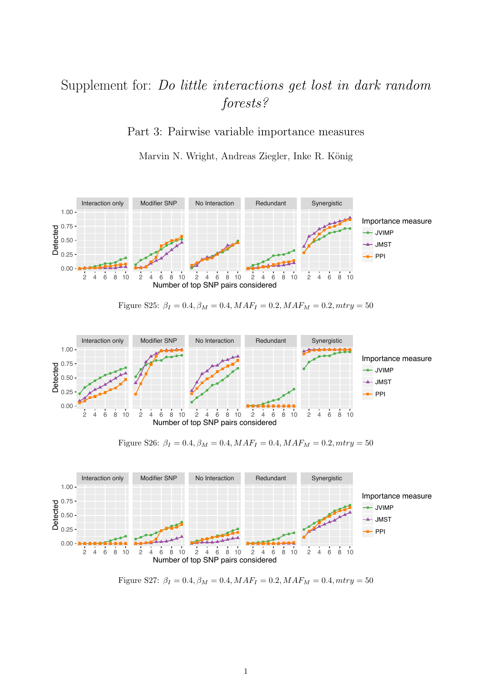

### S25

**Legenda original:** βI = 0.4,β M = 0.4,MAF I = 0.2,MAF M = 0.2,mtry = 50

**O que mede e por quê:** Recuperação do par designado entre 21 pares. x=k de 1 a 10; y=fração de realizações com posto do par≤k. No painel Sem interação, trata-se de prioridade sem termo AB no logit, não descoberta correta de um termo.

**Código dos painéis:** [01_main_simulation/02_plot_main.R](https://github.com/danifilho/Mestrado_ICMC/blob/edcbf4cc450583364e69cbe89a738596c7c2762f/documentacao/piloto7-wright2016/fontes/codigo_autores/replication/01_main_simulation/02_plot_main.R). Os scripts produzem os painéis; a paginação editorial do PDF não é atribuída a eles sem evidência.

**Resumo numérico publicado desta figura:** média sobre os cinco modelos e os cortes disponíveis — JVIMP: 0.275; JMST: 0.245; PPI: 0.254. Esse resumo é auxiliar de navegação; não mistura as medidas individuais com as de pares nem substitui a leitura por painel.

**Nossa reprodução desta figura:** 150 pontos comparados; 97.3% dentro de ±0,10; diferença absoluta média 0.0317. Configuração: quatro medidas originais preservadas e JVIMP 1.6.1. [Tabela ponto a ponto](https://github.com/danifilho/Mestrado_ICMC/blob/edcbf4cc450583364e69cbe89a738596c7c2762f/documentacao/piloto7-wright2016/resultados/tabelas/etapa0_completo_etapa0_comp_rfsrc341_jvimp_etapa0_comp_rfsrc161_pontos.csv).

### S26

**Legenda original:** βI = 0.4,β M = 0.4,MAF I = 0.4,MAF M = 0.2,mtry = 50

**O que mede e por quê:** Recuperação do par designado entre 21 pares. x=k de 1 a 10; y=fração de realizações com posto do par≤k. No painel Sem interação, trata-se de prioridade sem termo AB no logit, não descoberta correta de um termo.

**Código dos painéis:** [01_main_simulation/02_plot_main.R](https://github.com/danifilho/Mestrado_ICMC/blob/edcbf4cc450583364e69cbe89a738596c7c2762f/documentacao/piloto7-wright2016/fontes/codigo_autores/replication/01_main_simulation/02_plot_main.R). Os scripts produzem os painéis; a paginação editorial do PDF não é atribuída a eles sem evidência.

**Resumo numérico publicado desta figura:** média sobre os cinco modelos e os cortes disponíveis — JVIMP: 0.527; JMST: 0.574; PPI: 0.509. Esse resumo é auxiliar de navegação; não mistura as medidas individuais com as de pares nem substitui a leitura por painel.

**Nossa reprodução desta figura:** 150 pontos comparados; 92.0% dentro de ±0,10; diferença absoluta média 0.0359. Configuração: quatro medidas originais preservadas e JVIMP 1.6.1. [Tabela ponto a ponto](https://github.com/danifilho/Mestrado_ICMC/blob/edcbf4cc450583364e69cbe89a738596c7c2762f/documentacao/piloto7-wright2016/resultados/tabelas/etapa0_completo_etapa0_comp_rfsrc341_jvimp_etapa0_comp_rfsrc161_pontos.csv).

### S27

**Legenda original:** βI = 0.4,β M = 0.4,MAF I = 0.2,MAF M = 0.4,mtry = 50

**O que mede e por quê:** Recuperação do par designado entre 21 pares. x=k de 1 a 10; y=fração de realizações com posto do par≤k. No painel Sem interação, trata-se de prioridade sem termo AB no logit, não descoberta correta de um termo.

**Código dos painéis:** [01_main_simulation/02_plot_main.R](https://github.com/danifilho/Mestrado_ICMC/blob/edcbf4cc450583364e69cbe89a738596c7c2762f/documentacao/piloto7-wright2016/fontes/codigo_autores/replication/01_main_simulation/02_plot_main.R). Os scripts produzem os painéis; a paginação editorial do PDF não é atribuída a eles sem evidência.

**Resumo numérico publicado desta figura:** média sobre os cinco modelos e os cortes disponíveis — JVIMP: 0.189; JMST: 0.087; PPI: 0.138. Esse resumo é auxiliar de navegação; não mistura as medidas individuais com as de pares nem substitui a leitura por painel.

**Nossa reprodução desta figura:** 150 pontos comparados; 98.0% dentro de ±0,10; diferença absoluta média 0.0192. Configuração: quatro medidas originais preservadas e JVIMP 1.6.1. [Tabela ponto a ponto](https://github.com/danifilho/Mestrado_ICMC/blob/edcbf4cc450583364e69cbe89a738596c7c2762f/documentacao/piloto7-wright2016/resultados/tabelas/etapa0_completo_etapa0_comp_rfsrc341_jvimp_etapa0_comp_rfsrc161_pontos.csv).

## Página física 9: S28, S29, S30, S31

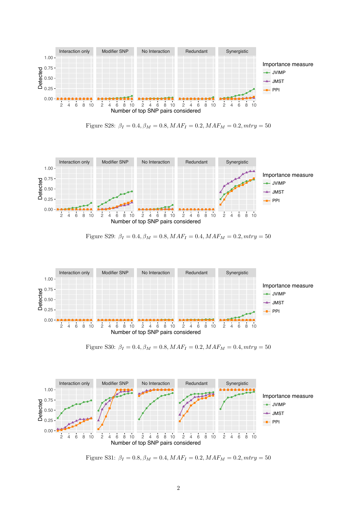

### S28

**Legenda original:** βI = 0.4,β M = 0.8,MAF I = 0.2,MAF M = 0.2,mtry = 50

**O que mede e por quê:** Recuperação do par designado entre 21 pares. x=k de 1 a 10; y=fração de realizações com posto do par≤k. No painel Sem interação, trata-se de prioridade sem termo AB no logit, não descoberta correta de um termo.

**Código dos painéis:** [01_main_simulation/02_plot_main.R](https://github.com/danifilho/Mestrado_ICMC/blob/edcbf4cc450583364e69cbe89a738596c7c2762f/documentacao/piloto7-wright2016/fontes/codigo_autores/replication/01_main_simulation/02_plot_main.R). Os scripts produzem os painéis; a paginação editorial do PDF não é atribuída a eles sem evidência.

**Resumo numérico publicado desta figura:** média sobre os cinco modelos e os cortes disponíveis — JVIMP: 0.026; JMST: 0.001; PPI: 0.002. Esse resumo é auxiliar de navegação; não mistura as medidas individuais com as de pares nem substitui a leitura por painel.

**Nossa reprodução desta figura:** 150 pontos comparados; 100.0% dentro de ±0,10; diferença absoluta média 0.0039. Configuração: quatro medidas originais preservadas e JVIMP 1.6.1. [Tabela ponto a ponto](https://github.com/danifilho/Mestrado_ICMC/blob/edcbf4cc450583364e69cbe89a738596c7c2762f/documentacao/piloto7-wright2016/resultados/tabelas/etapa0_completo_etapa0_comp_rfsrc341_jvimp_etapa0_comp_rfsrc161_pontos.csv).

### S29

**Legenda original:** βI = 0.4,β M = 0.8,MAF I = 0.4,MAF M = 0.2,mtry = 50

**O que mede e por quê:** Recuperação do par designado entre 21 pares. x=k de 1 a 10; y=fração de realizações com posto do par≤k. No painel Sem interação, trata-se de prioridade sem termo AB no logit, não descoberta correta de um termo.

**Código dos painéis:** [01_main_simulation/02_plot_main.R](https://github.com/danifilho/Mestrado_ICMC/blob/edcbf4cc450583364e69cbe89a738596c7c2762f/documentacao/piloto7-wright2016/fontes/codigo_autores/replication/01_main_simulation/02_plot_main.R). Os scripts produzem os painéis; a paginação editorial do PDF não é atribuída a eles sem evidência.

**Resumo numérico publicado desta figura:** média sobre os cinco modelos e os cortes disponíveis — JVIMP: 0.181; JMST: 0.161; PPI: 0.115. Esse resumo é auxiliar de navegação; não mistura as medidas individuais com as de pares nem substitui a leitura por painel.

**Nossa reprodução desta figura:** 150 pontos comparados; 100.0% dentro de ±0,10; diferença absoluta média 0.0205. Configuração: quatro medidas originais preservadas e JVIMP 1.6.1. [Tabela ponto a ponto](https://github.com/danifilho/Mestrado_ICMC/blob/edcbf4cc450583364e69cbe89a738596c7c2762f/documentacao/piloto7-wright2016/resultados/tabelas/etapa0_completo_etapa0_comp_rfsrc341_jvimp_etapa0_comp_rfsrc161_pontos.csv).

### S30

**Legenda original:** βI = 0.4,β M = 0.8,MAF I = 0.2,MAF M = 0.4,mtry = 50

**O que mede e por quê:** Recuperação do par designado entre 21 pares. x=k de 1 a 10; y=fração de realizações com posto do par≤k. No painel Sem interação, trata-se de prioridade sem termo AB no logit, não descoberta correta de um termo.

**Código dos painéis:** [01_main_simulation/02_plot_main.R](https://github.com/danifilho/Mestrado_ICMC/blob/edcbf4cc450583364e69cbe89a738596c7c2762f/documentacao/piloto7-wright2016/fontes/codigo_autores/replication/01_main_simulation/02_plot_main.R). Os scripts produzem os painéis; a paginação editorial do PDF não é atribuída a eles sem evidência.

**Resumo numérico publicado desta figura:** média sobre os cinco modelos e os cortes disponíveis — JVIMP: 0.019; JMST: 0.000; PPI: 0.000. Esse resumo é auxiliar de navegação; não mistura as medidas individuais com as de pares nem substitui a leitura por painel.

**Nossa reprodução desta figura:** 150 pontos comparados; 100.0% dentro de ±0,10; diferença absoluta média 0.0032. Configuração: quatro medidas originais preservadas e JVIMP 1.6.1. [Tabela ponto a ponto](https://github.com/danifilho/Mestrado_ICMC/blob/edcbf4cc450583364e69cbe89a738596c7c2762f/documentacao/piloto7-wright2016/resultados/tabelas/etapa0_completo_etapa0_comp_rfsrc341_jvimp_etapa0_comp_rfsrc161_pontos.csv).

### S31

**Legenda original:** βI = 0.8,β M = 0.4,MAF I = 0.2,MAF M = 0.2,mtry = 50

**O que mede e por quê:** Recuperação do par designado entre 21 pares. x=k de 1 a 10; y=fração de realizações com posto do par≤k. No painel Sem interação, trata-se de prioridade sem termo AB no logit, não descoberta correta de um termo.

**Código dos painéis:** [01_main_simulation/02_plot_main.R](https://github.com/danifilho/Mestrado_ICMC/blob/edcbf4cc450583364e69cbe89a738596c7c2762f/documentacao/piloto7-wright2016/fontes/codigo_autores/replication/01_main_simulation/02_plot_main.R). Os scripts produzem os painéis; a paginação editorial do PDF não é atribuída a eles sem evidência.

**Resumo numérico publicado desta figura:** média sobre os cinco modelos e os cortes disponíveis — JVIMP: 0.755; JMST: 0.740; PPI: 0.687. Esse resumo é auxiliar de navegação; não mistura as medidas individuais com as de pares nem substitui a leitura por painel.

**Nossa reprodução desta figura:** 150 pontos comparados; 98.0% dentro de ±0,10; diferença absoluta média 0.0255. Configuração: quatro medidas originais preservadas e JVIMP 1.6.1. [Tabela ponto a ponto](https://github.com/danifilho/Mestrado_ICMC/blob/edcbf4cc450583364e69cbe89a738596c7c2762f/documentacao/piloto7-wright2016/resultados/tabelas/etapa0_completo_etapa0_comp_rfsrc341_jvimp_etapa0_comp_rfsrc161_pontos.csv).

## Página física 10: S32, S33, S34, S35

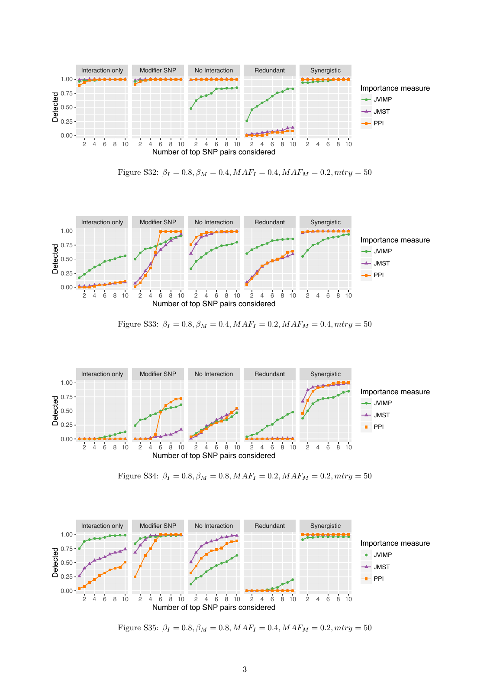

### S32

**Legenda original:** βI = 0.8,β M = 0.4,MAF I = 0.4,MAF M = 0.2,mtry = 50

**O que mede e por quê:** Recuperação do par designado entre 21 pares. x=k de 1 a 10; y=fração de realizações com posto do par≤k. No painel Sem interação, trata-se de prioridade sem termo AB no logit, não descoberta correta de um termo.

**Código dos painéis:** [01_main_simulation/02_plot_main.R](https://github.com/danifilho/Mestrado_ICMC/blob/edcbf4cc450583364e69cbe89a738596c7c2762f/documentacao/piloto7-wright2016/fontes/codigo_autores/replication/01_main_simulation/02_plot_main.R). Os scripts produzem os painéis; a paginação editorial do PDF não é atribuída a eles sem evidência.

**Resumo numérico publicado desta figura:** média sobre os cinco modelos e os cortes disponíveis — JVIMP: 0.864; JMST: 0.813; PPI: 0.800. Esse resumo é auxiliar de navegação; não mistura as medidas individuais com as de pares nem substitui a leitura por painel.

**Nossa reprodução desta figura:** 150 pontos comparados; 100.0% dentro de ±0,10; diferença absoluta média 0.0095. Configuração: quatro medidas originais preservadas e JVIMP 1.6.1. [Tabela ponto a ponto](https://github.com/danifilho/Mestrado_ICMC/blob/edcbf4cc450583364e69cbe89a738596c7c2762f/documentacao/piloto7-wright2016/resultados/tabelas/etapa0_completo_etapa0_comp_rfsrc341_jvimp_etapa0_comp_rfsrc161_pontos.csv).

### S33

**Legenda original:** βI = 0.8,β M = 0.4,MAF I = 0.2,MAF M = 0.4,mtry = 50

**O que mede e por quê:** Recuperação do par designado entre 21 pares. x=k de 1 a 10; y=fração de realizações com posto do par≤k. No painel Sem interação, trata-se de prioridade sem termo AB no logit, não descoberta correta de um termo.

**Código dos painéis:** [01_main_simulation/02_plot_main.R](https://github.com/danifilho/Mestrado_ICMC/blob/edcbf4cc450583364e69cbe89a738596c7c2762f/documentacao/piloto7-wright2016/fontes/codigo_autores/replication/01_main_simulation/02_plot_main.R). Os scripts produzem os painéis; a paginação editorial do PDF não é atribuída a eles sem evidência.

**Resumo numérico publicado desta figura:** média sobre os cinco modelos e os cortes disponíveis — JVIMP: 0.674; JMST: 0.581; PPI: 0.603. Esse resumo é auxiliar de navegação; não mistura as medidas individuais com as de pares nem substitui a leitura por painel.

**Nossa reprodução desta figura:** 150 pontos comparados; 92.7% dentro de ±0,10; diferença absoluta média 0.0294. Configuração: quatro medidas originais preservadas e JVIMP 1.6.1. [Tabela ponto a ponto](https://github.com/danifilho/Mestrado_ICMC/blob/edcbf4cc450583364e69cbe89a738596c7c2762f/documentacao/piloto7-wright2016/resultados/tabelas/etapa0_completo_etapa0_comp_rfsrc341_jvimp_etapa0_comp_rfsrc161_pontos.csv).

### S34

**Legenda original:** βI = 0.8,β M = 0.8,MAF I = 0.2,MAF M = 0.2,mtry = 50

**O que mede e por quê:** Recuperação do par designado entre 21 pares. x=k de 1 a 10; y=fração de realizações com posto do par≤k. No painel Sem interação, trata-se de prioridade sem termo AB no logit, não descoberta correta de um termo.

**Código dos painéis:** [01_main_simulation/02_plot_main.R](https://github.com/danifilho/Mestrado_ICMC/blob/edcbf4cc450583364e69cbe89a738596c7c2762f/documentacao/piloto7-wright2016/fontes/codigo_autores/replication/01_main_simulation/02_plot_main.R). Os scripts produzem os painéis; a paginação editorial do PDF não é atribuída a eles sem evidência.

**Resumo numérico publicado desta figura:** média sobre os cinco modelos e os cortes disponíveis — JVIMP: 0.340; JMST: 0.252; PPI: 0.294. Esse resumo é auxiliar de navegação; não mistura as medidas individuais com as de pares nem substitui a leitura por painel.

**Nossa reprodução desta figura:** 150 pontos comparados; 98.0% dentro de ±0,10; diferença absoluta média 0.0263. Configuração: quatro medidas originais preservadas e JVIMP 1.6.1. [Tabela ponto a ponto](https://github.com/danifilho/Mestrado_ICMC/blob/edcbf4cc450583364e69cbe89a738596c7c2762f/documentacao/piloto7-wright2016/resultados/tabelas/etapa0_completo_etapa0_comp_rfsrc341_jvimp_etapa0_comp_rfsrc161_pontos.csv).

### S35

**Legenda original:** βI = 0.8,β M = 0.8,MAF I = 0.4,MAF M = 0.2,mtry = 50

**O que mede e por quê:** Recuperação do par designado entre 21 pares. x=k de 1 a 10; y=fração de realizações com posto do par≤k. No painel Sem interação, trata-se de prioridade sem termo AB no logit, não descoberta correta de um termo.

**Código dos painéis:** [01_main_simulation/02_plot_main.R](https://github.com/danifilho/Mestrado_ICMC/blob/edcbf4cc450583364e69cbe89a738596c7c2762f/documentacao/piloto7-wright2016/fontes/codigo_autores/replication/01_main_simulation/02_plot_main.R). Os scripts produzem os painéis; a paginação editorial do PDF não é atribuída a eles sem evidência.

**Resumo numérico publicado desta figura:** média sobre os cinco modelos e os cortes disponíveis — JVIMP: 0.659; JMST: 0.669; PPI: 0.550. Esse resumo é auxiliar de navegação; não mistura as medidas individuais com as de pares nem substitui a leitura por painel.

**Nossa reprodução desta figura:** 150 pontos comparados; 91.3% dentro de ±0,10; diferença absoluta média 0.0333. Configuração: quatro medidas originais preservadas e JVIMP 1.6.1. [Tabela ponto a ponto](https://github.com/danifilho/Mestrado_ICMC/blob/edcbf4cc450583364e69cbe89a738596c7c2762f/documentacao/piloto7-wright2016/resultados/tabelas/etapa0_completo_etapa0_comp_rfsrc341_jvimp_etapa0_comp_rfsrc161_pontos.csv).

## Página física 11: S36, S37, S38, S39

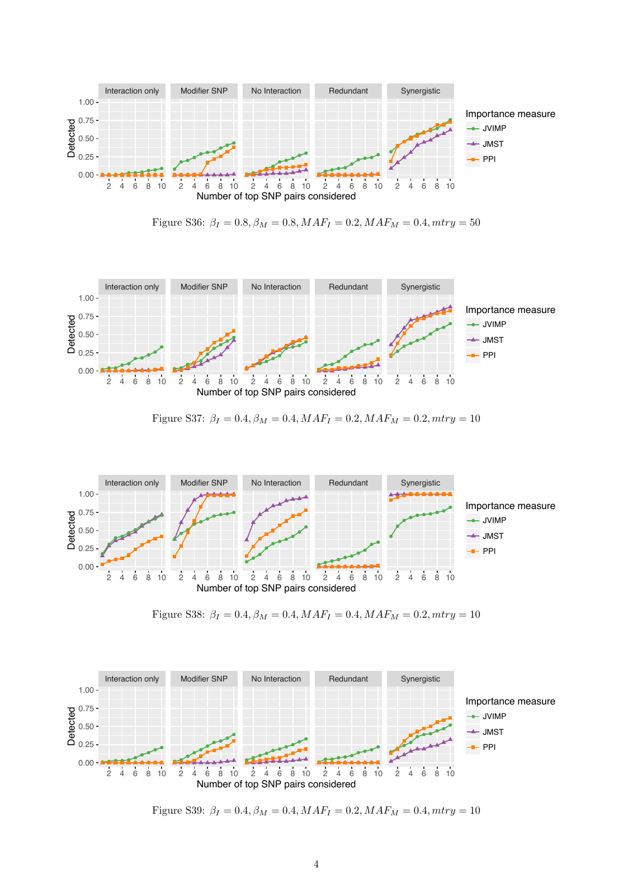

### S36

**Legenda original:** βI = 0.8,β M = 0.8,MAF I = 0.2,MAF M = 0.4,mtry = 50

**O que mede e por quê:** Recuperação do par designado entre 21 pares. x=k de 1 a 10; y=fração de realizações com posto do par≤k. No painel Sem interação, trata-se de prioridade sem termo AB no logit, não descoberta correta de um termo.

**Código dos painéis:** [01_main_simulation/02_plot_main.R](https://github.com/danifilho/Mestrado_ICMC/blob/edcbf4cc450583364e69cbe89a738596c7c2762f/documentacao/piloto7-wright2016/fontes/codigo_autores/replication/01_main_simulation/02_plot_main.R). Os scripts produzem os painéis; a paginação editorial do PDF não é atribuída a eles sem evidência.

**Resumo numérico publicado desta figura:** média sobre os cinco modelos e os cortes disponíveis — JVIMP: 0.233; JMST: 0.083; PPI: 0.151. Esse resumo é auxiliar de navegação; não mistura as medidas individuais com as de pares nem substitui a leitura por painel.

**Nossa reprodução desta figura:** 150 pontos comparados; 98.7% dentro de ±0,10; diferença absoluta média 0.0243. Configuração: quatro medidas originais preservadas e JVIMP 1.6.1. [Tabela ponto a ponto](https://github.com/danifilho/Mestrado_ICMC/blob/edcbf4cc450583364e69cbe89a738596c7c2762f/documentacao/piloto7-wright2016/resultados/tabelas/etapa0_completo_etapa0_comp_rfsrc341_jvimp_etapa0_comp_rfsrc161_pontos.csv).

### S37

**Legenda original:** βI = 0.4,β M = 0.4,MAF I = 0.2,MAF M = 0.2,mtry = 10

**O que mede e por quê:** Recuperação do par designado entre 21 pares. x=k de 1 a 10; y=fração de realizações com posto do par≤k. No painel Sem interação, trata-se de prioridade sem termo AB no logit, não descoberta correta de um termo.

**Código dos painéis:** [01_main_simulation/02_plot_main.R](https://github.com/danifilho/Mestrado_ICMC/blob/edcbf4cc450583364e69cbe89a738596c7c2762f/documentacao/piloto7-wright2016/fontes/codigo_autores/replication/01_main_simulation/02_plot_main.R). Os scripts produzem os painéis; a paginação editorial do PDF não é atribuída a eles sem evidência.

**Resumo numérico publicado desta figura:** média sobre os cinco modelos e os cortes disponíveis — JVIMP: 0.247; JMST: 0.226; PPI: 0.244. Esse resumo é auxiliar de navegação; não mistura as medidas individuais com as de pares nem substitui a leitura por painel.

**Nossa reprodução desta figura:** 150 pontos comparados; 95.3% dentro de ±0,10; diferença absoluta média 0.0313. Configuração: quatro medidas originais preservadas e JVIMP 1.6.1. [Tabela ponto a ponto](https://github.com/danifilho/Mestrado_ICMC/blob/edcbf4cc450583364e69cbe89a738596c7c2762f/documentacao/piloto7-wright2016/resultados/tabelas/etapa0_completo_etapa0_comp_rfsrc341_jvimp_etapa0_comp_rfsrc161_pontos.csv).

### S38

**Legenda original:** βI = 0.4,β M = 0.4,MAF I = 0.4,MAF M = 0.2,mtry = 10

**O que mede e por quê:** Recuperação do par designado entre 21 pares. x=k de 1 a 10; y=fração de realizações com posto do par≤k. No painel Sem interação, trata-se de prioridade sem termo AB no logit, não descoberta correta de um termo.

**Código dos painéis:** [01_main_simulation/02_plot_main.R](https://github.com/danifilho/Mestrado_ICMC/blob/edcbf4cc450583364e69cbe89a738596c7c2762f/documentacao/piloto7-wright2016/fontes/codigo_autores/replication/01_main_simulation/02_plot_main.R). Os scripts produzem os painéis; a paginação editorial do PDF não é atribuída a eles sem evidência.

**Resumo numérico publicado desta figura:** média sobre os cinco modelos e os cortes disponíveis — JVIMP: 0.450; JMST: 0.626; PPI: 0.491. Esse resumo é auxiliar de navegação; não mistura as medidas individuais com as de pares nem substitui a leitura por painel.

**Nossa reprodução desta figura:** 150 pontos comparados; 95.3% dentro de ±0,10; diferença absoluta média 0.0335. Configuração: quatro medidas originais preservadas e JVIMP 1.6.1. [Tabela ponto a ponto](https://github.com/danifilho/Mestrado_ICMC/blob/edcbf4cc450583364e69cbe89a738596c7c2762f/documentacao/piloto7-wright2016/resultados/tabelas/etapa0_completo_etapa0_comp_rfsrc341_jvimp_etapa0_comp_rfsrc161_pontos.csv).

### S39

**Legenda original:** βI = 0.4,β M = 0.4,MAF I = 0.2,MAF M = 0.4,mtry = 10

**O que mede e por quê:** Recuperação do par designado entre 21 pares. x=k de 1 a 10; y=fração de realizações com posto do par≤k. No painel Sem interação, trata-se de prioridade sem termo AB no logit, não descoberta correta de um termo.

**Código dos painéis:** [01_main_simulation/02_plot_main.R](https://github.com/danifilho/Mestrado_ICMC/blob/edcbf4cc450583364e69cbe89a738596c7c2762f/documentacao/piloto7-wright2016/fontes/codigo_autores/replication/01_main_simulation/02_plot_main.R). Os scripts produzem os painéis; a paginação editorial do PDF não é atribuída a eles sem evidência.

**Resumo numérico publicado desta figura:** média sobre os cinco modelos e os cortes disponíveis — JVIMP: 0.183; JMST: 0.041; PPI: 0.124. Esse resumo é auxiliar de navegação; não mistura as medidas individuais com as de pares nem substitui a leitura por painel.

**Nossa reprodução desta figura:** 150 pontos comparados; 100.0% dentro de ±0,10; diferença absoluta média 0.0177. Configuração: quatro medidas originais preservadas e JVIMP 1.6.1. [Tabela ponto a ponto](https://github.com/danifilho/Mestrado_ICMC/blob/edcbf4cc450583364e69cbe89a738596c7c2762f/documentacao/piloto7-wright2016/resultados/tabelas/etapa0_completo_etapa0_comp_rfsrc341_jvimp_etapa0_comp_rfsrc161_pontos.csv).

## Página física 12: S40, S41, S42, S43

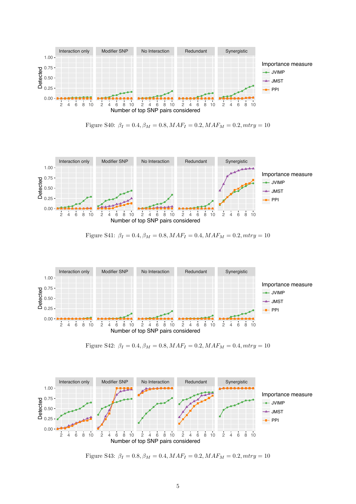

### S40

**Legenda original:** βI = 0.4,β M = 0.8,MAF I = 0.2,MAF M = 0.2,mtry = 10

**O que mede e por quê:** Recuperação do par designado entre 21 pares. x=k de 1 a 10; y=fração de realizações com posto do par≤k. No painel Sem interação, trata-se de prioridade sem termo AB no logit, não descoberta correta de um termo.

**Código dos painéis:** [01_main_simulation/02_plot_main.R](https://github.com/danifilho/Mestrado_ICMC/blob/edcbf4cc450583364e69cbe89a738596c7c2762f/documentacao/piloto7-wright2016/fontes/codigo_autores/replication/01_main_simulation/02_plot_main.R). Os scripts produzem os painéis; a paginação editorial do PDF não é atribuída a eles sem evidência.

**Resumo numérico publicado desta figura:** média sobre os cinco modelos e os cortes disponíveis — JVIMP: 0.068; JMST: 0.001; PPI: 0.001. Esse resumo é auxiliar de navegação; não mistura as medidas individuais com as de pares nem substitui a leitura por painel.

**Nossa reprodução desta figura:** 150 pontos comparados; 99.3% dentro de ±0,10; diferença absoluta média 0.0092. Configuração: quatro medidas originais preservadas e JVIMP 1.6.1. [Tabela ponto a ponto](https://github.com/danifilho/Mestrado_ICMC/blob/edcbf4cc450583364e69cbe89a738596c7c2762f/documentacao/piloto7-wright2016/resultados/tabelas/etapa0_completo_etapa0_comp_rfsrc341_jvimp_etapa0_comp_rfsrc161_pontos.csv).

### S41

**Legenda original:** βI = 0.4,β M = 0.8,MAF I = 0.4,MAF M = 0.2,mtry = 10

**O que mede e por quê:** Recuperação do par designado entre 21 pares. x=k de 1 a 10; y=fração de realizações com posto do par≤k. No painel Sem interação, trata-se de prioridade sem termo AB no logit, não descoberta correta de um termo.

**Código dos painéis:** [01_main_simulation/02_plot_main.R](https://github.com/danifilho/Mestrado_ICMC/blob/edcbf4cc450583364e69cbe89a738596c7c2762f/documentacao/piloto7-wright2016/fontes/codigo_autores/replication/01_main_simulation/02_plot_main.R). Os scripts produzem os painéis; a paginação editorial do PDF não é atribuída a eles sem evidência.

**Resumo numérico publicado desta figura:** média sobre os cinco modelos e os cortes disponíveis — JVIMP: 0.189; JMST: 0.193; PPI: 0.096. Esse resumo é auxiliar de navegação; não mistura as medidas individuais com as de pares nem substitui a leitura por painel.

**Nossa reprodução desta figura:** 150 pontos comparados; 94.7% dentro de ±0,10; diferença absoluta média 0.0307. Configuração: quatro medidas originais preservadas e JVIMP 1.6.1. [Tabela ponto a ponto](https://github.com/danifilho/Mestrado_ICMC/blob/edcbf4cc450583364e69cbe89a738596c7c2762f/documentacao/piloto7-wright2016/resultados/tabelas/etapa0_completo_etapa0_comp_rfsrc341_jvimp_etapa0_comp_rfsrc161_pontos.csv).

### S42

**Legenda original:** βI = 0.4,β M = 0.8,MAF I = 0.2,MAF M = 0.4,mtry = 10

**O que mede e por quê:** Recuperação do par designado entre 21 pares. x=k de 1 a 10; y=fração de realizações com posto do par≤k. No painel Sem interação, trata-se de prioridade sem termo AB no logit, não descoberta correta de um termo.

**Código dos painéis:** [01_main_simulation/02_plot_main.R](https://github.com/danifilho/Mestrado_ICMC/blob/edcbf4cc450583364e69cbe89a738596c7c2762f/documentacao/piloto7-wright2016/fontes/codigo_autores/replication/01_main_simulation/02_plot_main.R). Os scripts produzem os painéis; a paginação editorial do PDF não é atribuída a eles sem evidência.

**Resumo numérico publicado desta figura:** média sobre os cinco modelos e os cortes disponíveis — JVIMP: 0.040; JMST: 0.000; PPI: 0.000. Esse resumo é auxiliar de navegação; não mistura as medidas individuais com as de pares nem substitui a leitura por painel.

**Nossa reprodução desta figura:** 150 pontos comparados; 100.0% dentro de ±0,10; diferença absoluta média 0.0054. Configuração: quatro medidas originais preservadas e JVIMP 1.6.1. [Tabela ponto a ponto](https://github.com/danifilho/Mestrado_ICMC/blob/edcbf4cc450583364e69cbe89a738596c7c2762f/documentacao/piloto7-wright2016/resultados/tabelas/etapa0_completo_etapa0_comp_rfsrc341_jvimp_etapa0_comp_rfsrc161_pontos.csv).

### S43

**Legenda original:** βI = 0.8,β M = 0.4,MAF I = 0.2,MAF M = 0.2,mtry = 10

**O que mede e por quê:** Recuperação do par designado entre 21 pares. x=k de 1 a 10; y=fração de realizações com posto do par≤k. No painel Sem interação, trata-se de prioridade sem termo AB no logit, não descoberta correta de um termo.

**Código dos painéis:** [01_main_simulation/02_plot_main.R](https://github.com/danifilho/Mestrado_ICMC/blob/edcbf4cc450583364e69cbe89a738596c7c2762f/documentacao/piloto7-wright2016/fontes/codigo_autores/replication/01_main_simulation/02_plot_main.R). Os scripts produzem os painéis; a paginação editorial do PDF não é atribuída a eles sem evidência.

**Resumo numérico publicado desta figura:** média sobre os cinco modelos e os cortes disponíveis — JVIMP: 0.597; JMST: 0.679; PPI: 0.649. Esse resumo é auxiliar de navegação; não mistura as medidas individuais com as de pares nem substitui a leitura por painel.

**Nossa reprodução desta figura:** 150 pontos comparados; 94.0% dentro de ±0,10; diferença absoluta média 0.0323. Configuração: quatro medidas originais preservadas e JVIMP 1.6.1. [Tabela ponto a ponto](https://github.com/danifilho/Mestrado_ICMC/blob/edcbf4cc450583364e69cbe89a738596c7c2762f/documentacao/piloto7-wright2016/resultados/tabelas/etapa0_completo_etapa0_comp_rfsrc341_jvimp_etapa0_comp_rfsrc161_pontos.csv).

## Página física 13: S44, S45, S46, S47

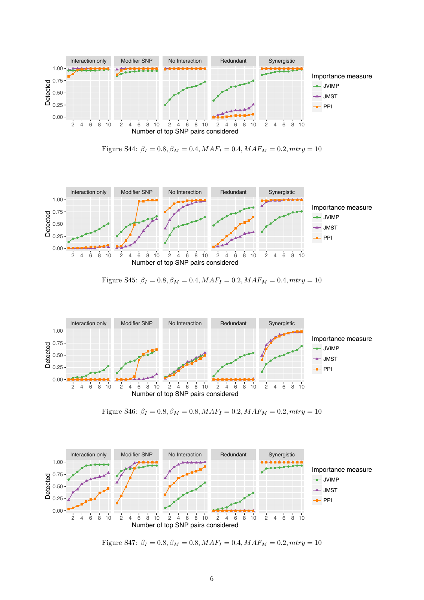

### S44

**Legenda original:** βI = 0.8,β M = 0.4,MAF I = 0.4,MAF M = 0.2,mtry = 10

**O que mede e por quê:** Recuperação do par designado entre 21 pares. x=k de 1 a 10; y=fração de realizações com posto do par≤k. No painel Sem interação, trata-se de prioridade sem termo AB no logit, não descoberta correta de um termo.

**Código dos painéis:** [01_main_simulation/02_plot_main.R](https://github.com/danifilho/Mestrado_ICMC/blob/edcbf4cc450583364e69cbe89a738596c7c2762f/documentacao/piloto7-wright2016/fontes/codigo_autores/replication/01_main_simulation/02_plot_main.R). Os scripts produzem os painéis; a paginação editorial do PDF não é atribuída a eles sem evidência.

**Resumo numérico publicado desta figura:** média sobre os cinco modelos e os cortes disponíveis — JVIMP: 0.791; JMST: 0.823; PPI: 0.794. Esse resumo é auxiliar de navegação; não mistura as medidas individuais com as de pares nem substitui a leitura por painel.

**Nossa reprodução desta figura:** 150 pontos comparados; 96.7% dentro de ±0,10; diferença absoluta média 0.0199. Configuração: quatro medidas originais preservadas e JVIMP 1.6.1. [Tabela ponto a ponto](https://github.com/danifilho/Mestrado_ICMC/blob/edcbf4cc450583364e69cbe89a738596c7c2762f/documentacao/piloto7-wright2016/resultados/tabelas/etapa0_completo_etapa0_comp_rfsrc341_jvimp_etapa0_comp_rfsrc161_pontos.csv).

### S45

**Legenda original:** βI = 0.8,β M = 0.4,MAF I = 0.2,MAF M = 0.4,mtry = 10

**O que mede e por quê:** Recuperação do par designado entre 21 pares. x=k de 1 a 10; y=fração de realizações com posto do par≤k. No painel Sem interação, trata-se de prioridade sem termo AB no logit, não descoberta correta de um termo.

**Código dos painéis:** [01_main_simulation/02_plot_main.R](https://github.com/danifilho/Mestrado_ICMC/blob/edcbf4cc450583364e69cbe89a738596c7c2762f/documentacao/piloto7-wright2016/fontes/codigo_autores/replication/01_main_simulation/02_plot_main.R). Os scripts produzem os painéis; a paginação editorial do PDF não é atribuída a eles sem evidência.

**Resumo numérico publicado desta figura:** média sobre os cinco modelos e os cortes disponíveis — JVIMP: 0.516; JMST: 0.442; PPI: 0.580. Esse resumo é auxiliar de navegação; não mistura as medidas individuais com as de pares nem substitui a leitura por painel.

**Nossa reprodução desta figura:** 150 pontos comparados; 94.0% dentro de ±0,10; diferença absoluta média 0.0369. Configuração: quatro medidas originais preservadas e JVIMP 1.6.1. [Tabela ponto a ponto](https://github.com/danifilho/Mestrado_ICMC/blob/edcbf4cc450583364e69cbe89a738596c7c2762f/documentacao/piloto7-wright2016/resultados/tabelas/etapa0_completo_etapa0_comp_rfsrc341_jvimp_etapa0_comp_rfsrc161_pontos.csv).

### S46

**Legenda original:** βI = 0.8,β M = 0.8,MAF I = 0.2,MAF M = 0.2,mtry = 10

**O que mede e por quê:** Recuperação do par designado entre 21 pares. x=k de 1 a 10; y=fração de realizações com posto do par≤k. No painel Sem interação, trata-se de prioridade sem termo AB no logit, não descoberta correta de um termo.

**Código dos painéis:** [01_main_simulation/02_plot_main.R](https://github.com/danifilho/Mestrado_ICMC/blob/edcbf4cc450583364e69cbe89a738596c7c2762f/documentacao/piloto7-wright2016/fontes/codigo_autores/replication/01_main_simulation/02_plot_main.R). Os scripts produzem os painéis; a paginação editorial do PDF não é atribuída a eles sem evidência.

**Resumo numérico publicado desta figura:** média sobre os cinco modelos e os cortes disponíveis — JVIMP: 0.330; JMST: 0.237; PPI: 0.275. Esse resumo é auxiliar de navegação; não mistura as medidas individuais com as de pares nem substitui a leitura por painel.

**Nossa reprodução desta figura:** 150 pontos comparados; 96.0% dentro de ±0,10; diferença absoluta média 0.0277. Configuração: quatro medidas originais preservadas e JVIMP 1.6.1. [Tabela ponto a ponto](https://github.com/danifilho/Mestrado_ICMC/blob/edcbf4cc450583364e69cbe89a738596c7c2762f/documentacao/piloto7-wright2016/resultados/tabelas/etapa0_completo_etapa0_comp_rfsrc341_jvimp_etapa0_comp_rfsrc161_pontos.csv).

### S47

**Legenda original:** βI = 0.8,β M = 0.8,MAF I = 0.4,MAF M = 0.2,mtry = 10

**O que mede e por quê:** Recuperação do par designado entre 21 pares. x=k de 1 a 10; y=fração de realizações com posto do par≤k. No painel Sem interação, trata-se de prioridade sem termo AB no logit, não descoberta correta de um termo.

**Código dos painéis:** [01_main_simulation/02_plot_main.R](https://github.com/danifilho/Mestrado_ICMC/blob/edcbf4cc450583364e69cbe89a738596c7c2762f/documentacao/piloto7-wright2016/fontes/codigo_autores/replication/01_main_simulation/02_plot_main.R). Os scripts produzem os painéis; a paginação editorial do PDF não é atribuída a eles sem evidência.

**Resumo numérico publicado desta figura:** média sobre os cinco modelos e os cortes disponíveis — JVIMP: 0.623; JMST: 0.681; PPI: 0.533. Esse resumo é auxiliar de navegação; não mistura as medidas individuais com as de pares nem substitui a leitura por painel.

**Nossa reprodução desta figura:** 150 pontos comparados; 85.3% dentro de ±0,10; diferença absoluta média 0.0403. Configuração: quatro medidas originais preservadas e JVIMP 1.6.1. [Tabela ponto a ponto](https://github.com/danifilho/Mestrado_ICMC/blob/edcbf4cc450583364e69cbe89a738596c7c2762f/documentacao/piloto7-wright2016/resultados/tabelas/etapa0_completo_etapa0_comp_rfsrc341_jvimp_etapa0_comp_rfsrc161_pontos.csv).

## Página física 14: S48

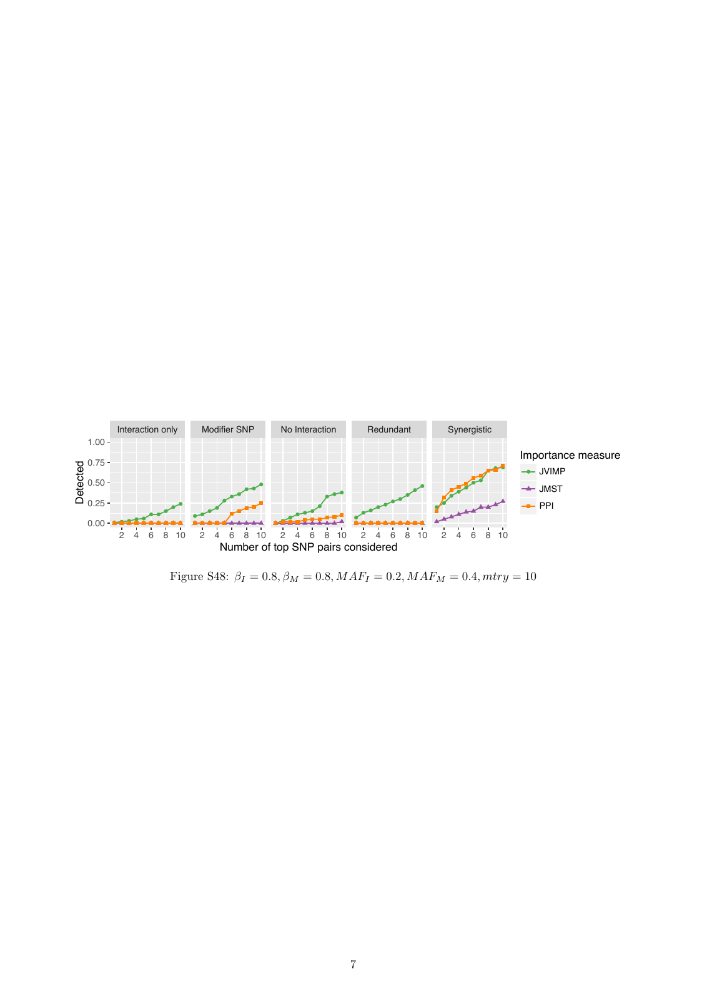

### S48

**Legenda original:** βI = 0.8,β M = 0.8,MAF I = 0.2,MAF M = 0.4,mtry = 10

**O que mede e por quê:** Recuperação do par designado entre 21 pares. x=k de 1 a 10; y=fração de realizações com posto do par≤k. No painel Sem interação, trata-se de prioridade sem termo AB no logit, não descoberta correta de um termo.

**Código dos painéis:** [01_main_simulation/02_plot_main.R](https://github.com/danifilho/Mestrado_ICMC/blob/edcbf4cc450583364e69cbe89a738596c7c2762f/documentacao/piloto7-wright2016/fontes/codigo_autores/replication/01_main_simulation/02_plot_main.R). Os scripts produzem os painéis; a paginação editorial do PDF não é atribuída a eles sem evidência.

**Resumo numérico publicado desta figura:** média sobre os cinco modelos e os cortes disponíveis — JVIMP: 0.257; JMST: 0.029; PPI: 0.127. Esse resumo é auxiliar de navegação; não mistura as medidas individuais com as de pares nem substitui a leitura por painel.

**Nossa reprodução desta figura:** 150 pontos comparados; 98.0% dentro de ±0,10; diferença absoluta média 0.0219. Configuração: quatro medidas originais preservadas e JVIMP 1.6.1. [Tabela ponto a ponto](https://github.com/danifilho/Mestrado_ICMC/blob/edcbf4cc450583364e69cbe89a738596c7c2762f/documentacao/piloto7-wright2016/resultados/tabelas/etapa0_completo_etapa0_comp_rfsrc341_jvimp_etapa0_comp_rfsrc161_pontos.csv).

## Página física 15: S49, S50, S51

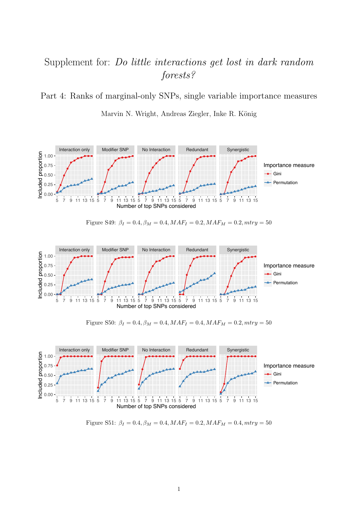

### S49

**Legenda original:** βI = 0.4,β M = 0.4,MAF I = 0.2,MAF M = 0.2,mtry = 50

**O que mede e por quê:** Prioridade das cinco variáveis de efeito individual. x=k de 5 a 15; o critério dos autores acompanha a inclusão de todas as cinco no topo. Serve para mostrar a concorrência marginal que pode preceder os SNPs designados; valores altos não validam detecção de interação.

**Código dos painéis:** [04_marginal_main/02_plot_marginal.R](https://github.com/danifilho/Mestrado_ICMC/blob/edcbf4cc450583364e69cbe89a738596c7c2762f/documentacao/piloto7-wright2016/fontes/codigo_autores/replication/04_marginal_main/02_plot_marginal.R). Os scripts produzem os painéis; a paginação editorial do PDF não é atribuída a eles sem evidência.

**Situação local:** figura dos autores disponibilizada e explicada; fora do gabarito numérico S1–S48 e sem reprodução local reivindicada.

### S50

**Legenda original:** βI = 0.4,β M = 0.4,MAF I = 0.4,MAF M = 0.2,mtry = 50

**O que mede e por quê:** Prioridade das cinco variáveis de efeito individual. x=k de 5 a 15; o critério dos autores acompanha a inclusão de todas as cinco no topo. Serve para mostrar a concorrência marginal que pode preceder os SNPs designados; valores altos não validam detecção de interação.

**Código dos painéis:** [04_marginal_main/02_plot_marginal.R](https://github.com/danifilho/Mestrado_ICMC/blob/edcbf4cc450583364e69cbe89a738596c7c2762f/documentacao/piloto7-wright2016/fontes/codigo_autores/replication/04_marginal_main/02_plot_marginal.R). Os scripts produzem os painéis; a paginação editorial do PDF não é atribuída a eles sem evidência.

**Situação local:** figura dos autores disponibilizada e explicada; fora do gabarito numérico S1–S48 e sem reprodução local reivindicada.

### S51

**Legenda original:** βI = 0.4,β M = 0.4,MAF I = 0.2,MAF M = 0.4,mtry = 50

**O que mede e por quê:** Prioridade das cinco variáveis de efeito individual. x=k de 5 a 15; o critério dos autores acompanha a inclusão de todas as cinco no topo. Serve para mostrar a concorrência marginal que pode preceder os SNPs designados; valores altos não validam detecção de interação.

**Código dos painéis:** [04_marginal_main/02_plot_marginal.R](https://github.com/danifilho/Mestrado_ICMC/blob/edcbf4cc450583364e69cbe89a738596c7c2762f/documentacao/piloto7-wright2016/fontes/codigo_autores/replication/04_marginal_main/02_plot_marginal.R). Os scripts produzem os painéis; a paginação editorial do PDF não é atribuída a eles sem evidência.

**Situação local:** figura dos autores disponibilizada e explicada; fora do gabarito numérico S1–S48 e sem reprodução local reivindicada.

## Página física 16: S52, S53, S54, S55

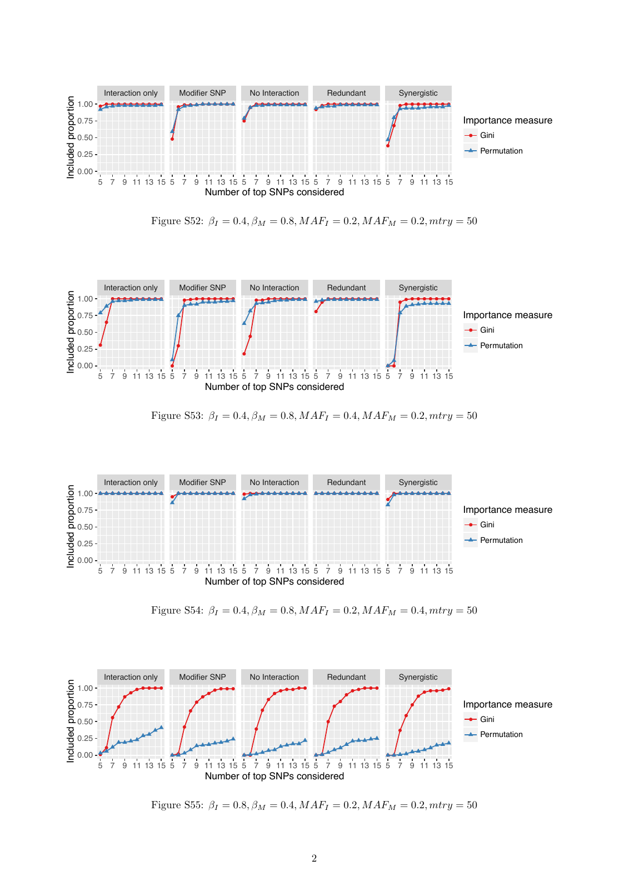

### S52

**Legenda original:** βI = 0.4,β M = 0.8,MAF I = 0.2,MAF M = 0.2,mtry = 50

**O que mede e por quê:** Prioridade das cinco variáveis de efeito individual. x=k de 5 a 15; o critério dos autores acompanha a inclusão de todas as cinco no topo. Serve para mostrar a concorrência marginal que pode preceder os SNPs designados; valores altos não validam detecção de interação.

**Código dos painéis:** [04_marginal_main/02_plot_marginal.R](https://github.com/danifilho/Mestrado_ICMC/blob/edcbf4cc450583364e69cbe89a738596c7c2762f/documentacao/piloto7-wright2016/fontes/codigo_autores/replication/04_marginal_main/02_plot_marginal.R). Os scripts produzem os painéis; a paginação editorial do PDF não é atribuída a eles sem evidência.

**Situação local:** figura dos autores disponibilizada e explicada; fora do gabarito numérico S1–S48 e sem reprodução local reivindicada.

### S53

**Legenda original:** βI = 0.4,β M = 0.8,MAF I = 0.4,MAF M = 0.2,mtry = 50

**O que mede e por quê:** Prioridade das cinco variáveis de efeito individual. x=k de 5 a 15; o critério dos autores acompanha a inclusão de todas as cinco no topo. Serve para mostrar a concorrência marginal que pode preceder os SNPs designados; valores altos não validam detecção de interação.

**Código dos painéis:** [04_marginal_main/02_plot_marginal.R](https://github.com/danifilho/Mestrado_ICMC/blob/edcbf4cc450583364e69cbe89a738596c7c2762f/documentacao/piloto7-wright2016/fontes/codigo_autores/replication/04_marginal_main/02_plot_marginal.R). Os scripts produzem os painéis; a paginação editorial do PDF não é atribuída a eles sem evidência.

**Situação local:** figura dos autores disponibilizada e explicada; fora do gabarito numérico S1–S48 e sem reprodução local reivindicada.

### S54

**Legenda original:** βI = 0.4,β M = 0.8,MAF I = 0.2,MAF M = 0.4,mtry = 50

**O que mede e por quê:** Prioridade das cinco variáveis de efeito individual. x=k de 5 a 15; o critério dos autores acompanha a inclusão de todas as cinco no topo. Serve para mostrar a concorrência marginal que pode preceder os SNPs designados; valores altos não validam detecção de interação.

**Código dos painéis:** [04_marginal_main/02_plot_marginal.R](https://github.com/danifilho/Mestrado_ICMC/blob/edcbf4cc450583364e69cbe89a738596c7c2762f/documentacao/piloto7-wright2016/fontes/codigo_autores/replication/04_marginal_main/02_plot_marginal.R). Os scripts produzem os painéis; a paginação editorial do PDF não é atribuída a eles sem evidência.

**Situação local:** figura dos autores disponibilizada e explicada; fora do gabarito numérico S1–S48 e sem reprodução local reivindicada.

### S55

**Legenda original:** βI = 0.8,β M = 0.4,MAF I = 0.2,MAF M = 0.2,mtry = 50

**O que mede e por quê:** Prioridade das cinco variáveis de efeito individual. x=k de 5 a 15; o critério dos autores acompanha a inclusão de todas as cinco no topo. Serve para mostrar a concorrência marginal que pode preceder os SNPs designados; valores altos não validam detecção de interação.

**Código dos painéis:** [04_marginal_main/02_plot_marginal.R](https://github.com/danifilho/Mestrado_ICMC/blob/edcbf4cc450583364e69cbe89a738596c7c2762f/documentacao/piloto7-wright2016/fontes/codigo_autores/replication/04_marginal_main/02_plot_marginal.R). Os scripts produzem os painéis; a paginação editorial do PDF não é atribuída a eles sem evidência.

**Situação local:** figura dos autores disponibilizada e explicada; fora do gabarito numérico S1–S48 e sem reprodução local reivindicada.

## Página física 17: S56, S57, S58, S59

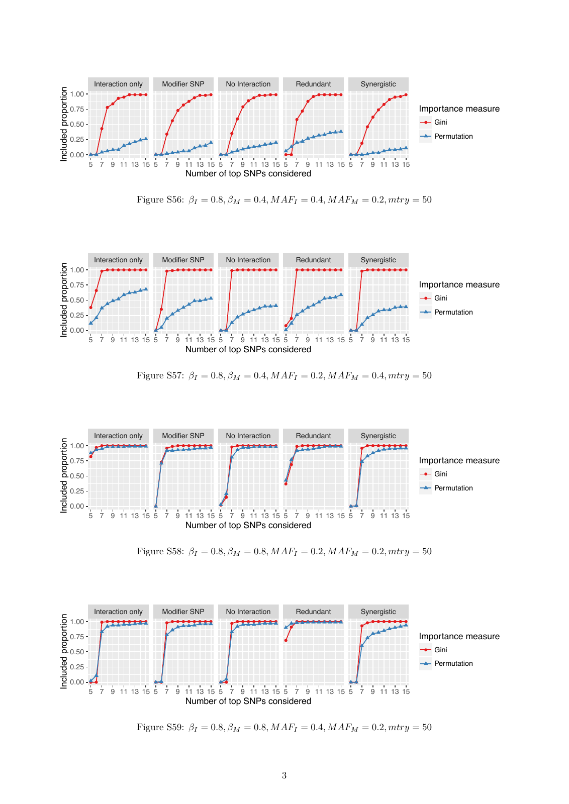

### S56

**Legenda original:** βI = 0.8,β M = 0.4,MAF I = 0.4,MAF M = 0.2,mtry = 50

**O que mede e por quê:** Prioridade das cinco variáveis de efeito individual. x=k de 5 a 15; o critério dos autores acompanha a inclusão de todas as cinco no topo. Serve para mostrar a concorrência marginal que pode preceder os SNPs designados; valores altos não validam detecção de interação.

**Código dos painéis:** [04_marginal_main/02_plot_marginal.R](https://github.com/danifilho/Mestrado_ICMC/blob/edcbf4cc450583364e69cbe89a738596c7c2762f/documentacao/piloto7-wright2016/fontes/codigo_autores/replication/04_marginal_main/02_plot_marginal.R). Os scripts produzem os painéis; a paginação editorial do PDF não é atribuída a eles sem evidência.

**Situação local:** figura dos autores disponibilizada e explicada; fora do gabarito numérico S1–S48 e sem reprodução local reivindicada.

### S57

**Legenda original:** βI = 0.8,β M = 0.4,MAF I = 0.2,MAF M = 0.4,mtry = 50

**O que mede e por quê:** Prioridade das cinco variáveis de efeito individual. x=k de 5 a 15; o critério dos autores acompanha a inclusão de todas as cinco no topo. Serve para mostrar a concorrência marginal que pode preceder os SNPs designados; valores altos não validam detecção de interação.

**Código dos painéis:** [04_marginal_main/02_plot_marginal.R](https://github.com/danifilho/Mestrado_ICMC/blob/edcbf4cc450583364e69cbe89a738596c7c2762f/documentacao/piloto7-wright2016/fontes/codigo_autores/replication/04_marginal_main/02_plot_marginal.R). Os scripts produzem os painéis; a paginação editorial do PDF não é atribuída a eles sem evidência.

**Situação local:** figura dos autores disponibilizada e explicada; fora do gabarito numérico S1–S48 e sem reprodução local reivindicada.

### S58

**Legenda original:** βI = 0.8,β M = 0.8,MAF I = 0.2,MAF M = 0.2,mtry = 50

**O que mede e por quê:** Prioridade das cinco variáveis de efeito individual. x=k de 5 a 15; o critério dos autores acompanha a inclusão de todas as cinco no topo. Serve para mostrar a concorrência marginal que pode preceder os SNPs designados; valores altos não validam detecção de interação.

**Código dos painéis:** [04_marginal_main/02_plot_marginal.R](https://github.com/danifilho/Mestrado_ICMC/blob/edcbf4cc450583364e69cbe89a738596c7c2762f/documentacao/piloto7-wright2016/fontes/codigo_autores/replication/04_marginal_main/02_plot_marginal.R). Os scripts produzem os painéis; a paginação editorial do PDF não é atribuída a eles sem evidência.

**Situação local:** figura dos autores disponibilizada e explicada; fora do gabarito numérico S1–S48 e sem reprodução local reivindicada.

### S59

**Legenda original:** βI = 0.8,β M = 0.8,MAF I = 0.4,MAF M = 0.2,mtry = 50

**O que mede e por quê:** Prioridade das cinco variáveis de efeito individual. x=k de 5 a 15; o critério dos autores acompanha a inclusão de todas as cinco no topo. Serve para mostrar a concorrência marginal que pode preceder os SNPs designados; valores altos não validam detecção de interação.

**Código dos painéis:** [04_marginal_main/02_plot_marginal.R](https://github.com/danifilho/Mestrado_ICMC/blob/edcbf4cc450583364e69cbe89a738596c7c2762f/documentacao/piloto7-wright2016/fontes/codigo_autores/replication/04_marginal_main/02_plot_marginal.R). Os scripts produzem os painéis; a paginação editorial do PDF não é atribuída a eles sem evidência.

**Situação local:** figura dos autores disponibilizada e explicada; fora do gabarito numérico S1–S48 e sem reprodução local reivindicada.

## Página física 18: S60, S61, S62, S63

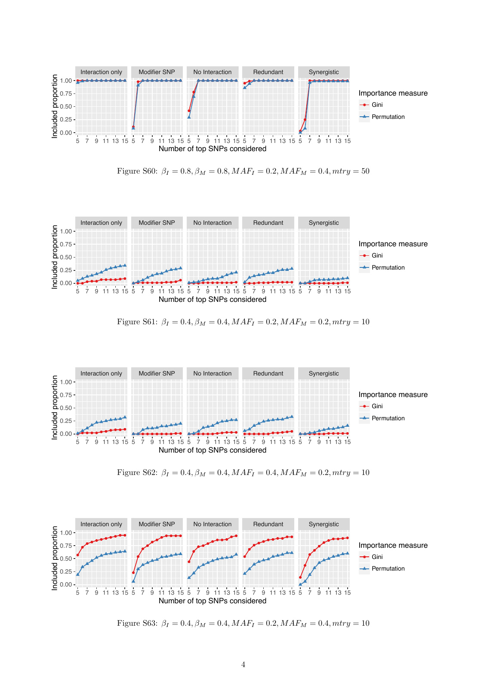

### S60

**Legenda original:** βI = 0.8,β M = 0.8,MAF I = 0.2,MAF M = 0.4,mtry = 50

**O que mede e por quê:** Prioridade das cinco variáveis de efeito individual. x=k de 5 a 15; o critério dos autores acompanha a inclusão de todas as cinco no topo. Serve para mostrar a concorrência marginal que pode preceder os SNPs designados; valores altos não validam detecção de interação.

**Código dos painéis:** [04_marginal_main/02_plot_marginal.R](https://github.com/danifilho/Mestrado_ICMC/blob/edcbf4cc450583364e69cbe89a738596c7c2762f/documentacao/piloto7-wright2016/fontes/codigo_autores/replication/04_marginal_main/02_plot_marginal.R). Os scripts produzem os painéis; a paginação editorial do PDF não é atribuída a eles sem evidência.

**Situação local:** figura dos autores disponibilizada e explicada; fora do gabarito numérico S1–S48 e sem reprodução local reivindicada.

### S61

**Legenda original:** βI = 0.4,β M = 0.4,MAF I = 0.2,MAF M = 0.2,mtry = 10

**O que mede e por quê:** Prioridade das cinco variáveis de efeito individual. x=k de 5 a 15; o critério dos autores acompanha a inclusão de todas as cinco no topo. Serve para mostrar a concorrência marginal que pode preceder os SNPs designados; valores altos não validam detecção de interação.

**Código dos painéis:** [04_marginal_main/02_plot_marginal.R](https://github.com/danifilho/Mestrado_ICMC/blob/edcbf4cc450583364e69cbe89a738596c7c2762f/documentacao/piloto7-wright2016/fontes/codigo_autores/replication/04_marginal_main/02_plot_marginal.R). Os scripts produzem os painéis; a paginação editorial do PDF não é atribuída a eles sem evidência.

**Situação local:** figura dos autores disponibilizada e explicada; fora do gabarito numérico S1–S48 e sem reprodução local reivindicada.

### S62

**Legenda original:** βI = 0.4,β M = 0.4,MAF I = 0.4,MAF M = 0.2,mtry = 10

**O que mede e por quê:** Prioridade das cinco variáveis de efeito individual. x=k de 5 a 15; o critério dos autores acompanha a inclusão de todas as cinco no topo. Serve para mostrar a concorrência marginal que pode preceder os SNPs designados; valores altos não validam detecção de interação.

**Código dos painéis:** [04_marginal_main/02_plot_marginal.R](https://github.com/danifilho/Mestrado_ICMC/blob/edcbf4cc450583364e69cbe89a738596c7c2762f/documentacao/piloto7-wright2016/fontes/codigo_autores/replication/04_marginal_main/02_plot_marginal.R). Os scripts produzem os painéis; a paginação editorial do PDF não é atribuída a eles sem evidência.

**Situação local:** figura dos autores disponibilizada e explicada; fora do gabarito numérico S1–S48 e sem reprodução local reivindicada.

### S63

**Legenda original:** βI = 0.4,β M = 0.4,MAF I = 0.2,MAF M = 0.4,mtry = 10

**O que mede e por quê:** Prioridade das cinco variáveis de efeito individual. x=k de 5 a 15; o critério dos autores acompanha a inclusão de todas as cinco no topo. Serve para mostrar a concorrência marginal que pode preceder os SNPs designados; valores altos não validam detecção de interação.

**Código dos painéis:** [04_marginal_main/02_plot_marginal.R](https://github.com/danifilho/Mestrado_ICMC/blob/edcbf4cc450583364e69cbe89a738596c7c2762f/documentacao/piloto7-wright2016/fontes/codigo_autores/replication/04_marginal_main/02_plot_marginal.R). Os scripts produzem os painéis; a paginação editorial do PDF não é atribuída a eles sem evidência.

**Situação local:** figura dos autores disponibilizada e explicada; fora do gabarito numérico S1–S48 e sem reprodução local reivindicada.

## Página física 19: S64, S65, S66, S67

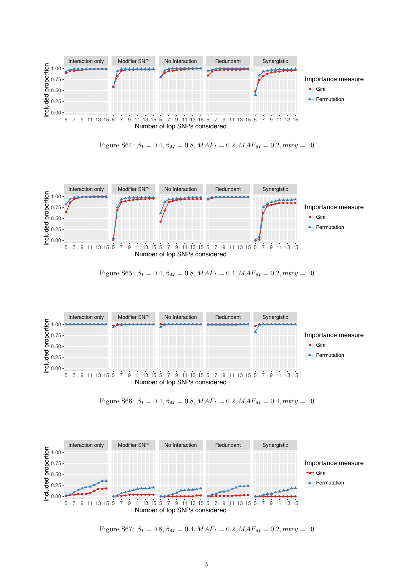

### S64

**Legenda original:** βI = 0.4,β M = 0.8,MAF I = 0.2,MAF M = 0.2,mtry = 10

**O que mede e por quê:** Prioridade das cinco variáveis de efeito individual. x=k de 5 a 15; o critério dos autores acompanha a inclusão de todas as cinco no topo. Serve para mostrar a concorrência marginal que pode preceder os SNPs designados; valores altos não validam detecção de interação.

**Código dos painéis:** [04_marginal_main/02_plot_marginal.R](https://github.com/danifilho/Mestrado_ICMC/blob/edcbf4cc450583364e69cbe89a738596c7c2762f/documentacao/piloto7-wright2016/fontes/codigo_autores/replication/04_marginal_main/02_plot_marginal.R). Os scripts produzem os painéis; a paginação editorial do PDF não é atribuída a eles sem evidência.

**Situação local:** figura dos autores disponibilizada e explicada; fora do gabarito numérico S1–S48 e sem reprodução local reivindicada.

### S65

**Legenda original:** βI = 0.4,β M = 0.8,MAF I = 0.4,MAF M = 0.2,mtry = 10

**O que mede e por quê:** Prioridade das cinco variáveis de efeito individual. x=k de 5 a 15; o critério dos autores acompanha a inclusão de todas as cinco no topo. Serve para mostrar a concorrência marginal que pode preceder os SNPs designados; valores altos não validam detecção de interação.

**Código dos painéis:** [04_marginal_main/02_plot_marginal.R](https://github.com/danifilho/Mestrado_ICMC/blob/edcbf4cc450583364e69cbe89a738596c7c2762f/documentacao/piloto7-wright2016/fontes/codigo_autores/replication/04_marginal_main/02_plot_marginal.R). Os scripts produzem os painéis; a paginação editorial do PDF não é atribuída a eles sem evidência.

**Situação local:** figura dos autores disponibilizada e explicada; fora do gabarito numérico S1–S48 e sem reprodução local reivindicada.

### S66

**Legenda original:** βI = 0.4,β M = 0.8,MAF I = 0.2,MAF M = 0.4,mtry = 10

**O que mede e por quê:** Prioridade das cinco variáveis de efeito individual. x=k de 5 a 15; o critério dos autores acompanha a inclusão de todas as cinco no topo. Serve para mostrar a concorrência marginal que pode preceder os SNPs designados; valores altos não validam detecção de interação.

**Código dos painéis:** [04_marginal_main/02_plot_marginal.R](https://github.com/danifilho/Mestrado_ICMC/blob/edcbf4cc450583364e69cbe89a738596c7c2762f/documentacao/piloto7-wright2016/fontes/codigo_autores/replication/04_marginal_main/02_plot_marginal.R). Os scripts produzem os painéis; a paginação editorial do PDF não é atribuída a eles sem evidência.

**Situação local:** figura dos autores disponibilizada e explicada; fora do gabarito numérico S1–S48 e sem reprodução local reivindicada.

### S67

**Legenda original:** βI = 0.8,β M = 0.4,MAF I = 0.2,MAF M = 0.2,mtry = 10

**O que mede e por quê:** Prioridade das cinco variáveis de efeito individual. x=k de 5 a 15; o critério dos autores acompanha a inclusão de todas as cinco no topo. Serve para mostrar a concorrência marginal que pode preceder os SNPs designados; valores altos não validam detecção de interação.

**Código dos painéis:** [04_marginal_main/02_plot_marginal.R](https://github.com/danifilho/Mestrado_ICMC/blob/edcbf4cc450583364e69cbe89a738596c7c2762f/documentacao/piloto7-wright2016/fontes/codigo_autores/replication/04_marginal_main/02_plot_marginal.R). Os scripts produzem os painéis; a paginação editorial do PDF não é atribuída a eles sem evidência.

**Situação local:** figura dos autores disponibilizada e explicada; fora do gabarito numérico S1–S48 e sem reprodução local reivindicada.

## Página física 20: S68, S69, S70, S71

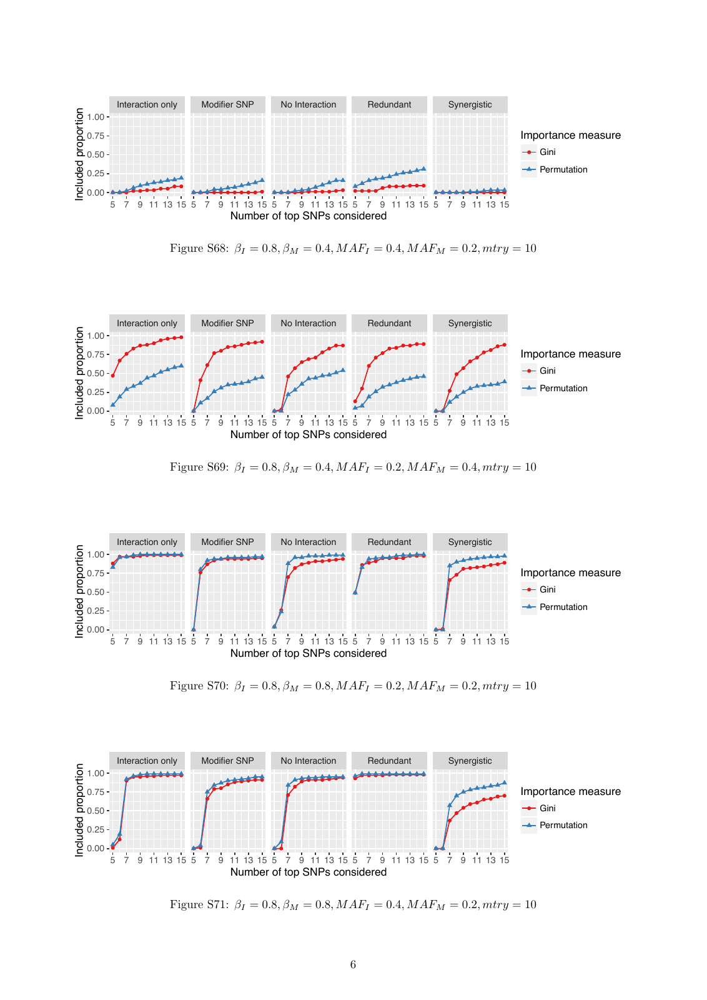

### S68

**Legenda original:** βI = 0.8,β M = 0.4,MAF I = 0.4,MAF M = 0.2,mtry = 10

**O que mede e por quê:** Prioridade das cinco variáveis de efeito individual. x=k de 5 a 15; o critério dos autores acompanha a inclusão de todas as cinco no topo. Serve para mostrar a concorrência marginal que pode preceder os SNPs designados; valores altos não validam detecção de interação.

**Código dos painéis:** [04_marginal_main/02_plot_marginal.R](https://github.com/danifilho/Mestrado_ICMC/blob/edcbf4cc450583364e69cbe89a738596c7c2762f/documentacao/piloto7-wright2016/fontes/codigo_autores/replication/04_marginal_main/02_plot_marginal.R). Os scripts produzem os painéis; a paginação editorial do PDF não é atribuída a eles sem evidência.

**Situação local:** figura dos autores disponibilizada e explicada; fora do gabarito numérico S1–S48 e sem reprodução local reivindicada.

### S69

**Legenda original:** βI = 0.8,β M = 0.4,MAF I = 0.2,MAF M = 0.4,mtry = 10

**O que mede e por quê:** Prioridade das cinco variáveis de efeito individual. x=k de 5 a 15; o critério dos autores acompanha a inclusão de todas as cinco no topo. Serve para mostrar a concorrência marginal que pode preceder os SNPs designados; valores altos não validam detecção de interação.

**Código dos painéis:** [04_marginal_main/02_plot_marginal.R](https://github.com/danifilho/Mestrado_ICMC/blob/edcbf4cc450583364e69cbe89a738596c7c2762f/documentacao/piloto7-wright2016/fontes/codigo_autores/replication/04_marginal_main/02_plot_marginal.R). Os scripts produzem os painéis; a paginação editorial do PDF não é atribuída a eles sem evidência.

**Situação local:** figura dos autores disponibilizada e explicada; fora do gabarito numérico S1–S48 e sem reprodução local reivindicada.

### S70

**Legenda original:** βI = 0.8,β M = 0.8,MAF I = 0.2,MAF M = 0.2,mtry = 10

**O que mede e por quê:** Prioridade das cinco variáveis de efeito individual. x=k de 5 a 15; o critério dos autores acompanha a inclusão de todas as cinco no topo. Serve para mostrar a concorrência marginal que pode preceder os SNPs designados; valores altos não validam detecção de interação.

**Código dos painéis:** [04_marginal_main/02_plot_marginal.R](https://github.com/danifilho/Mestrado_ICMC/blob/edcbf4cc450583364e69cbe89a738596c7c2762f/documentacao/piloto7-wright2016/fontes/codigo_autores/replication/04_marginal_main/02_plot_marginal.R). Os scripts produzem os painéis; a paginação editorial do PDF não é atribuída a eles sem evidência.

**Situação local:** figura dos autores disponibilizada e explicada; fora do gabarito numérico S1–S48 e sem reprodução local reivindicada.

### S71

**Legenda original:** βI = 0.8,β M = 0.8,MAF I = 0.4,MAF M = 0.2,mtry = 10

**O que mede e por quê:** Prioridade das cinco variáveis de efeito individual. x=k de 5 a 15; o critério dos autores acompanha a inclusão de todas as cinco no topo. Serve para mostrar a concorrência marginal que pode preceder os SNPs designados; valores altos não validam detecção de interação.

**Código dos painéis:** [04_marginal_main/02_plot_marginal.R](https://github.com/danifilho/Mestrado_ICMC/blob/edcbf4cc450583364e69cbe89a738596c7c2762f/documentacao/piloto7-wright2016/fontes/codigo_autores/replication/04_marginal_main/02_plot_marginal.R). Os scripts produzem os painéis; a paginação editorial do PDF não é atribuída a eles sem evidência.

**Situação local:** figura dos autores disponibilizada e explicada; fora do gabarito numérico S1–S48 e sem reprodução local reivindicada.

## Página física 21: S72

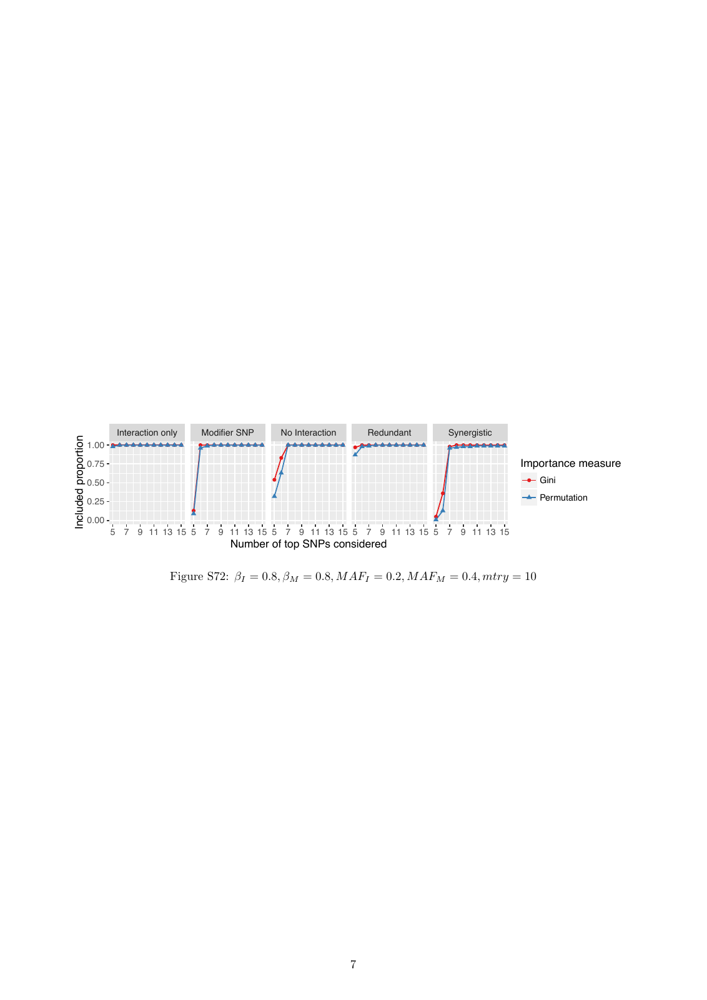

### S72

**Legenda original:** βI = 0.8,β M = 0.8,MAF I = 0.2,MAF M = 0.4,mtry = 10

**O que mede e por quê:** Prioridade das cinco variáveis de efeito individual. x=k de 5 a 15; o critério dos autores acompanha a inclusão de todas as cinco no topo. Serve para mostrar a concorrência marginal que pode preceder os SNPs designados; valores altos não validam detecção de interação.

**Código dos painéis:** [04_marginal_main/02_plot_marginal.R](https://github.com/danifilho/Mestrado_ICMC/blob/edcbf4cc450583364e69cbe89a738596c7c2762f/documentacao/piloto7-wright2016/fontes/codigo_autores/replication/04_marginal_main/02_plot_marginal.R). Os scripts produzem os painéis; a paginação editorial do PDF não é atribuída a eles sem evidência.

**Situação local:** figura dos autores disponibilizada e explicada; fora do gabarito numérico S1–S48 e sem reprodução local reivindicada.

## Página física 22: S73, S74, S75

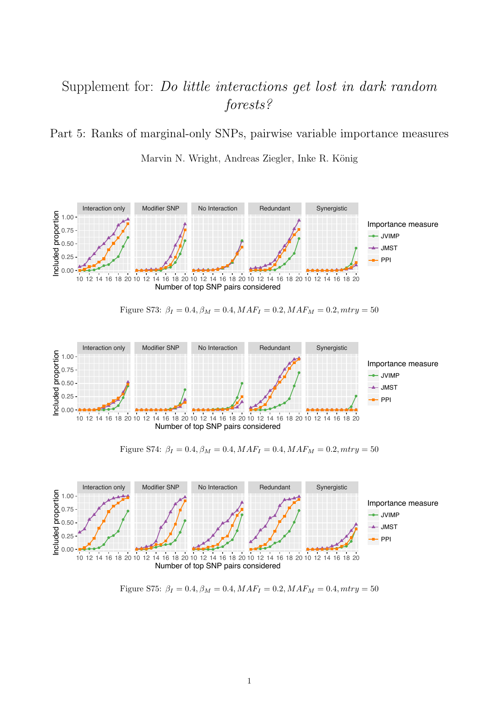

### S73

**Legenda original:** βI = 0.4,β M = 0.4,MAF I = 0.2,MAF M = 0.2,mtry = 50

**O que mede e por quê:** Prioridade dos dez pares formados apenas pelas cinco variáveis de efeito individual. x=k de 10 a 20; acompanha a inclusão conjunta desses pares. São combinações sem termo de produto no gerador logit. Curvas altas evidenciam que a medida pode privilegiar atributos com efeitos próprios.

**Código dos painéis:** [04_marginal_main/02_plot_marginal.R](https://github.com/danifilho/Mestrado_ICMC/blob/edcbf4cc450583364e69cbe89a738596c7c2762f/documentacao/piloto7-wright2016/fontes/codigo_autores/replication/04_marginal_main/02_plot_marginal.R). Os scripts produzem os painéis; a paginação editorial do PDF não é atribuída a eles sem evidência.

**Situação local:** figura dos autores disponibilizada e explicada; fora do gabarito numérico S1–S48 e sem reprodução local reivindicada.

### S74

**Legenda original:** βI = 0.4,β M = 0.4,MAF I = 0.4,MAF M = 0.2,mtry = 50

**O que mede e por quê:** Prioridade dos dez pares formados apenas pelas cinco variáveis de efeito individual. x=k de 10 a 20; acompanha a inclusão conjunta desses pares. São combinações sem termo de produto no gerador logit. Curvas altas evidenciam que a medida pode privilegiar atributos com efeitos próprios.

**Código dos painéis:** [04_marginal_main/02_plot_marginal.R](https://github.com/danifilho/Mestrado_ICMC/blob/edcbf4cc450583364e69cbe89a738596c7c2762f/documentacao/piloto7-wright2016/fontes/codigo_autores/replication/04_marginal_main/02_plot_marginal.R). Os scripts produzem os painéis; a paginação editorial do PDF não é atribuída a eles sem evidência.

**Situação local:** figura dos autores disponibilizada e explicada; fora do gabarito numérico S1–S48 e sem reprodução local reivindicada.

### S75

**Legenda original:** βI = 0.4,β M = 0.4,MAF I = 0.2,MAF M = 0.4,mtry = 50

**O que mede e por quê:** Prioridade dos dez pares formados apenas pelas cinco variáveis de efeito individual. x=k de 10 a 20; acompanha a inclusão conjunta desses pares. São combinações sem termo de produto no gerador logit. Curvas altas evidenciam que a medida pode privilegiar atributos com efeitos próprios.

**Código dos painéis:** [04_marginal_main/02_plot_marginal.R](https://github.com/danifilho/Mestrado_ICMC/blob/edcbf4cc450583364e69cbe89a738596c7c2762f/documentacao/piloto7-wright2016/fontes/codigo_autores/replication/04_marginal_main/02_plot_marginal.R). Os scripts produzem os painéis; a paginação editorial do PDF não é atribuída a eles sem evidência.

**Situação local:** figura dos autores disponibilizada e explicada; fora do gabarito numérico S1–S48 e sem reprodução local reivindicada.

## Página física 23: S76, S77, S78, S79

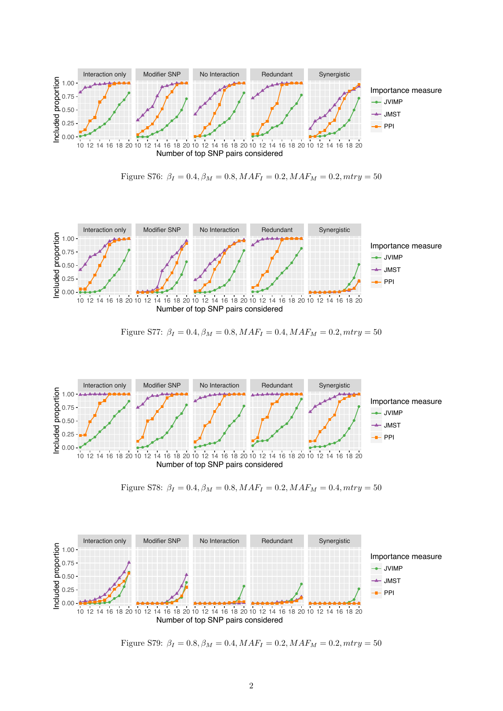

### S76

**Legenda original:** βI = 0.4,β M = 0.8,MAF I = 0.2,MAF M = 0.2,mtry = 50

**O que mede e por quê:** Prioridade dos dez pares formados apenas pelas cinco variáveis de efeito individual. x=k de 10 a 20; acompanha a inclusão conjunta desses pares. São combinações sem termo de produto no gerador logit. Curvas altas evidenciam que a medida pode privilegiar atributos com efeitos próprios.

**Código dos painéis:** [04_marginal_main/02_plot_marginal.R](https://github.com/danifilho/Mestrado_ICMC/blob/edcbf4cc450583364e69cbe89a738596c7c2762f/documentacao/piloto7-wright2016/fontes/codigo_autores/replication/04_marginal_main/02_plot_marginal.R). Os scripts produzem os painéis; a paginação editorial do PDF não é atribuída a eles sem evidência.

**Situação local:** figura dos autores disponibilizada e explicada; fora do gabarito numérico S1–S48 e sem reprodução local reivindicada.

### S77

**Legenda original:** βI = 0.4,β M = 0.8,MAF I = 0.4,MAF M = 0.2,mtry = 50

**O que mede e por quê:** Prioridade dos dez pares formados apenas pelas cinco variáveis de efeito individual. x=k de 10 a 20; acompanha a inclusão conjunta desses pares. São combinações sem termo de produto no gerador logit. Curvas altas evidenciam que a medida pode privilegiar atributos com efeitos próprios.

**Código dos painéis:** [04_marginal_main/02_plot_marginal.R](https://github.com/danifilho/Mestrado_ICMC/blob/edcbf4cc450583364e69cbe89a738596c7c2762f/documentacao/piloto7-wright2016/fontes/codigo_autores/replication/04_marginal_main/02_plot_marginal.R). Os scripts produzem os painéis; a paginação editorial do PDF não é atribuída a eles sem evidência.

**Situação local:** figura dos autores disponibilizada e explicada; fora do gabarito numérico S1–S48 e sem reprodução local reivindicada.

### S78

**Legenda original:** βI = 0.4,β M = 0.8,MAF I = 0.2,MAF M = 0.4,mtry = 50

**O que mede e por quê:** Prioridade dos dez pares formados apenas pelas cinco variáveis de efeito individual. x=k de 10 a 20; acompanha a inclusão conjunta desses pares. São combinações sem termo de produto no gerador logit. Curvas altas evidenciam que a medida pode privilegiar atributos com efeitos próprios.

**Código dos painéis:** [04_marginal_main/02_plot_marginal.R](https://github.com/danifilho/Mestrado_ICMC/blob/edcbf4cc450583364e69cbe89a738596c7c2762f/documentacao/piloto7-wright2016/fontes/codigo_autores/replication/04_marginal_main/02_plot_marginal.R). Os scripts produzem os painéis; a paginação editorial do PDF não é atribuída a eles sem evidência.

**Situação local:** figura dos autores disponibilizada e explicada; fora do gabarito numérico S1–S48 e sem reprodução local reivindicada.

### S79

**Legenda original:** βI = 0.8,β M = 0.4,MAF I = 0.2,MAF M = 0.2,mtry = 50

**O que mede e por quê:** Prioridade dos dez pares formados apenas pelas cinco variáveis de efeito individual. x=k de 10 a 20; acompanha a inclusão conjunta desses pares. São combinações sem termo de produto no gerador logit. Curvas altas evidenciam que a medida pode privilegiar atributos com efeitos próprios.

**Código dos painéis:** [04_marginal_main/02_plot_marginal.R](https://github.com/danifilho/Mestrado_ICMC/blob/edcbf4cc450583364e69cbe89a738596c7c2762f/documentacao/piloto7-wright2016/fontes/codigo_autores/replication/04_marginal_main/02_plot_marginal.R). Os scripts produzem os painéis; a paginação editorial do PDF não é atribuída a eles sem evidência.

**Situação local:** figura dos autores disponibilizada e explicada; fora do gabarito numérico S1–S48 e sem reprodução local reivindicada.

## Página física 24: S80, S81, S82, S83

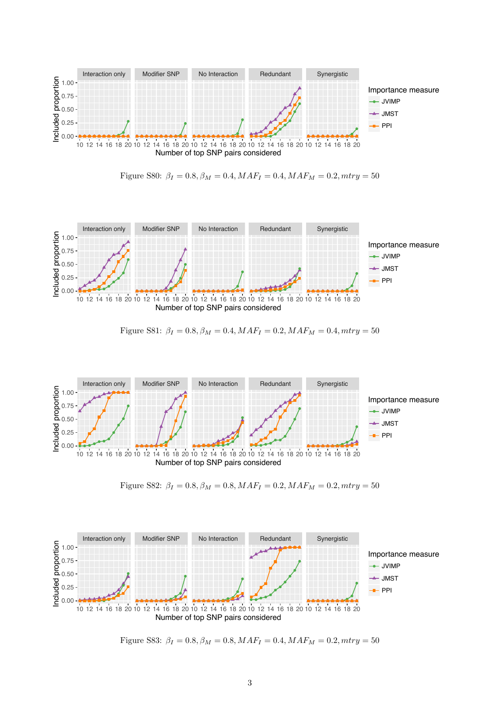

### S80

**Legenda original:** βI = 0.8,β M = 0.4,MAF I = 0.4,MAF M = 0.2,mtry = 50

**O que mede e por quê:** Prioridade dos dez pares formados apenas pelas cinco variáveis de efeito individual. x=k de 10 a 20; acompanha a inclusão conjunta desses pares. São combinações sem termo de produto no gerador logit. Curvas altas evidenciam que a medida pode privilegiar atributos com efeitos próprios.

**Código dos painéis:** [04_marginal_main/02_plot_marginal.R](https://github.com/danifilho/Mestrado_ICMC/blob/edcbf4cc450583364e69cbe89a738596c7c2762f/documentacao/piloto7-wright2016/fontes/codigo_autores/replication/04_marginal_main/02_plot_marginal.R). Os scripts produzem os painéis; a paginação editorial do PDF não é atribuída a eles sem evidência.

**Situação local:** figura dos autores disponibilizada e explicada; fora do gabarito numérico S1–S48 e sem reprodução local reivindicada.

### S81

**Legenda original:** βI = 0.8,β M = 0.4,MAF I = 0.2,MAF M = 0.4,mtry = 50

**O que mede e por quê:** Prioridade dos dez pares formados apenas pelas cinco variáveis de efeito individual. x=k de 10 a 20; acompanha a inclusão conjunta desses pares. São combinações sem termo de produto no gerador logit. Curvas altas evidenciam que a medida pode privilegiar atributos com efeitos próprios.

**Código dos painéis:** [04_marginal_main/02_plot_marginal.R](https://github.com/danifilho/Mestrado_ICMC/blob/edcbf4cc450583364e69cbe89a738596c7c2762f/documentacao/piloto7-wright2016/fontes/codigo_autores/replication/04_marginal_main/02_plot_marginal.R). Os scripts produzem os painéis; a paginação editorial do PDF não é atribuída a eles sem evidência.

**Situação local:** figura dos autores disponibilizada e explicada; fora do gabarito numérico S1–S48 e sem reprodução local reivindicada.

### S82

**Legenda original:** βI = 0.8,β M = 0.8,MAF I = 0.2,MAF M = 0.2,mtry = 50

**O que mede e por quê:** Prioridade dos dez pares formados apenas pelas cinco variáveis de efeito individual. x=k de 10 a 20; acompanha a inclusão conjunta desses pares. São combinações sem termo de produto no gerador logit. Curvas altas evidenciam que a medida pode privilegiar atributos com efeitos próprios.

**Código dos painéis:** [04_marginal_main/02_plot_marginal.R](https://github.com/danifilho/Mestrado_ICMC/blob/edcbf4cc450583364e69cbe89a738596c7c2762f/documentacao/piloto7-wright2016/fontes/codigo_autores/replication/04_marginal_main/02_plot_marginal.R). Os scripts produzem os painéis; a paginação editorial do PDF não é atribuída a eles sem evidência.

**Situação local:** figura dos autores disponibilizada e explicada; fora do gabarito numérico S1–S48 e sem reprodução local reivindicada.

### S83

**Legenda original:** βI = 0.8,β M = 0.8,MAF I = 0.4,MAF M = 0.2,mtry = 50

**O que mede e por quê:** Prioridade dos dez pares formados apenas pelas cinco variáveis de efeito individual. x=k de 10 a 20; acompanha a inclusão conjunta desses pares. São combinações sem termo de produto no gerador logit. Curvas altas evidenciam que a medida pode privilegiar atributos com efeitos próprios.

**Código dos painéis:** [04_marginal_main/02_plot_marginal.R](https://github.com/danifilho/Mestrado_ICMC/blob/edcbf4cc450583364e69cbe89a738596c7c2762f/documentacao/piloto7-wright2016/fontes/codigo_autores/replication/04_marginal_main/02_plot_marginal.R). Os scripts produzem os painéis; a paginação editorial do PDF não é atribuída a eles sem evidência.

**Situação local:** figura dos autores disponibilizada e explicada; fora do gabarito numérico S1–S48 e sem reprodução local reivindicada.

## Página física 25: S84, S85, S86, S87

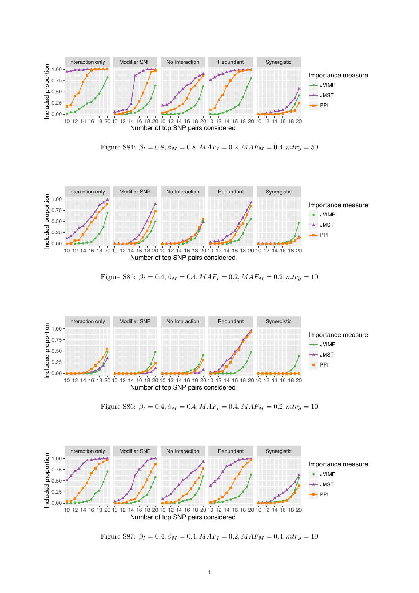

### S84

**Legenda original:** βI = 0.8,β M = 0.8,MAF I = 0.2,MAF M = 0.4,mtry = 50

**O que mede e por quê:** Prioridade dos dez pares formados apenas pelas cinco variáveis de efeito individual. x=k de 10 a 20; acompanha a inclusão conjunta desses pares. São combinações sem termo de produto no gerador logit. Curvas altas evidenciam que a medida pode privilegiar atributos com efeitos próprios.

**Código dos painéis:** [04_marginal_main/02_plot_marginal.R](https://github.com/danifilho/Mestrado_ICMC/blob/edcbf4cc450583364e69cbe89a738596c7c2762f/documentacao/piloto7-wright2016/fontes/codigo_autores/replication/04_marginal_main/02_plot_marginal.R). Os scripts produzem os painéis; a paginação editorial do PDF não é atribuída a eles sem evidência.

**Situação local:** figura dos autores disponibilizada e explicada; fora do gabarito numérico S1–S48 e sem reprodução local reivindicada.

### S85

**Legenda original:** βI = 0.4,β M = 0.4,MAF I = 0.2,MAF M = 0.2,mtry = 10

**O que mede e por quê:** Prioridade dos dez pares formados apenas pelas cinco variáveis de efeito individual. x=k de 10 a 20; acompanha a inclusão conjunta desses pares. São combinações sem termo de produto no gerador logit. Curvas altas evidenciam que a medida pode privilegiar atributos com efeitos próprios.

**Código dos painéis:** [04_marginal_main/02_plot_marginal.R](https://github.com/danifilho/Mestrado_ICMC/blob/edcbf4cc450583364e69cbe89a738596c7c2762f/documentacao/piloto7-wright2016/fontes/codigo_autores/replication/04_marginal_main/02_plot_marginal.R). Os scripts produzem os painéis; a paginação editorial do PDF não é atribuída a eles sem evidência.

**Situação local:** figura dos autores disponibilizada e explicada; fora do gabarito numérico S1–S48 e sem reprodução local reivindicada.

### S86

**Legenda original:** βI = 0.4,β M = 0.4,MAF I = 0.4,MAF M = 0.2,mtry = 10

**O que mede e por quê:** Prioridade dos dez pares formados apenas pelas cinco variáveis de efeito individual. x=k de 10 a 20; acompanha a inclusão conjunta desses pares. São combinações sem termo de produto no gerador logit. Curvas altas evidenciam que a medida pode privilegiar atributos com efeitos próprios.

**Código dos painéis:** [04_marginal_main/02_plot_marginal.R](https://github.com/danifilho/Mestrado_ICMC/blob/edcbf4cc450583364e69cbe89a738596c7c2762f/documentacao/piloto7-wright2016/fontes/codigo_autores/replication/04_marginal_main/02_plot_marginal.R). Os scripts produzem os painéis; a paginação editorial do PDF não é atribuída a eles sem evidência.

**Situação local:** figura dos autores disponibilizada e explicada; fora do gabarito numérico S1–S48 e sem reprodução local reivindicada.

### S87

**Legenda original:** βI = 0.4,β M = 0.4,MAF I = 0.2,MAF M = 0.4,mtry = 10

**O que mede e por quê:** Prioridade dos dez pares formados apenas pelas cinco variáveis de efeito individual. x=k de 10 a 20; acompanha a inclusão conjunta desses pares. São combinações sem termo de produto no gerador logit. Curvas altas evidenciam que a medida pode privilegiar atributos com efeitos próprios.

**Código dos painéis:** [04_marginal_main/02_plot_marginal.R](https://github.com/danifilho/Mestrado_ICMC/blob/edcbf4cc450583364e69cbe89a738596c7c2762f/documentacao/piloto7-wright2016/fontes/codigo_autores/replication/04_marginal_main/02_plot_marginal.R). Os scripts produzem os painéis; a paginação editorial do PDF não é atribuída a eles sem evidência.

**Situação local:** figura dos autores disponibilizada e explicada; fora do gabarito numérico S1–S48 e sem reprodução local reivindicada.

## Página física 26: S88, S89, S90, S91

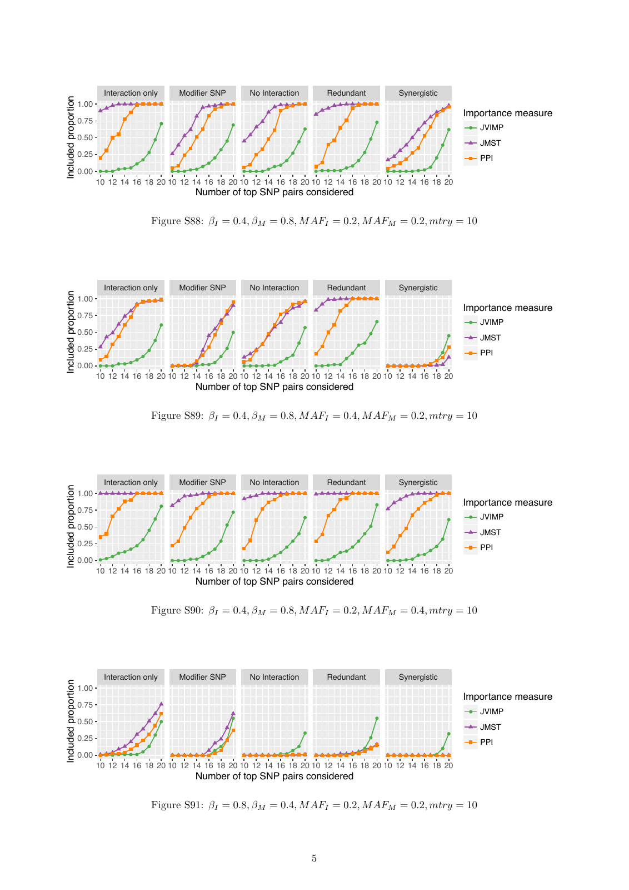

### S88

**Legenda original:** βI = 0.4,β M = 0.8,MAF I = 0.2,MAF M = 0.2,mtry = 10

**O que mede e por quê:** Prioridade dos dez pares formados apenas pelas cinco variáveis de efeito individual. x=k de 10 a 20; acompanha a inclusão conjunta desses pares. São combinações sem termo de produto no gerador logit. Curvas altas evidenciam que a medida pode privilegiar atributos com efeitos próprios.

**Código dos painéis:** [04_marginal_main/02_plot_marginal.R](https://github.com/danifilho/Mestrado_ICMC/blob/edcbf4cc450583364e69cbe89a738596c7c2762f/documentacao/piloto7-wright2016/fontes/codigo_autores/replication/04_marginal_main/02_plot_marginal.R). Os scripts produzem os painéis; a paginação editorial do PDF não é atribuída a eles sem evidência.

**Situação local:** figura dos autores disponibilizada e explicada; fora do gabarito numérico S1–S48 e sem reprodução local reivindicada.

### S89

**Legenda original:** βI = 0.4,β M = 0.8,MAF I = 0.4,MAF M = 0.2,mtry = 10

**O que mede e por quê:** Prioridade dos dez pares formados apenas pelas cinco variáveis de efeito individual. x=k de 10 a 20; acompanha a inclusão conjunta desses pares. São combinações sem termo de produto no gerador logit. Curvas altas evidenciam que a medida pode privilegiar atributos com efeitos próprios.

**Código dos painéis:** [04_marginal_main/02_plot_marginal.R](https://github.com/danifilho/Mestrado_ICMC/blob/edcbf4cc450583364e69cbe89a738596c7c2762f/documentacao/piloto7-wright2016/fontes/codigo_autores/replication/04_marginal_main/02_plot_marginal.R). Os scripts produzem os painéis; a paginação editorial do PDF não é atribuída a eles sem evidência.

**Situação local:** figura dos autores disponibilizada e explicada; fora do gabarito numérico S1–S48 e sem reprodução local reivindicada.

### S90

**Legenda original:** βI = 0.4,β M = 0.8,MAF I = 0.2,MAF M = 0.4,mtry = 10

**O que mede e por quê:** Prioridade dos dez pares formados apenas pelas cinco variáveis de efeito individual. x=k de 10 a 20; acompanha a inclusão conjunta desses pares. São combinações sem termo de produto no gerador logit. Curvas altas evidenciam que a medida pode privilegiar atributos com efeitos próprios.

**Código dos painéis:** [04_marginal_main/02_plot_marginal.R](https://github.com/danifilho/Mestrado_ICMC/blob/edcbf4cc450583364e69cbe89a738596c7c2762f/documentacao/piloto7-wright2016/fontes/codigo_autores/replication/04_marginal_main/02_plot_marginal.R). Os scripts produzem os painéis; a paginação editorial do PDF não é atribuída a eles sem evidência.

**Situação local:** figura dos autores disponibilizada e explicada; fora do gabarito numérico S1–S48 e sem reprodução local reivindicada.

### S91

**Legenda original:** βI = 0.8,β M = 0.4,MAF I = 0.2,MAF M = 0.2,mtry = 10

**O que mede e por quê:** Prioridade dos dez pares formados apenas pelas cinco variáveis de efeito individual. x=k de 10 a 20; acompanha a inclusão conjunta desses pares. São combinações sem termo de produto no gerador logit. Curvas altas evidenciam que a medida pode privilegiar atributos com efeitos próprios.

**Código dos painéis:** [04_marginal_main/02_plot_marginal.R](https://github.com/danifilho/Mestrado_ICMC/blob/edcbf4cc450583364e69cbe89a738596c7c2762f/documentacao/piloto7-wright2016/fontes/codigo_autores/replication/04_marginal_main/02_plot_marginal.R). Os scripts produzem os painéis; a paginação editorial do PDF não é atribuída a eles sem evidência.

**Situação local:** figura dos autores disponibilizada e explicada; fora do gabarito numérico S1–S48 e sem reprodução local reivindicada.

## Página física 27: S92, S93, S94, S95

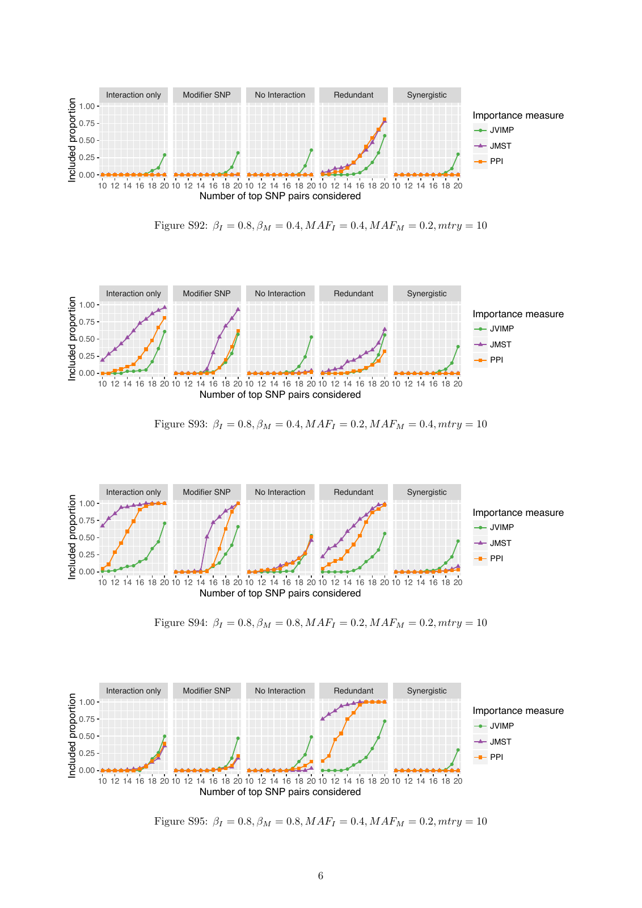

### S92

**Legenda original:** βI = 0.8,β M = 0.4,MAF I = 0.4,MAF M = 0.2,mtry = 10

**O que mede e por quê:** Prioridade dos dez pares formados apenas pelas cinco variáveis de efeito individual. x=k de 10 a 20; acompanha a inclusão conjunta desses pares. São combinações sem termo de produto no gerador logit. Curvas altas evidenciam que a medida pode privilegiar atributos com efeitos próprios.

**Código dos painéis:** [04_marginal_main/02_plot_marginal.R](https://github.com/danifilho/Mestrado_ICMC/blob/edcbf4cc450583364e69cbe89a738596c7c2762f/documentacao/piloto7-wright2016/fontes/codigo_autores/replication/04_marginal_main/02_plot_marginal.R). Os scripts produzem os painéis; a paginação editorial do PDF não é atribuída a eles sem evidência.

**Situação local:** figura dos autores disponibilizada e explicada; fora do gabarito numérico S1–S48 e sem reprodução local reivindicada.

### S93

**Legenda original:** βI = 0.8,β M = 0.4,MAF I = 0.2,MAF M = 0.4,mtry = 10

**O que mede e por quê:** Prioridade dos dez pares formados apenas pelas cinco variáveis de efeito individual. x=k de 10 a 20; acompanha a inclusão conjunta desses pares. São combinações sem termo de produto no gerador logit. Curvas altas evidenciam que a medida pode privilegiar atributos com efeitos próprios.

**Código dos painéis:** [04_marginal_main/02_plot_marginal.R](https://github.com/danifilho/Mestrado_ICMC/blob/edcbf4cc450583364e69cbe89a738596c7c2762f/documentacao/piloto7-wright2016/fontes/codigo_autores/replication/04_marginal_main/02_plot_marginal.R). Os scripts produzem os painéis; a paginação editorial do PDF não é atribuída a eles sem evidência.

**Situação local:** figura dos autores disponibilizada e explicada; fora do gabarito numérico S1–S48 e sem reprodução local reivindicada.

### S94

**Legenda original:** βI = 0.8,β M = 0.8,MAF I = 0.2,MAF M = 0.2,mtry = 10

**O que mede e por quê:** Prioridade dos dez pares formados apenas pelas cinco variáveis de efeito individual. x=k de 10 a 20; acompanha a inclusão conjunta desses pares. São combinações sem termo de produto no gerador logit. Curvas altas evidenciam que a medida pode privilegiar atributos com efeitos próprios.

**Código dos painéis:** [04_marginal_main/02_plot_marginal.R](https://github.com/danifilho/Mestrado_ICMC/blob/edcbf4cc450583364e69cbe89a738596c7c2762f/documentacao/piloto7-wright2016/fontes/codigo_autores/replication/04_marginal_main/02_plot_marginal.R). Os scripts produzem os painéis; a paginação editorial do PDF não é atribuída a eles sem evidência.

**Situação local:** figura dos autores disponibilizada e explicada; fora do gabarito numérico S1–S48 e sem reprodução local reivindicada.

### S95

**Legenda original:** βI = 0.8,β M = 0.8,MAF I = 0.4,MAF M = 0.2,mtry = 10

**O que mede e por quê:** Prioridade dos dez pares formados apenas pelas cinco variáveis de efeito individual. x=k de 10 a 20; acompanha a inclusão conjunta desses pares. São combinações sem termo de produto no gerador logit. Curvas altas evidenciam que a medida pode privilegiar atributos com efeitos próprios.

**Código dos painéis:** [04_marginal_main/02_plot_marginal.R](https://github.com/danifilho/Mestrado_ICMC/blob/edcbf4cc450583364e69cbe89a738596c7c2762f/documentacao/piloto7-wright2016/fontes/codigo_autores/replication/04_marginal_main/02_plot_marginal.R). Os scripts produzem os painéis; a paginação editorial do PDF não é atribuída a eles sem evidência.

**Situação local:** figura dos autores disponibilizada e explicada; fora do gabarito numérico S1–S48 e sem reprodução local reivindicada.

## Página física 28: S96

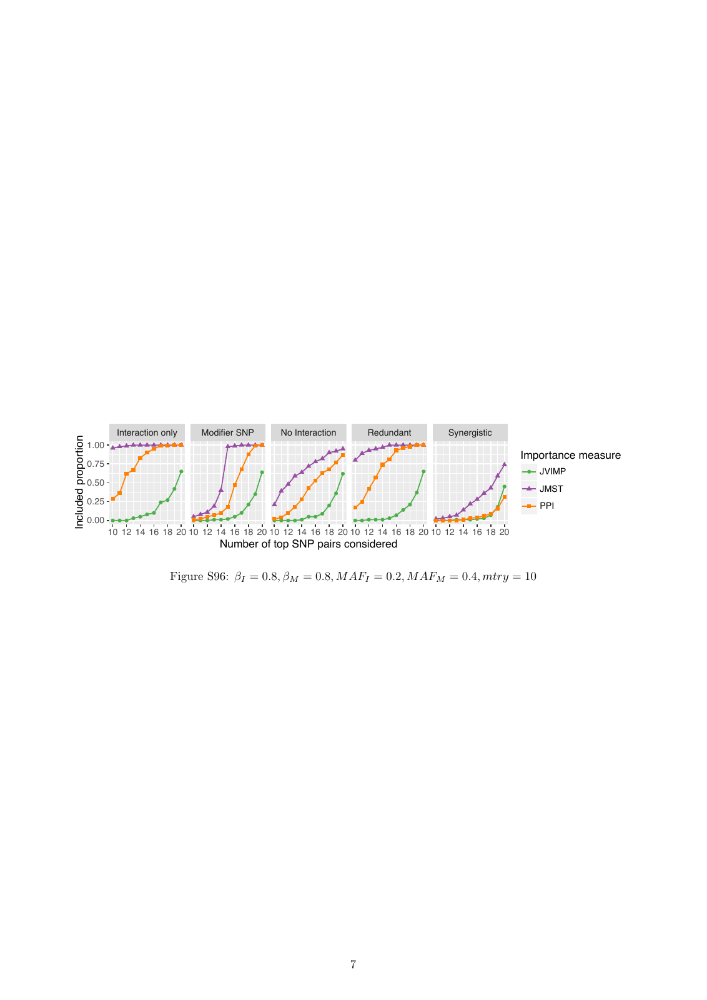

### S96

**Legenda original:** βI = 0.8,β M = 0.8,MAF I = 0.2,MAF M = 0.4,mtry = 10

**O que mede e por quê:** Prioridade dos dez pares formados apenas pelas cinco variáveis de efeito individual. x=k de 10 a 20; acompanha a inclusão conjunta desses pares. São combinações sem termo de produto no gerador logit. Curvas altas evidenciam que a medida pode privilegiar atributos com efeitos próprios.

**Código dos painéis:** [04_marginal_main/02_plot_marginal.R](https://github.com/danifilho/Mestrado_ICMC/blob/edcbf4cc450583364e69cbe89a738596c7c2762f/documentacao/piloto7-wright2016/fontes/codigo_autores/replication/04_marginal_main/02_plot_marginal.R). Os scripts produzem os painéis; a paginação editorial do PDF não é atribuída a eles sem evidência.

**Situação local:** figura dos autores disponibilizada e explicada; fora do gabarito numérico S1–S48 e sem reprodução local reivindicada.

## Página física 29: S97, S98, S99

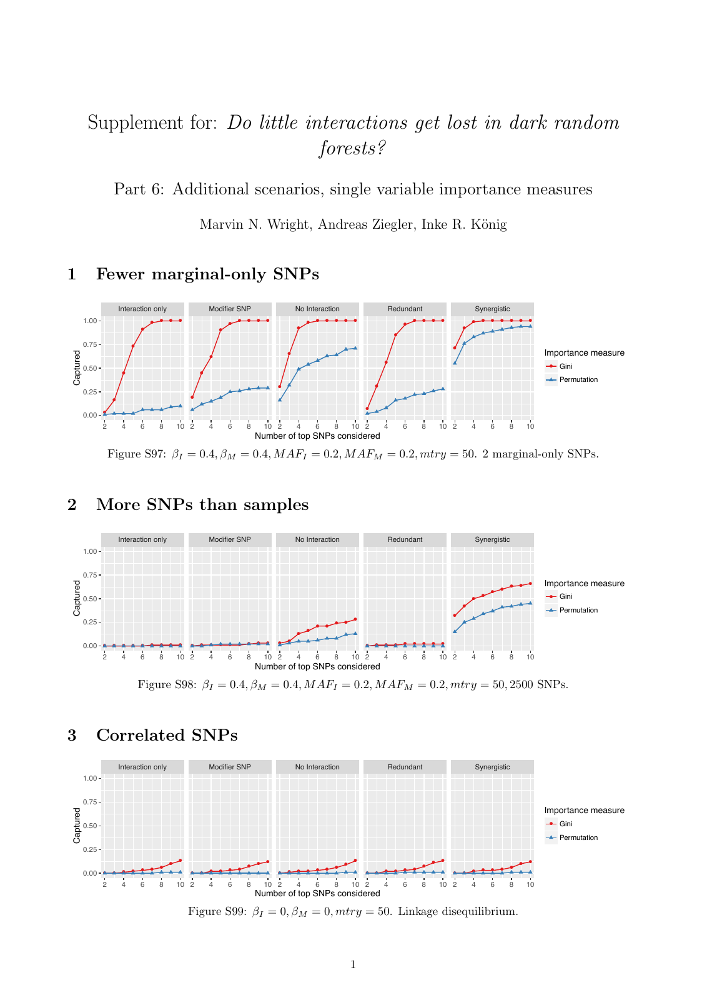

### S97

**Legenda original:** βI = 0.4,β M = 0.4,MAF I = 0.2,MAF M = 0.2,mtry = 50. 2 marginal-only SNPs.

**O que mede e por quê:** Captura individual com somente dois SNPs marginais concorrentes. Menor concorrência pode antecipar a entrada do par designado; compare com o caso base, sem atribuir isso a um novo algoritmo.

**Código dos painéis:** [01_main_simulation/04_plot_fewer_marginal.R](https://github.com/danifilho/Mestrado_ICMC/blob/edcbf4cc450583364e69cbe89a738596c7c2762f/documentacao/piloto7-wright2016/fontes/codigo_autores/replication/01_main_simulation/04_plot_fewer_marginal.R). Os scripts produzem os painéis; a paginação editorial do PDF não é atribuída a eles sem evidência.

**Situação local:** figura dos autores disponibilizada e explicada; fora do gabarito numérico S1–S48 e sem reprodução local reivindicada.

### S98

**Legenda original:** βI = 0.4,β M = 0.4,MAF I = 0.2,MAF M = 0.2,mtry = 50, 2500 SNPs.

**O que mede e por quê:** Captura individual com 2.500 SNPs totais e 2.493 de ruído, mantendo n=1.000. Examina p maior que n; k continua uma lista curta. Não foi executado na nossa extensão.

**Código dos painéis:** [02_more_SNPs/02_plot_largep.R](https://github.com/danifilho/Mestrado_ICMC/blob/edcbf4cc450583364e69cbe89a738596c7c2762f/documentacao/piloto7-wright2016/fontes/codigo_autores/replication/02_more_SNPs/02_plot_largep.R). Os scripts produzem os painéis; a paginação editorial do PDF não é atribuída a eles sem evidência.

**Situação local:** figura dos autores disponibilizada e explicada; fora do gabarito numérico S1–S48 e sem reprodução local reivindicada.

### S99

**Legenda original:** βI = 0,β M = 0,mtry = 50. Linkage disequilibrium.

**O que mede e por quê:** Captura individual sob desequilíbrio de ligação simulado com estrutura genética. Os coeficientes específicos estão na legenda abaixo. Em coeficientes nulos, inclusão de variáveis não indica efeito causal; nos demais, correlação pode redistribuir importância.

**Código dos painéis:** [03_ld_simulation/03_plot_ld.R](https://github.com/danifilho/Mestrado_ICMC/blob/edcbf4cc450583364e69cbe89a738596c7c2762f/documentacao/piloto7-wright2016/fontes/codigo_autores/replication/03_ld_simulation/03_plot_ld.R). Os scripts produzem os painéis; a paginação editorial do PDF não é atribuída a eles sem evidência.

**Situação local:** figura dos autores disponibilizada e explicada; fora do gabarito numérico S1–S48 e sem reprodução local reivindicada.

## Página física 30: S100, S101, S102, S103

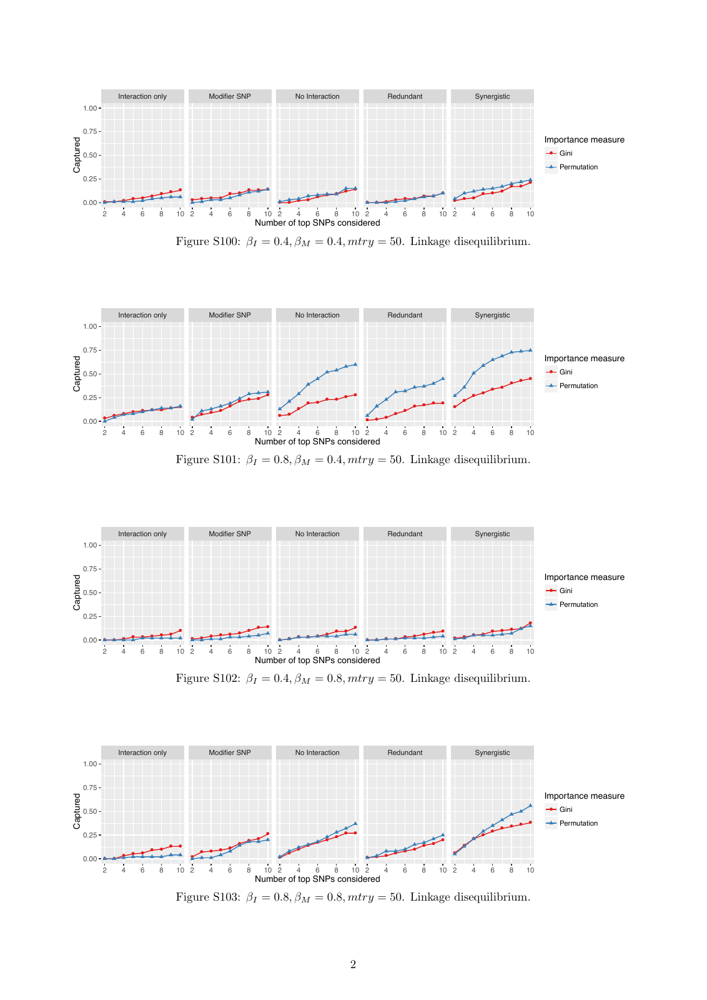

### S100

**Legenda original:** βI = 0.4,β M = 0.4,mtry = 50. Linkage disequilibrium.

**O que mede e por quê:** Captura individual sob desequilíbrio de ligação simulado com estrutura genética. Os coeficientes específicos estão na legenda abaixo. Em coeficientes nulos, inclusão de variáveis não indica efeito causal; nos demais, correlação pode redistribuir importância.

**Código dos painéis:** [03_ld_simulation/03_plot_ld.R](https://github.com/danifilho/Mestrado_ICMC/blob/edcbf4cc450583364e69cbe89a738596c7c2762f/documentacao/piloto7-wright2016/fontes/codigo_autores/replication/03_ld_simulation/03_plot_ld.R). Os scripts produzem os painéis; a paginação editorial do PDF não é atribuída a eles sem evidência.

**Situação local:** figura dos autores disponibilizada e explicada; fora do gabarito numérico S1–S48 e sem reprodução local reivindicada.

### S101

**Legenda original:** βI = 0.8,β M = 0.4,mtry = 50. Linkage disequilibrium.

**O que mede e por quê:** Captura individual sob desequilíbrio de ligação simulado com estrutura genética. Os coeficientes específicos estão na legenda abaixo. Em coeficientes nulos, inclusão de variáveis não indica efeito causal; nos demais, correlação pode redistribuir importância.

**Código dos painéis:** [03_ld_simulation/03_plot_ld.R](https://github.com/danifilho/Mestrado_ICMC/blob/edcbf4cc450583364e69cbe89a738596c7c2762f/documentacao/piloto7-wright2016/fontes/codigo_autores/replication/03_ld_simulation/03_plot_ld.R). Os scripts produzem os painéis; a paginação editorial do PDF não é atribuída a eles sem evidência.

**Situação local:** figura dos autores disponibilizada e explicada; fora do gabarito numérico S1–S48 e sem reprodução local reivindicada.

### S102

**Legenda original:** βI = 0.4,β M = 0.8,mtry = 50. Linkage disequilibrium.

**O que mede e por quê:** Captura individual sob desequilíbrio de ligação simulado com estrutura genética. Os coeficientes específicos estão na legenda abaixo. Em coeficientes nulos, inclusão de variáveis não indica efeito causal; nos demais, correlação pode redistribuir importância.

**Código dos painéis:** [03_ld_simulation/03_plot_ld.R](https://github.com/danifilho/Mestrado_ICMC/blob/edcbf4cc450583364e69cbe89a738596c7c2762f/documentacao/piloto7-wright2016/fontes/codigo_autores/replication/03_ld_simulation/03_plot_ld.R). Os scripts produzem os painéis; a paginação editorial do PDF não é atribuída a eles sem evidência.

**Situação local:** figura dos autores disponibilizada e explicada; fora do gabarito numérico S1–S48 e sem reprodução local reivindicada.

### S103

**Legenda original:** βI = 0.8,β M = 0.8,mtry = 50. Linkage disequilibrium.

**O que mede e por quê:** Captura individual sob desequilíbrio de ligação simulado com estrutura genética. Os coeficientes específicos estão na legenda abaixo. Em coeficientes nulos, inclusão de variáveis não indica efeito causal; nos demais, correlação pode redistribuir importância.

**Código dos painéis:** [03_ld_simulation/03_plot_ld.R](https://github.com/danifilho/Mestrado_ICMC/blob/edcbf4cc450583364e69cbe89a738596c7c2762f/documentacao/piloto7-wright2016/fontes/codigo_autores/replication/03_ld_simulation/03_plot_ld.R). Os scripts produzem os painéis; a paginação editorial do PDF não é atribuída a eles sem evidência.

**Situação local:** figura dos autores disponibilizada e explicada; fora do gabarito numérico S1–S48 e sem reprodução local reivindicada.

## Página física 31: S104, S105, S106

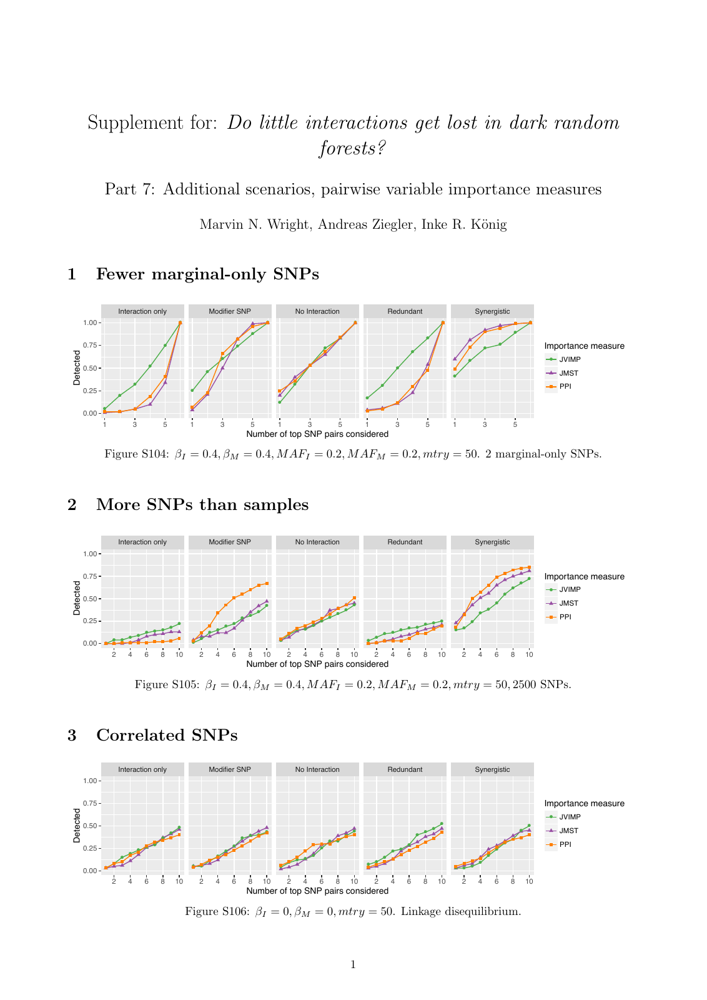

### S104

**Legenda original:** βI = 0.4,β M = 0.4,MAF I = 0.2,MAF M = 0.2,mtry = 50. 2 marginal-only SNPs.

**O que mede e por quê:** Recuperação do par com apenas dois SNPs marginais: quatro SNPs não ruidosos dão seis pares candidatos. Não comparar a mesma posição k diretamente com o universo de 21 pares sem ajustar a referência.

**Código dos painéis:** [01_main_simulation/04_plot_fewer_marginal.R](https://github.com/danifilho/Mestrado_ICMC/blob/edcbf4cc450583364e69cbe89a738596c7c2762f/documentacao/piloto7-wright2016/fontes/codigo_autores/replication/01_main_simulation/04_plot_fewer_marginal.R). Os scripts produzem os painéis; a paginação editorial do PDF não é atribuída a eles sem evidência.

**Situação local:** figura dos autores disponibilizada e explicada; fora do gabarito numérico S1–S48 e sem reprodução local reivindicada.

### S105

**Legenda original:** βI = 0.4,β M = 0.4,MAF I = 0.2,MAF M = 0.2,mtry = 50, 2500 SNPs.

**O que mede e por quê:** Recuperação do par com 2.500 SNPs no ajuste. Os pares com ruído continuam excluídos do ranking; portanto, não equivale a buscar entre todos os pares de 2.500 SNPs.

**Código dos painéis:** [02_more_SNPs/02_plot_largep.R](https://github.com/danifilho/Mestrado_ICMC/blob/edcbf4cc450583364e69cbe89a738596c7c2762f/documentacao/piloto7-wright2016/fontes/codigo_autores/replication/02_more_SNPs/02_plot_largep.R). Os scripts produzem os painéis; a paginação editorial do PDF não é atribuída a eles sem evidência.

**Situação local:** figura dos autores disponibilizada e explicada; fora do gabarito numérico S1–S48 e sem reprodução local reivindicada.

### S106

**Legenda original:** βI = 0,β M = 0,mtry = 50. Linkage disequilibrium.

**O que mede e por quê:** Ranking do par sob desequilíbrio de ligação. A combinação dos coeficientes da legenda determina se existe sinal no gerador. Uma curva alta no desenho de coeficientes nulos não comprova interação: é um controle de comportamento sob correlação.

**Código dos painéis:** [03_ld_simulation/03_plot_ld.R](https://github.com/danifilho/Mestrado_ICMC/blob/edcbf4cc450583364e69cbe89a738596c7c2762f/documentacao/piloto7-wright2016/fontes/codigo_autores/replication/03_ld_simulation/03_plot_ld.R). Os scripts produzem os painéis; a paginação editorial do PDF não é atribuída a eles sem evidência.

**Situação local:** figura dos autores disponibilizada e explicada; fora do gabarito numérico S1–S48 e sem reprodução local reivindicada.

## Página física 32: S107, S108, S109, S110

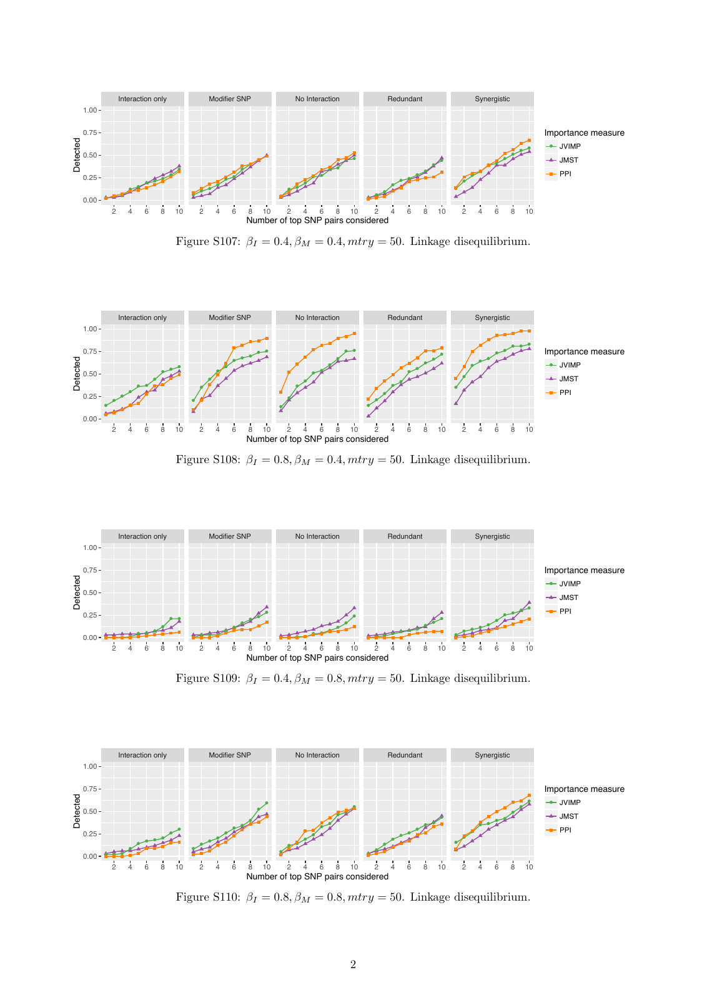

### S107

**Legenda original:** βI = 0.4,β M = 0.4,mtry = 50. Linkage disequilibrium.

**O que mede e por quê:** Ranking do par sob desequilíbrio de ligação. A combinação dos coeficientes da legenda determina se existe sinal no gerador. Uma curva alta no desenho de coeficientes nulos não comprova interação: é um controle de comportamento sob correlação.

**Código dos painéis:** [03_ld_simulation/03_plot_ld.R](https://github.com/danifilho/Mestrado_ICMC/blob/edcbf4cc450583364e69cbe89a738596c7c2762f/documentacao/piloto7-wright2016/fontes/codigo_autores/replication/03_ld_simulation/03_plot_ld.R). Os scripts produzem os painéis; a paginação editorial do PDF não é atribuída a eles sem evidência.

**Situação local:** figura dos autores disponibilizada e explicada; fora do gabarito numérico S1–S48 e sem reprodução local reivindicada.

### S108

**Legenda original:** βI = 0.8,β M = 0.4,mtry = 50. Linkage disequilibrium.

**O que mede e por quê:** Ranking do par sob desequilíbrio de ligação. A combinação dos coeficientes da legenda determina se existe sinal no gerador. Uma curva alta no desenho de coeficientes nulos não comprova interação: é um controle de comportamento sob correlação.

**Código dos painéis:** [03_ld_simulation/03_plot_ld.R](https://github.com/danifilho/Mestrado_ICMC/blob/edcbf4cc450583364e69cbe89a738596c7c2762f/documentacao/piloto7-wright2016/fontes/codigo_autores/replication/03_ld_simulation/03_plot_ld.R). Os scripts produzem os painéis; a paginação editorial do PDF não é atribuída a eles sem evidência.

**Situação local:** figura dos autores disponibilizada e explicada; fora do gabarito numérico S1–S48 e sem reprodução local reivindicada.

### S109

**Legenda original:** βI = 0.4,β M = 0.8,mtry = 50. Linkage disequilibrium.

**O que mede e por quê:** Ranking do par sob desequilíbrio de ligação. A combinação dos coeficientes da legenda determina se existe sinal no gerador. Uma curva alta no desenho de coeficientes nulos não comprova interação: é um controle de comportamento sob correlação.

**Código dos painéis:** [03_ld_simulation/03_plot_ld.R](https://github.com/danifilho/Mestrado_ICMC/blob/edcbf4cc450583364e69cbe89a738596c7c2762f/documentacao/piloto7-wright2016/fontes/codigo_autores/replication/03_ld_simulation/03_plot_ld.R). Os scripts produzem os painéis; a paginação editorial do PDF não é atribuída a eles sem evidência.

**Situação local:** figura dos autores disponibilizada e explicada; fora do gabarito numérico S1–S48 e sem reprodução local reivindicada.

### S110

**Legenda original:** βI = 0.8,β M = 0.8,mtry = 50. Linkage disequilibrium.

**O que mede e por quê:** Ranking do par sob desequilíbrio de ligação. A combinação dos coeficientes da legenda determina se existe sinal no gerador. Uma curva alta no desenho de coeficientes nulos não comprova interação: é um controle de comportamento sob correlação.

**Código dos painéis:** [03_ld_simulation/03_plot_ld.R](https://github.com/danifilho/Mestrado_ICMC/blob/edcbf4cc450583364e69cbe89a738596c7c2762f/documentacao/piloto7-wright2016/fontes/codigo_autores/replication/03_ld_simulation/03_plot_ld.R). Os scripts produzem os painéis; a paginação editorial do PDF não é atribuída a eles sem evidência.

**Situação local:** figura dos autores disponibilizada e explicada; fora do gabarito numérico S1–S48 e sem reprodução local reivindicada.

## Página física 33: S111, S112, S113

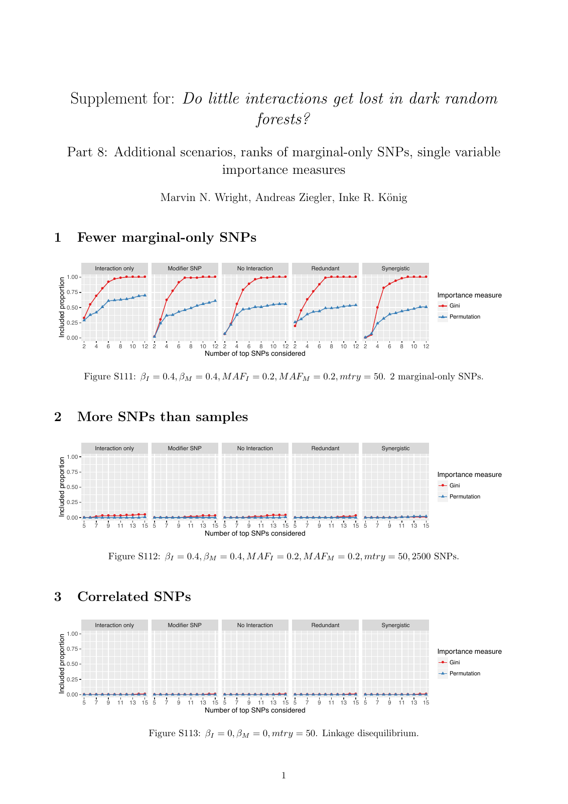

### S111

**Legenda original:** βI = 0.4,β M = 0.4,MAF I = 0.2,MAF M = 0.2,mtry = 50. 2 marginal-only SNPs.

**O que mede e por quê:** Inclusão das duas variáveis marginais no ensaio com menos concorrentes. A curva avalia efeitos individuais e deve ser distinguida de S97, que acompanha os SNPs designados.

**Código dos painéis:** [04_marginal_main/04_plot_marginal_fewer_SNPs.R](https://github.com/danifilho/Mestrado_ICMC/blob/edcbf4cc450583364e69cbe89a738596c7c2762f/documentacao/piloto7-wright2016/fontes/codigo_autores/replication/04_marginal_main/04_plot_marginal_fewer_SNPs.R). Os scripts produzem os painéis; a paginação editorial do PDF não é atribuída a eles sem evidência.

**Situação local:** figura dos autores disponibilizada e explicada; fora do gabarito numérico S1–S48 e sem reprodução local reivindicada.

### S112

**Legenda original:** βI = 0.4,β M = 0.4,MAF I = 0.2,MAF M = 0.2,mtry = 50, 2500 SNPs.

**O que mede e por quê:** Inclusão das cinco variáveis marginais com 2.500 SNPs totais. Curvas altas indicam prioridade dos efeitos principais mesmo sob ruído abundante, não recuperação específica do par.

**Código dos painéis:** [05_marginal_more_SNPs/02_plot_marginal_largep.R](https://github.com/danifilho/Mestrado_ICMC/blob/edcbf4cc450583364e69cbe89a738596c7c2762f/documentacao/piloto7-wright2016/fontes/codigo_autores/replication/05_marginal_more_SNPs/02_plot_marginal_largep.R). Os scripts produzem os painéis; a paginação editorial do PDF não é atribuída a eles sem evidência.

**Situação local:** figura dos autores disponibilizada e explicada; fora do gabarito numérico S1–S48 e sem reprodução local reivindicada.

### S113

**Legenda original:** βI = 0,β M = 0,mtry = 50. Linkage disequilibrium.

**O que mede e por quê:** Inclusão de variáveis marginais sob desequilíbrio de ligação. Leia os coeficientes da legenda para distinguir o controle completamente nulo de cenários com sinal; a correlação altera a interpretação da importância individual.

**Código dos painéis:** [06_marginal_ld/02_plot_marginal_ld.R](https://github.com/danifilho/Mestrado_ICMC/blob/edcbf4cc450583364e69cbe89a738596c7c2762f/documentacao/piloto7-wright2016/fontes/codigo_autores/replication/06_marginal_ld/02_plot_marginal_ld.R). Os scripts produzem os painéis; a paginação editorial do PDF não é atribuída a eles sem evidência.

**Situação local:** figura dos autores disponibilizada e explicada; fora do gabarito numérico S1–S48 e sem reprodução local reivindicada.

## Página física 34: S114, S115, S116, S117

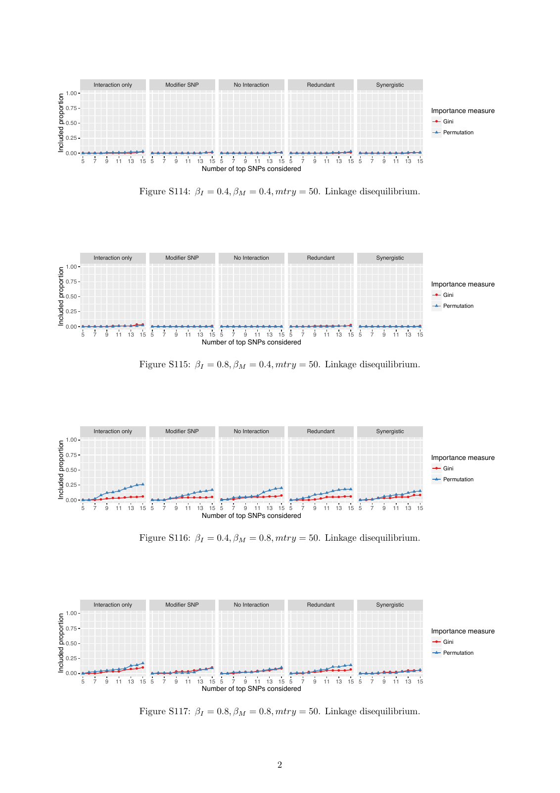

### S114

**Legenda original:** βI = 0.4,β M = 0.4,mtry = 50. Linkage disequilibrium.

**O que mede e por quê:** Inclusão de variáveis marginais sob desequilíbrio de ligação. Leia os coeficientes da legenda para distinguir o controle completamente nulo de cenários com sinal; a correlação altera a interpretação da importância individual.

**Código dos painéis:** [06_marginal_ld/02_plot_marginal_ld.R](https://github.com/danifilho/Mestrado_ICMC/blob/edcbf4cc450583364e69cbe89a738596c7c2762f/documentacao/piloto7-wright2016/fontes/codigo_autores/replication/06_marginal_ld/02_plot_marginal_ld.R). Os scripts produzem os painéis; a paginação editorial do PDF não é atribuída a eles sem evidência.

**Situação local:** figura dos autores disponibilizada e explicada; fora do gabarito numérico S1–S48 e sem reprodução local reivindicada.

### S115

**Legenda original:** βI = 0.8,β M = 0.4,mtry = 50. Linkage disequilibrium.

**O que mede e por quê:** Inclusão de variáveis marginais sob desequilíbrio de ligação. Leia os coeficientes da legenda para distinguir o controle completamente nulo de cenários com sinal; a correlação altera a interpretação da importância individual.

**Código dos painéis:** [06_marginal_ld/02_plot_marginal_ld.R](https://github.com/danifilho/Mestrado_ICMC/blob/edcbf4cc450583364e69cbe89a738596c7c2762f/documentacao/piloto7-wright2016/fontes/codigo_autores/replication/06_marginal_ld/02_plot_marginal_ld.R). Os scripts produzem os painéis; a paginação editorial do PDF não é atribuída a eles sem evidência.

**Situação local:** figura dos autores disponibilizada e explicada; fora do gabarito numérico S1–S48 e sem reprodução local reivindicada.

### S116

**Legenda original:** βI = 0.4,β M = 0.8,mtry = 50. Linkage disequilibrium.

**O que mede e por quê:** Inclusão de variáveis marginais sob desequilíbrio de ligação. Leia os coeficientes da legenda para distinguir o controle completamente nulo de cenários com sinal; a correlação altera a interpretação da importância individual.

**Código dos painéis:** [06_marginal_ld/02_plot_marginal_ld.R](https://github.com/danifilho/Mestrado_ICMC/blob/edcbf4cc450583364e69cbe89a738596c7c2762f/documentacao/piloto7-wright2016/fontes/codigo_autores/replication/06_marginal_ld/02_plot_marginal_ld.R). Os scripts produzem os painéis; a paginação editorial do PDF não é atribuída a eles sem evidência.

**Situação local:** figura dos autores disponibilizada e explicada; fora do gabarito numérico S1–S48 e sem reprodução local reivindicada.

### S117

**Legenda original:** βI = 0.8,β M = 0.8,mtry = 50. Linkage disequilibrium.

**O que mede e por quê:** Inclusão de variáveis marginais sob desequilíbrio de ligação. Leia os coeficientes da legenda para distinguir o controle completamente nulo de cenários com sinal; a correlação altera a interpretação da importância individual.

**Código dos painéis:** [06_marginal_ld/02_plot_marginal_ld.R](https://github.com/danifilho/Mestrado_ICMC/blob/edcbf4cc450583364e69cbe89a738596c7c2762f/documentacao/piloto7-wright2016/fontes/codigo_autores/replication/06_marginal_ld/02_plot_marginal_ld.R). Os scripts produzem os painéis; a paginação editorial do PDF não é atribuída a eles sem evidência.

**Situação local:** figura dos autores disponibilizada e explicada; fora do gabarito numérico S1–S48 e sem reprodução local reivindicada.

## Página física 35: S118, S119, S120

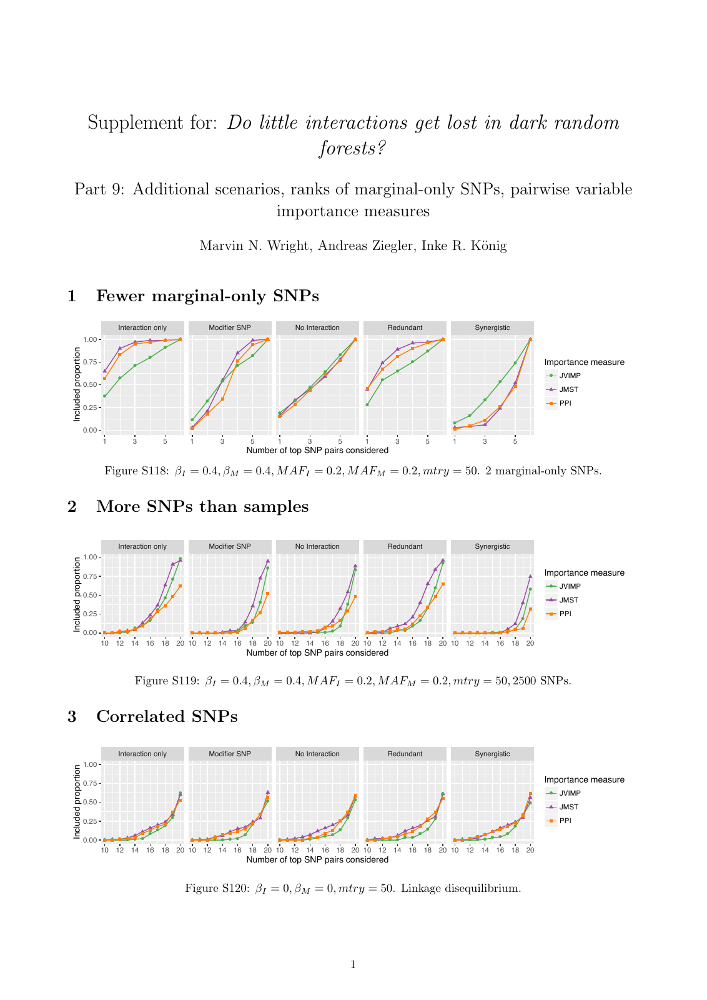

### S118

**Legenda original:** βI = 0.4,β M = 0.4,MAF I = 0.2,MAF M = 0.2,mtry = 50. 2 marginal-only SNPs.

**O que mede e por quê:** Prioridade da combinação entre as duas variáveis marginais no cenário com dois efeitos individuais. O alvo aqui não é o par de interação; o universo elegível é menor que o da grade principal.

**Código dos painéis:** [04_marginal_main/04_plot_marginal_fewer_SNPs.R](https://github.com/danifilho/Mestrado_ICMC/blob/edcbf4cc450583364e69cbe89a738596c7c2762f/documentacao/piloto7-wright2016/fontes/codigo_autores/replication/04_marginal_main/04_plot_marginal_fewer_SNPs.R). Os scripts produzem os painéis; a paginação editorial do PDF não é atribuída a eles sem evidência.

**Situação local:** figura dos autores disponibilizada e explicada; fora do gabarito numérico S1–S48 e sem reprodução local reivindicada.

### S119

**Legenda original:** βI = 0.4,β M = 0.4,MAF I = 0.2,MAF M = 0.2,mtry = 50, 2500 SNPs.

**O que mede e por quê:** Inclusão dos pares entre variáveis marginais com 2.500 SNPs no ajuste. Mede competição de pares de atributos individualmente relevantes; não descoberta entre todos os milhões de pares possíveis.

**Código dos painéis:** [05_marginal_more_SNPs/02_plot_marginal_largep.R](https://github.com/danifilho/Mestrado_ICMC/blob/edcbf4cc450583364e69cbe89a738596c7c2762f/documentacao/piloto7-wright2016/fontes/codigo_autores/replication/05_marginal_more_SNPs/02_plot_marginal_largep.R). Os scripts produzem os painéis; a paginação editorial do PDF não é atribuída a eles sem evidência.

**Situação local:** figura dos autores disponibilizada e explicada; fora do gabarito numérico S1–S48 e sem reprodução local reivindicada.

### S120

**Legenda original:** βI = 0,β M = 0,mtry = 50. Linkage disequilibrium.

**O que mede e por quê:** Inclusão dos pares entre SNPs marginais sob desequilíbrio de ligação. x é quantidade de pares examinados; a curva acompanha a inclusão do conjunto-alvo marginal. Interprete junto à legenda dos coeficientes e não como confirmação de interações moleculares.

**Código dos painéis:** [06_marginal_ld/02_plot_marginal_ld.R](https://github.com/danifilho/Mestrado_ICMC/blob/edcbf4cc450583364e69cbe89a738596c7c2762f/documentacao/piloto7-wright2016/fontes/codigo_autores/replication/06_marginal_ld/02_plot_marginal_ld.R). Os scripts produzem os painéis; a paginação editorial do PDF não é atribuída a eles sem evidência.

**Situação local:** figura dos autores disponibilizada e explicada; fora do gabarito numérico S1–S48 e sem reprodução local reivindicada.

## Página física 36: S121, S122, S123, S124

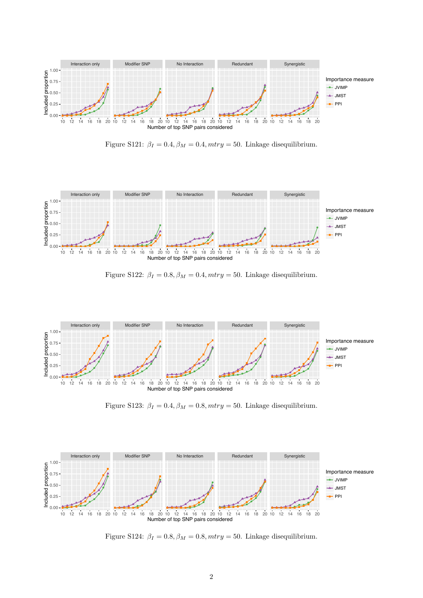

### S121

**Legenda original:** βI = 0.4,β M = 0.4,mtry = 50. Linkage disequilibrium.

**O que mede e por quê:** Inclusão dos pares entre SNPs marginais sob desequilíbrio de ligação. x é quantidade de pares examinados; a curva acompanha a inclusão do conjunto-alvo marginal. Interprete junto à legenda dos coeficientes e não como confirmação de interações moleculares.

**Código dos painéis:** [06_marginal_ld/02_plot_marginal_ld.R](https://github.com/danifilho/Mestrado_ICMC/blob/edcbf4cc450583364e69cbe89a738596c7c2762f/documentacao/piloto7-wright2016/fontes/codigo_autores/replication/06_marginal_ld/02_plot_marginal_ld.R). Os scripts produzem os painéis; a paginação editorial do PDF não é atribuída a eles sem evidência.

**Situação local:** figura dos autores disponibilizada e explicada; fora do gabarito numérico S1–S48 e sem reprodução local reivindicada.

### S122

**Legenda original:** βI = 0.8,β M = 0.4,mtry = 50. Linkage disequilibrium.

**O que mede e por quê:** Inclusão dos pares entre SNPs marginais sob desequilíbrio de ligação. x é quantidade de pares examinados; a curva acompanha a inclusão do conjunto-alvo marginal. Interprete junto à legenda dos coeficientes e não como confirmação de interações moleculares.

**Código dos painéis:** [06_marginal_ld/02_plot_marginal_ld.R](https://github.com/danifilho/Mestrado_ICMC/blob/edcbf4cc450583364e69cbe89a738596c7c2762f/documentacao/piloto7-wright2016/fontes/codigo_autores/replication/06_marginal_ld/02_plot_marginal_ld.R). Os scripts produzem os painéis; a paginação editorial do PDF não é atribuída a eles sem evidência.

**Situação local:** figura dos autores disponibilizada e explicada; fora do gabarito numérico S1–S48 e sem reprodução local reivindicada.

### S123

**Legenda original:** βI = 0.4,β M = 0.8,mtry = 50. Linkage disequilibrium.

**O que mede e por quê:** Inclusão dos pares entre SNPs marginais sob desequilíbrio de ligação. x é quantidade de pares examinados; a curva acompanha a inclusão do conjunto-alvo marginal. Interprete junto à legenda dos coeficientes e não como confirmação de interações moleculares.

**Código dos painéis:** [06_marginal_ld/02_plot_marginal_ld.R](https://github.com/danifilho/Mestrado_ICMC/blob/edcbf4cc450583364e69cbe89a738596c7c2762f/documentacao/piloto7-wright2016/fontes/codigo_autores/replication/06_marginal_ld/02_plot_marginal_ld.R). Os scripts produzem os painéis; a paginação editorial do PDF não é atribuída a eles sem evidência.

**Situação local:** figura dos autores disponibilizada e explicada; fora do gabarito numérico S1–S48 e sem reprodução local reivindicada.

### S124

**Legenda original:** βI = 0.8,β M = 0.8,mtry = 50. Linkage disequilibrium.

**O que mede e por quê:** Inclusão dos pares entre SNPs marginais sob desequilíbrio de ligação. x é quantidade de pares examinados; a curva acompanha a inclusão do conjunto-alvo marginal. Interprete junto à legenda dos coeficientes e não como confirmação de interações moleculares.

**Código dos painéis:** [06_marginal_ld/02_plot_marginal_ld.R](https://github.com/danifilho/Mestrado_ICMC/blob/edcbf4cc450583364e69cbe89a738596c7c2762f/documentacao/piloto7-wright2016/fontes/codigo_autores/replication/06_marginal_ld/02_plot_marginal_ld.R). Os scripts produzem os painéis; a paginação editorial do PDF não é atribuída a eles sem evidência.

**Situação local:** figura dos autores disponibilizada e explicada; fora do gabarito numérico S1–S48 e sem reprodução local reivindicada.

---
Snapshot das evidências: [`edcbf4cc4505`](https://github.com/danifilho/Mestrado_ICMC/commit/edcbf4cc450583364e69cbe89a738596c7c2762f). Documentação publicada em 19/11/2026.
