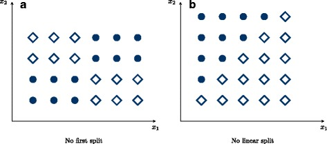
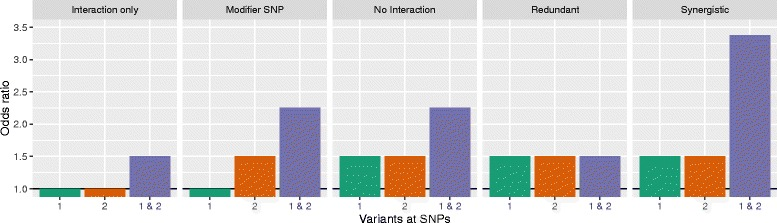
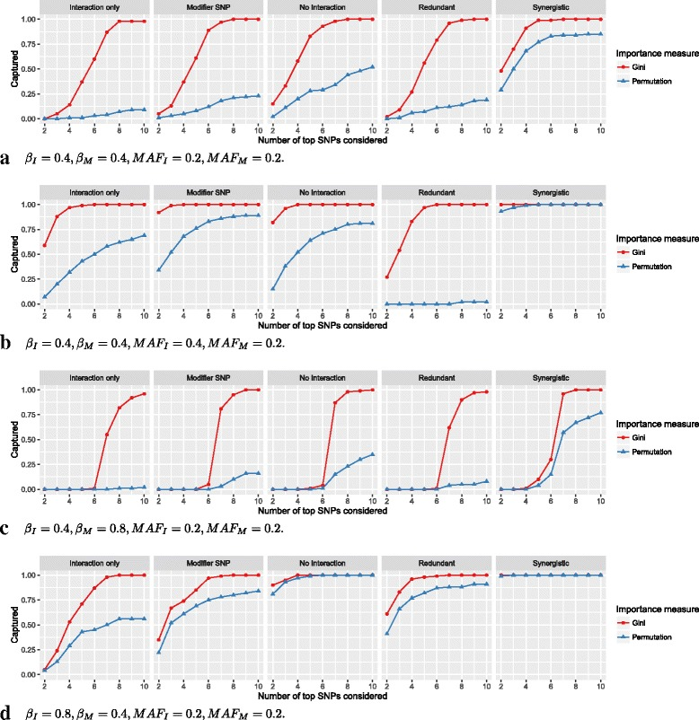
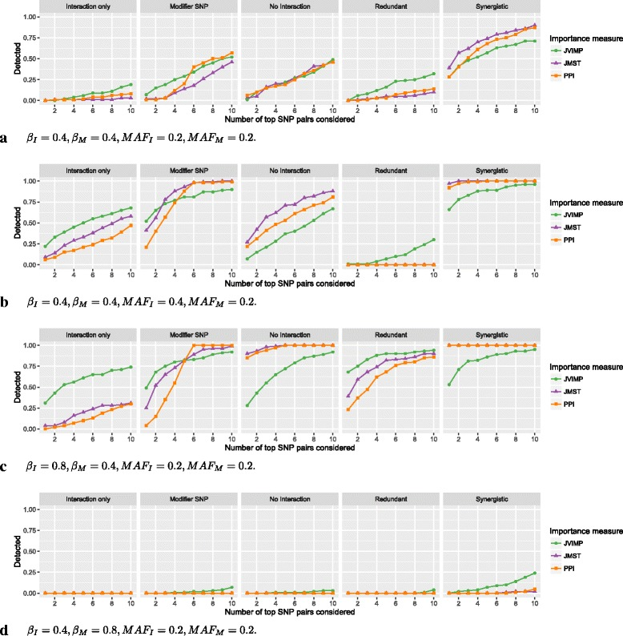
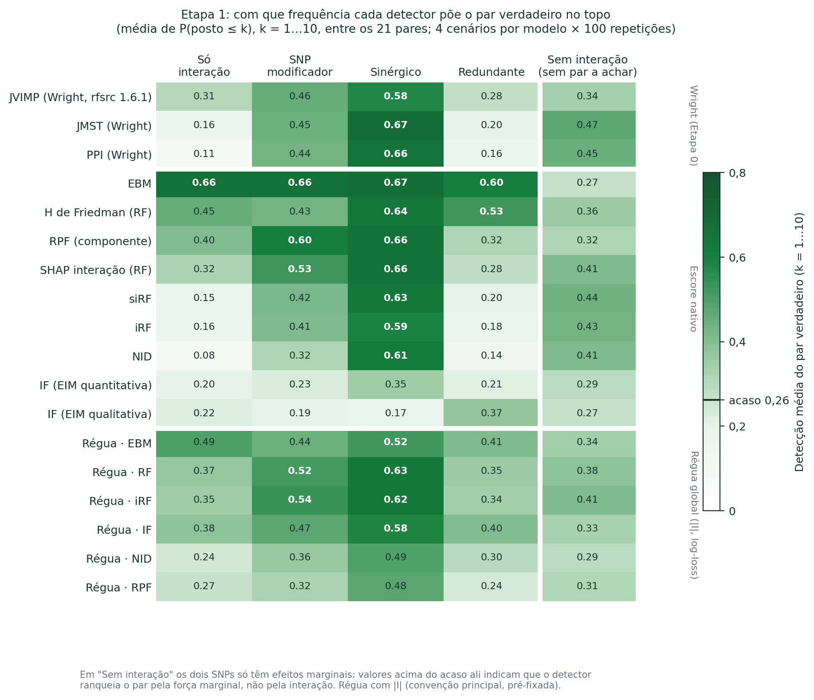
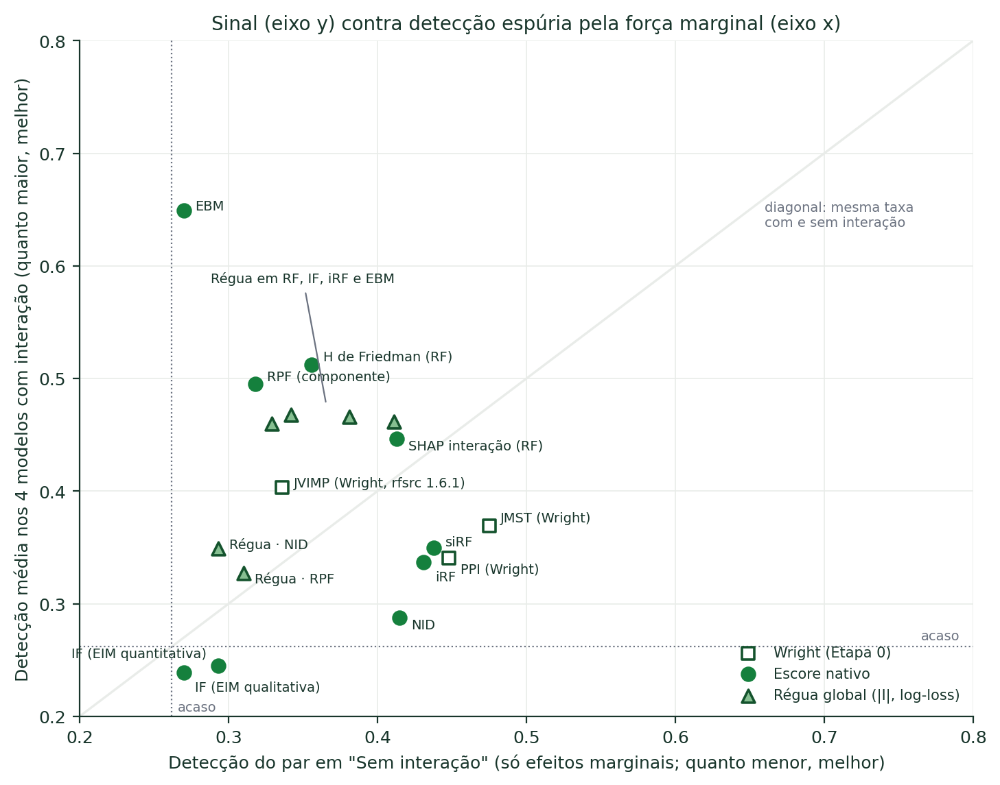
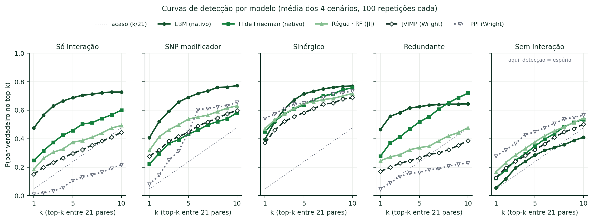
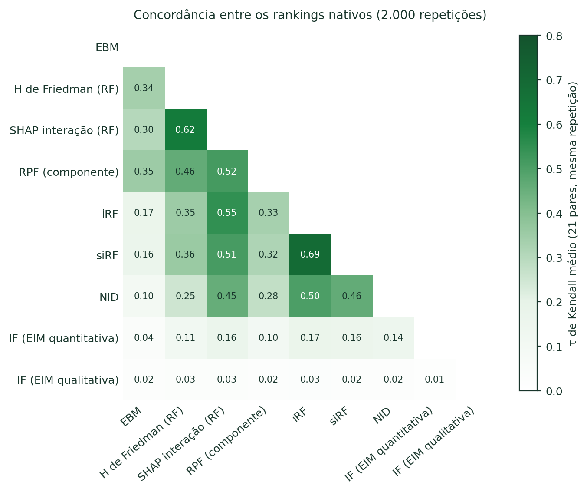

# Piloto 7 — todas as figuras principais comentadas

[Principal](https://github.com/danifilho/Mestrado_ICMC/wiki/Piloto-7-Wright-Documentacao-integral) · [Dados e outputs](https://github.com/danifilho/Mestrado_ICMC/wiki/Piloto-7-Dados-e-outputs) · [Atlas S1–S124](https://github.com/danifilho/Mestrado_ICMC/wiki/Piloto-7-Atlas-Wright)

Data: 19/11/2026. As imagens abaixo são os originais do artigo ou os resultados históricos preservados. Não foram redesenhadas para ocultar limitações. **Não há PNG próprio de comparação Etapa 0 no diretório histórico consultado:** a reprodução foi entregue em tabelas/vereditos. As 48 figuras usadas como gabarito estão integralmente no atlas, junto às diferenças numéricas por figura.

## P1 — Figura 1 do artigo: por que uma árvore pode ter dificuldade

**Fonte:** Wright et al. 2016, Fig. 1, CC BY 4.0. [Artigo](https://pmc.ncbi.nlm.nih.gov/articles/PMC4815164/). São exemplos didáticos, não resultados das nossas 2.000 realizações.

- Eixo horizontal: x1; vertical: x2. Símbolos representam duas classes.
- Painel a: a organização por quadrantes exige considerar duas divisões. Um primeiro corte isolado pode não oferecer ganho suficiente ao critério guloso.
- Painel b: a separação segue uma orientação diagonal; divisões paralelas aos eixos podem necessitar muitos cortes para aproximá-la.
- A imagem não diz que toda floresta falhará nem que todo problema de interação é XOR. Ilustra por que representar relações conjuntas e encontrá-las pelo algoritmo de treinamento são questões diferentes.
- Não há barras de erro, prevalências ou medida de desempenho neste desenho.

**Código:** os arquivos suplementares de simulação estão anexados, mas não identificamos um script que gere especificamente esta ilustração. Não atribuímos falsamente o desenho a `02_plot_main.R`.

## P2 — Figura 2 do artigo: os cinco modelos

Cinco painéis; em cada um, três barras: variante no SNP1, no SNP2 e em ambos. O eixo vertical é **odds ratio**, não probabilidade de doença. A linha em OR=1 marca a referência.

- Só interação: variantes isoladas não elevam o OR de referência ilustrado, mas a combinação eleva.
- Modificador: um efeito isolado e um efeito adicional na combinação.
- Sem interação: OR individuais de 1,5 resultam em OR combinado de 2,25, pois a ausência de interação é multiplicativa nas odds/aditiva no logit. 2,25 não é “risco de 225%”.
- Redundante: o efeito combinado ilustrado não excede cada efeito individual.
- Sinérgico: há contribuição adicional na mesma direção.

A fórmula de simulação usa genótipos 0/1/2 e coeficientes específicos; esta figura é uma ilustração conceitual, não uma tabela de todos os indivíduos. “Sem termos individuais no logit” não garante associação marginal nula após integrar o outro SNP.

**Código/evidência:** [problems.R](https://github.com/danifilho/Mestrado_ICMC/blob/edcbf4cc450583364e69cbe89a738596c7c2762f/documentacao/piloto7-wright2016/fontes/codigo_autores/replication/01_main_simulation/problems.R) operacionaliza os modelos; não foi localizado o script específico das barras. [Suplemento de penetrâncias](https://github.com/danifilho/Mestrado_ICMC/blob/edcbf4cc450583364e69cbe89a738596c7c2762f/documentacao/piloto7-wright2016/fontes/MOESM2_ESM.pdf).

## P3 — Figura 3 do artigo: encontrar os dois SNPs individualmente

Cada linha a–d contém cinco tipos de modelo. Cada minipainel tem x=k (quantos SNPs do topo examinamos) e y=fração de repetições em que **ambos** os SNPs designados estão entre esses k. Vermelho/círculos: Gini; azul/triângulos: permutação. Ranking individual entre 100 SNPs.

- a: beta_I=.4, beta_M=.4, MAF_I=.2, MAF_M=.2.
- b: aumenta MAF_I para .4. Não aumenta diretamente o coeficiente; muda frequência dos genótipos do par.
- c: aumenta beta_M para .8. Os cinco atributos concorrentes têm efeitos mais fortes.
- d: aumenta beta_I para .8. Os coeficientes do par mudam conforme o tipo de fórmula.

No painel a “Só interação”, a curva Gini sobe perto de k=6–7; isso é compatível com ambos os SNPs serem encontrados, mas precedidos por outras variáveis. Não significa que Gini tenha apontado o par como interação. A permutação individual é mais baixa em vários painéis. O controle “Sem interação” pode ser fácil para importância individual: isso é esperado, pois ambos os SNPs têm efeitos próprios.

**Conclusão permitida:** medidas individuais podem capturar variáveis relevantes sem identificar a natureza conjunta de seus efeitos. **Não permitido:** usar essa imagem para afirmar que Gini recuperou interações pareadas.

**Anexo do código:** [02_plot_main.R](https://github.com/danifilho/Mestrado_ICMC/blob/edcbf4cc450583364e69cbe89a738596c7c2762f/documentacao/piloto7-wright2016/fontes/codigo_autores/replication/01_main_simulation/02_plot_main.R), seção `Plots single measures`: lê `results.Rds`, calcula indicadores rank≤k, agrega por parâmetros, exclui modifier_snp2, usa ggplot/facet_wrap e paleta Set1. Esse script reproduz os painéis correspondentes; o arranjo editorial a–d do artigo pode ser uma montagem posterior. As versões suplementares correspondentes são S1, S2, S4 e S7.

## P4 — Figura 4 do artigo: priorizar o par

Eixo x=k pares; y=fração das 100 repetições com o par designado no top-k. Verde/círculos: JVIMP; roxo/triângulos: JMST; laranja/quadrados: PPI. Universo de 21 pares entre os sete SNPs relevantes. Cada linha compara cinco modelos geradores.

**Atenção à ordem:** a=base, b=MAF_I maior, **c=beta_I maior**, **d=beta_M maior**. As letras c/d trocam de papel em relação à Figura 3. Não confundir o efeito de aumentar o sinal do par com aumentar a concorrência marginal.

A linha d evidencia dificuldade quando os efeitos concorrentes são fortes. A linha c mostra que aumentar o coeficiente pode melhorar algumas medidas e tipos de interação. A coluna “Sem interação” mede prioridade dada ao par sem produto no logit; não é uma demonstração direta de mecanismo biológico falso. Curvas altas no cenário sinérgico não garantem bom resultado em “Só interação”.

**Conclusão original:** as medidas de pares estudadas têm dificuldade para separar interações dos efeitos marginais nos desenhos avaliados. Nossa documentação conserva o escopo e acrescenta cautela sobre escala e ranking versus teste formal.

**Anexo:** [02_plot_main.R](https://github.com/danifilho/Mestrado_ICMC/blob/edcbf4cc450583364e69cbe89a738596c7c2762f/documentacao/piloto7-wright2016/fontes/codigo_autores/replication/01_main_simulation/02_plot_main.R), seção `Plots pairwise measures`; [algorithms.R](https://github.com/danifilho/Mestrado_ICMC/blob/edcbf4cc450583364e69cbe89a738596c7c2762f/documentacao/piloto7-wright2016/fontes/codigo_autores/replication/01_main_simulation/algorithms.R). Correspondências suplementares: S25, S26, S31 e S28 na ordem a–d. A Etapa 0 extraiu todos os S1–S48, não apenas esses quatro.

## E1 — Nosso mapa de recuperação

**Script:** [06_figuras_etapa1.py, fig_mapa](https://github.com/danifilho/Mestrado_ICMC/blob/edcbf4cc450583364e69cbe89a738596c7c2762f/documentacao/piloto7-wright2016/scripts/06_figuras_etapa1.py). **Dados do desenho:** [CSV](https://github.com/danifilho/Mestrado_ICMC/blob/edcbf4cc450583364e69cbe89a738596c7c2762f/documentacao/piloto7-wright2016/figuras/dados/e1_fig1_mapa_deteccao.csv). **Formato vetorial:** [SVG](https://github.com/danifilho/Mestrado_ICMC/blob/edcbf4cc450583364e69cbe89a738596c7c2762f/documentacao/piloto7-wright2016/figuras/e1_fig1_mapa_deteccao.svg).

Uma célula é a média da curva top-1…top-10, primeiro calculada por cenário e depois resumida nas quatro configurações do mesmo tipo de modelo. Cada coluna reúne 400 realizações; não são quatro indivíduos nem 400 folds. Verde mais escuro significa valor maior, não necessariamente melhor: na coluna de controle, prioridade alta requer interpretação diferente.

As linhas têm três blocos: medidas históricas de Wright, escores nativos e régua comum por |I|/log-loss. Dentro de cada bloco são ordenadas pela média nas quatro colunas com interação. A ordem vertical, portanto, já usa o resultado e não é classificação pré-especificada independente.

Valores são formatados com duas casas; a tabela de entrada já arredondou resumos a três. A paleta vai de 0 a .8. Texto branco acima de .5; negrito nas quatro primeiras colunas quando valor≥.5. Esses limiares são **formatação**, não significância estatística.

Exemplo: iRF .16 em “Só interação” versus .59 no sinérgico descreve heterogeneidade de recuperação; não demonstra incapacidade universal. EBM .66 em “Só interação” não significa 66% de acerto em primeiro lugar. IF próximo da referência depende da configuração de 500 árvores e do escore considerado.

**Ressalvas da legenda histórica:** ela atribui o controle à força marginal de maneira categórica. Nesta auditoria, tratamos isso como hipótese compatível com o padrão, condicionada à escala do gabarito. A linha de “acaso .26” é referência de ranking aleatório sem empates; não calibra automaticamente a regra de postos médios.

## E2 — Recuperação versus prioridade no controle

**Script:** [fig_sinal_ruido](https://github.com/danifilho/Mestrado_ICMC/blob/edcbf4cc450583364e69cbe89a738596c7c2762f/documentacao/piloto7-wright2016/scripts/06_figuras_etapa1.py). **Dados:** [CSV](https://github.com/danifilho/Mestrado_ICMC/blob/edcbf4cc450583364e69cbe89a738596c7c2762f/documentacao/piloto7-wright2016/figuras/dados/e1_fig2_sinal_vs_espurio.csv). **SVG:** [arquivo](https://github.com/danifilho/Mestrado_ICMC/blob/edcbf4cc450583364e69cbe89a738596c7c2762f/documentacao/piloto7-wright2016/figuras/e1_fig2_sinal_vs_espurio.svg).

Cada ponto representa um procedimento resumido. Quadrados vazios: medidas de Wright. Círculos verdes: escores nativos. Triângulos: régua comum aplicada a preditores diferentes.

- x: média top-k no controle “Sem interação”.
- y: média das quatro colunas com interação, todas com peso igual.
- diagonal y=x: mesmo valor resumido nas duas situações; não linha de equivalência formal.
- linhas pontilhadas .2619: referência uniforme histórica.
- eixos começam em .2 e terminam em .8; não começam em zero.

A posição alta e à esquerda parece desejável para separar o par do controle. Contudo, **não é uma curva ROC**: x não é especificidade nem taxa calibrada de falso positivo, y não é sensibilidade clínica. As duas coordenadas vêm de distribuições geradoras diferentes.

EBM aparece em (.27,.65), mas sob inclusão fracionária para empates passa aproximadamente a (.311,.668). Esse deslocamento posterior mostra por que “próximo do acaso” não deve ser conclusão definitiva. Não há barras de incerteza nesta figura.

Os quatro triângulos agrupados em y≈.46–.47 têm **recuperação média semelhante**. Não se conclui que possuem as mesmas listas. A anotação coletiva foi usada para evitar rótulos sobrepostos; o CSV identifica cada ponto.

## E3 — Curvas completas

**Script:** [fig_curvas](https://github.com/danifilho/Mestrado_ICMC/blob/edcbf4cc450583364e69cbe89a738596c7c2762f/documentacao/piloto7-wright2016/scripts/06_figuras_etapa1.py). **Dados:** [CSV](https://github.com/danifilho/Mestrado_ICMC/blob/edcbf4cc450583364e69cbe89a738596c7c2762f/documentacao/piloto7-wright2016/figuras/dados/e1_fig3_curvas.csv). **SVG:** [arquivo](https://github.com/danifilho/Mestrado_ICMC/blob/edcbf4cc450583364e69cbe89a738596c7c2762f/documentacao/piloto7-wright2016/figuras/e1_fig3_curvas.svg).

Cinco painéis, um por tipo de gerador. x é o tamanho da lista examinada, 1 a 10; y é a fração de realizações com posto≤k, média nas quatro configurações. Ao aumentar k, a curva não deve diminuir.

A seleção de linhas mostradas é fixa no script: EBM, H, régua RF, JVIMP e PPI. **A ausência de iRF/IF/NID nesta figura não é ausência de resultados**; suas curvas estão na tabela completa. EBM usa círculo verde escuro; H quadrado; régua RF triângulo claro; JVIMP losango vazado/tracejado; PPI triângulo invertido/pontilhado. A referência k/21 cresce com k.

Exemplo de leitura: no painel “Só interação”, EBM tem aproximadamente .47 no top-1 e .69 no top-5; são probabilidades de inclusão em listas de tamanhos distintos, não duas métricas de previsão. No painel redundante H ultrapassa EBM em cortes maiores, mostrando que a classificação por média pode esconder mudanças de ordem conforme a quantidade de pares que se aceita inspecionar.

No painel sem interação, a legenda “detecção=espúria” é nomenclatura histórica. Aqui a formulação rigorosa é “priorização do par designado sem termo AB no logit”. Permanecem as limitações de escala e empates. Não há intervalos de confiança desenhados.

## E4 — Concordância dos escores nativos

**Script:** [fig_concordancia](https://github.com/danifilho/Mestrado_ICMC/blob/edcbf4cc450583364e69cbe89a738596c7c2762f/documentacao/piloto7-wright2016/scripts/06_figuras_etapa1.py). **Dados:** [CSV](https://github.com/danifilho/Mestrado_ICMC/blob/edcbf4cc450583364e69cbe89a738596c7c2762f/documentacao/piloto7-wright2016/figuras/dados/e1_fig4_concordancia.csv). **SVG:** [arquivo](https://github.com/danifilho/Mestrado_ICMC/blob/edcbf4cc450583364e69cbe89a738596c7c2762f/documentacao/piloto7-wright2016/figuras/e1_fig4_concordancia.svg).

Cada célula compara dois escores nativos sobre os mesmos 21 pares e a mesma realização. É a média de tau de Kendall; não é Jaccard e não é porcentagem de pares iguais. A diagonal e o triângulo superior ficam vazios para não repetir informação, não porque faltaram métodos.

Exemplos: iRF×siRF=.69; H×SHAP=.62, ambos sobre o mesmo RF; EBM×iRF=.17. A concordância entre dois escores do mesmo preditor pode refletir a base compartilhada. Alta concordância não prova acerto; baixa não prova que um deles falhou.

A escala de cores é 0 a .8, embora Kendall matematicamente possa ir de −1 a 1. Uma extensão deve usar escala apropriada caso apareçam valores negativos. Rankings constantes geram NaN e são excluídos da média, mas o n histórico pode contar essas linhas: o denominador válido exige conferência separada.

**Esta figura não responde diretamente à orientação de comparar todos pela régua comum.** Para isso, a tabela completa contém as comparações das réguas; os novos ensaios A–D devem colocá-las no centro da apresentação.

## Construção visual comum aos quatro gráficos locais

Matplotlib com backend Agg, fonte DejaVu Sans, fundo branco e exportação 200 dpi; também SVG. Paleta: escuro #14532D, médio #15803D, claro #86BF91, fundo #E7F3E8, texto #18352B, neutro #E9ECE9 e cinza #6B7280. São escolhas de comunicação, sem efeito nas métricas. `bbox_inches="tight"` ajusta a área exportada. O script salva o dado específico do gráfico ao lado da imagem.

A inspeção visual confirma a presença das quatro figuras e seus rótulos; esta documentação **não altera as frases históricas embutidas nas imagens**. As ressalvas desta página são parte necessária da leitura científica.

---
Snapshot das evidências: [`edcbf4cc4505`](https://github.com/danifilho/Mestrado_ICMC/commit/edcbf4cc450583364e69cbe89a738596c7c2762f). Documentação publicada em 19/11/2026.
